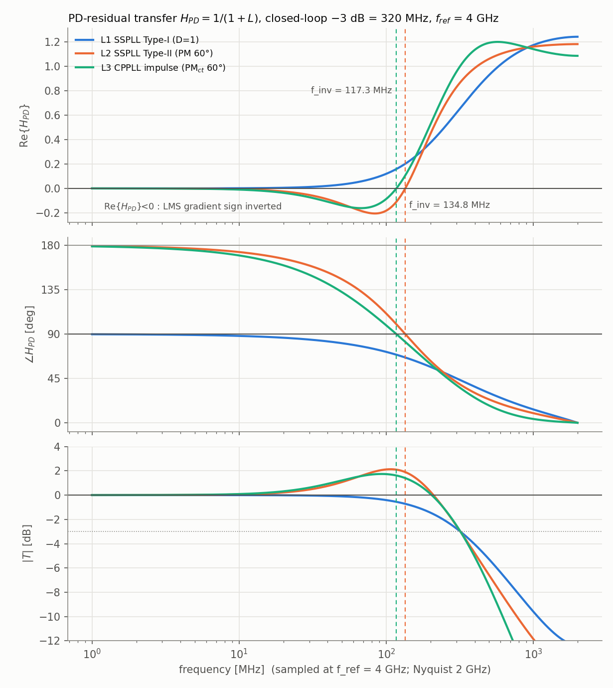
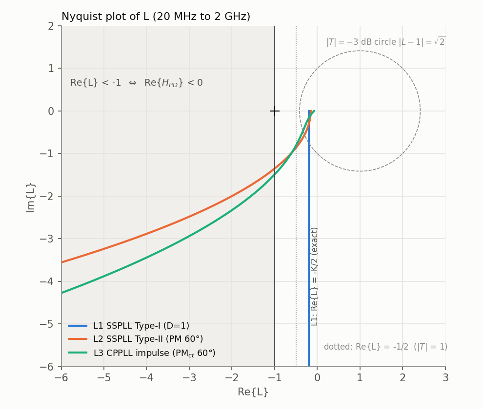
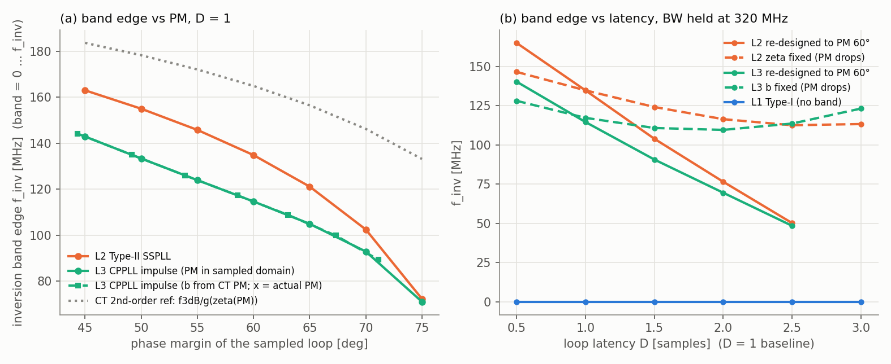

# Loop 分析：DTC GOS / PMUX PHOS error 到 PD 輸出的 transfer function（L1 / L2 / L3）

> 子題：推導並計算 $H_{PD}=1/(1+L)$ 與 $T=L/(1+L)$，找出 $\mathrm{Re}\{H_{PD}\}<0$（LMS 極性反轉）的頻帶，
> 比較 **L1 SSPLL Type-I、L2 SSPLL Type-II、L3 傳統 CPPLL**，三者都設計成 closed-loop $|T|$ −3 dB = **320 MHz**，$f_{ref}=4$ GHz。
> 本文所有數字都來自本資料夾的程式（`run_analysis.py` → `analysis_log.txt` / `loops_summary.json`；`selftest.py` 全數 PASS）。
> 標記：**[Exact]** = 在所述模型內嚴格成立（解析式，並有數值驗證）；**[Num]** = 模型內的數值結果；**[Approx]** = 近似；**[Conj]** = 推測，待其他子題驗證。

---

## 0. 結論先講

1. **一行就能證明的關鍵恆等式 [Exact，對任何 $L$ 成立]**
   $$
   \mathrm{Re}\{H_{PD}\}=\frac{1+\mathrm{Re}\{L\}}{|1+L|^2}
   \quad\Longrightarrow\quad
   \boxed{\mathrm{Re}\{H_{PD}\}<0 \iff \mathrm{Re}\{L\}<-1 \iff \mathrm{Re}\{T\}>1}\ \Rightarrow\ |T|>1 .
   $$
   也就是說：**LMS 梯度反號的頻帶 = Nyquist 圖落在 $\mathrm{Re}\{L\}=-1$ 這條垂直線左邊的頻率**，它一定包含在 $|T|>0$ dB（jitter peaking）的頻帶之內、也一定在 gain crossover $f_c$ 以下（因為需要 $|L|>1$）。在 −3 dB 頻率上 $|L-1|=\sqrt2\Rightarrow \mathrm{Re}\{L\}\ge 1-\sqrt2$，所以 $f_{3dB}$ 處絕不反號。**沒有 peaking（$|T|\le1$）的迴路就不可能反號。**

2. **L1 SSPLL Type-I（$L=Kz^{-1}/(1-z^{-1})$，$K=0.38884$）：永不反號 [Exact]。**
   $\mathrm{Re}\{L\}\equiv-K/2$（Nyquist 圖是一條垂直線），故
   $\mathrm{Re}\{H_{PD}\}=\dfrac{(2-K)(1-\cos\Omega)}{|1-(1-K)e^{-j\Omega}|^2}\ge0$，相位 $\angle H_{PD}=\arctan\!\big(\tfrac{K}{2-K}\cot\tfrac{\Omega}{2}\big)\in(0^\circ,90^\circ)$。
   低頻相位 → +90°（first difference），所以低頻 regressor 的梯度「幾乎正交」→ **收斂很慢但方向正確**。

3. **L2 SSPLL Type-II（PM 60°）：反號頻帶 = 0 – 134.82 MHz [Exact closed form]**，最深 $\mathrm{Re}\{H_{PD}\}=-0.205$ @ 83.8 MHz；低頻相位 → 180°（second difference）。
   $$f_{inv}=\frac{f_{ref}}{\pi}\arcsin\sqrt{\frac{K_i}{2(2-K_p)}}\qquad(K_p=0.28772,\ K_i=0.038253)$$

4. **L3 CPPLL（3rd-order type-II，CT PM 60°，impulse-invariant 映射）：反號頻帶 = 0 – 117.28 MHz**，最深 −0.162 @ 67.3 MHz；同樣低頻 → 180°。

5. **Sweep 趨勢 [Num]**：PM 45°→75° 時 L2 的 $f_{inv}$ 由 163.0 → 72.3 MHz（$f_{inv}/f_{3dB}$ = 0.51 → 0.23），L3 由 144.2 → 89.3 MHz；PM 越低、peaking 越大 → 反號帶越寬越深。延遲（latency）$D$ 增加時：若重新設計維持 PM=60°，帶寬反而**縮小**（L2：165.1 → 50.2 MHz，$D$=0.5 → 2.5），若不重設計（ζ 或 b 固定、PM 掉），帶子變深（min Re 從 −0.21 → −0.33）。Type-I 要反號需要 $K(D-\tfrac12)>1$（等價 PM ≲ 33°）或寄生極點使 $\zeta\lesssim0.5$（本例 $f_p\le 0.25$ GHz，PM ≤ 45°）。

6. **與 LMS 的連結（線性化/小 μ 示意，[Num]）**：在 first-order accumulator（無 DSM）下，PHOS 8-weight LMS 的 mean dynamics 在 L2 於 $\alpha f_{ref}\in[3.9,126]$ MHz（以及 α≈1/4、1/2 附近的 aliasing 小區）出現實部為負的 eigenvalue（發散模態），L3 於 $[3.9,105.5]$ MHz；**L1 從不發散**。GOS（sawtooth regressor）在此模型下 $g_{eff}$ 永遠 >0，但 Type-II 的慢 sawtooth 增益只剩 $\approx 12/(K_iP^2)$（Type-I 是 $6/(KP)$），近乎 marginal。原因：Type-II 的「phase step 後 PD error 面積恆為 0」（$\sum_n e_{step}[n]=H_{PD}(z)/(1-z^{-1})|_{z=1}=0$）。

7. **與 VCO 頻率無關**：$H_{PD}$ 作用在「PD 處的 timing error 序列」，$T_{vco}$（例如示意用的 16 GHz，62.5 ps）只決定注入量 $e_{GOS}\propto(a-w_g)\rho\,T_{vco}/8$ 的大小，不影響任何符號結論；比較器雜訊 $\sigma_v$ 也不進入 $H_{PD}$。



---

## 1. 模型與約定

- 正規化：時間單位 $T_{ref}=250$ ps，$\Omega=2\pi f/f_{ref}$ [rad/sample]；所有迴路常數 $K,K_p,K_i,\omega_z,\omega_p$ 都是這個單位（乘 $f_{ref}$ 得 rad/s）。
- 注入點：DTC（reference 側）與 PMUX（feedback 側）都在 phase-comparison summing node 注入，
  $e_{PD}[n]=(h_{PD}*e_{inj})[n]$，$H_{PD}=1/(1+L)$；注入極性（reference/feedback 可能相反）已被併入 calibration 的符號定義，使得 $H_{PD}\equiv1$ 時更新方向正確。故 **「$\mathrm{Re}\{H_{PD}\}<0$」就是梯度反號**。
- $H_{PD}(z=1)=0$（Type ≥ 1）：$e_{inj}$ 的 DC 成分（例如非負 GOS regressor $\rho\in[0,1)$ 的平均值 1/2 所造成的固定 phase offset）被迴路完全吃掉，對 LMS 沒有梯度，只有 AC 成分有作用。
- **Latency** $D$：$L(z)=L_0(z)\,z^{-(D-1)}$，$D=1$ 為 baseline（第 $n$ 個 sample 的誤差最早影響第 $n+1$ 個 PD sample，即題目的「≈1 個 reference cycle」）。
  非整數 $D$ 預設用 exact fractional delay $e^{-j\Omega(D-1)}$（只有頻率響應）；$D\ge1$ 另提供物理的 modified-z（pulse 延遲小數週期，rational）。
  $D=0.5$ 為非因果的「樂觀參考」：此時 L1 變成 $K/(2j\sin\frac\Omega2)$，即無延遲理想積分器的 aliased 版本。
  CT 等效延遲：$z^{-1}/(1-z^{-1})=e^{-j\Omega/2}/(2j\sin\frac\Omega2)$，所以 baseline $D=1$ 相當於 CT 積分器加 **半週期延遲**（ZOH 重心），一般 $\tau_{eq}=(D-\tfrac12)T_{ref}$。

### 1.1 三個迴路

| 模型 | $L(z)$ | 物理意義 |
|---|---|---|
| **L1** SSPLL Type-I | $L_0=\dfrac{Kz^{-1}}{1-z^{-1}}$；寄生極點時用 $K/(s(1+s/\omega_p))$ 的 ZOH-exact 形式 $L_0=Kz^{-1}\Big[\dfrac{1}{1-z^{-1}}-\dfrac{(1-p)/\omega_p}{1-pz^{-1}}\Big]$，$p=e^{-\omega_p}$ | SSPD sample-hold → VCO 積分 |
| **L2** SSPLL Type-II | $L_0=\Big(K_p+\dfrac{K_i}{1-z^{-1}}\Big)\dfrac{z^{-1}}{1-z^{-1}}$，參數化 $K_i=\omega_n^2,\ K_p=2\zeta\omega_n$ | 窄 CP pulse（impulse-invariant）P+I path |
| **L3** CPPLL | CT：$L(s)=\dfrac{K(1+s/\omega_z)}{s^2(1+s/\omega_p)}$，PM-optimal：$\omega_z=\omega_c/\sqrt b,\ \omega_p=\omega_c\sqrt b,\ K=\omega_c^2/\sqrt b$，$\mathrm{PM}_{ct}=\arctan\frac{b-1}{2\sqrt b}$ | R + C1∥C2 loop filter |

L3 的 CT→$f_{ref}$ 取樣域映射（全部重新縮放 $\omega_c$ 使「該域」的 −3 dB = 320 MHz）：
- **`impulse`（預設，物理正確：CP pulse 寬 ≪ $T_{ref}$）**：$L(z)=T\sum_{k\ge1}h(kT)z^{-k}$，$h(t)=Kt+B+Ce^{-\omega_pt}$，$B=K(\omega_z^{-1}-\omega_p^{-1})=-C$，
  $$L(z)=\frac{Kz^{-1}}{(1-z^{-1})^2}+\frac{Bz^{-1}}{1-z^{-1}}+\frac{Cp\,z^{-1}}{1-pz^{-1}},\quad p=e^{-\omega_p}$$
  （$h(0)=B+C=0$，所以 $k=0$ 項無歧義。小數延遲 $\delta$ 的 modified-z：$K[\frac{z^{-1}}{(1-z^{-1})^2}-\frac{\delta z^{-1}}{1-z^{-1}}]+\frac{Bz^{-1}}{1-z^{-1}}+\frac{Cp^{1-\delta}z^{-1}}{1-pz^{-1}}$。）
  注意 $\omega_p\to\infty$ 時 L3-impulse 就是 L2，對應 $K_i=K,\ K_p=K/\omega_z$。
- **`zoh`**：CP 電流 hold 一整個週期，$L(z)=(1-z^{-1})\mathcal Z\{L(s)/s\}$（`scipy.signal.cont2discrete`）。
- **`ct`**：直接用 $L(j\omega)$（無取樣、無延遲）。
- **`ct_delay`**：$L(j\omega)e^{-j\omega T/2}$（以半週期延遲近似取樣/ZOH）。結果與 `zoh` 幾乎一致（PM 52.09° vs 52.04°，$f_{inv}$ 113.96 vs 115.10 MHz），驗證了「ZOH ≈ 半週期延遲」。

---

## 2. 名目設計（[Num]，皆為 −3 dB = 320.000 MHz、閉迴路穩定）

| | **L1** Type-I (D=1) | **L2** Type-II (PM 60°) | **L3** CPPLL impulse (PM$_{ct}$ 60°) |
|---|---|---|---|
| 參數 | $K=0.388836$（= $1.5554\times10^9$ rad/s）| $K_p=0.287717,\ K_i=0.0382535$；$\zeta_{eq}=0.7355$，$f_{n,eq}=124.51$ MHz，integral zero $f_z=K_if_{ref}/(2\pi K_p)=84.64$ MHz | $b=13.928$，$f_z=51.85$，$f_p=722.2$，$f_{c,design}=193.50$ MHz，$K=0.024755$ |
| $f_c$（$\lvert L\rvert=1$）| 249.13 MHz | 209.59 MHz | 195.94 MHz |
| PM / GM | 78.79° / 14.23 dB @ 2 GHz | 60.00° / 16.28 dB @ 2 GHz | 58.58° / 22.09 dB @ 2 GHz |
| delay margin | 3.51 cycles | 3.18 cycles | 3.32 cycles |
| modulus margin $\min\lvert1+L\rvert$ | 0.806 | 0.847 | 0.795 |
| $\lvert T\rvert$ peak | 0 dB（無 peaking）| 2.127 dB @ 107.1 MHz | 1.736 dB @ 93.0 MHz |
| $\lvert H_{PD}\rvert$ peak | 1.878 dB @ 2 GHz | 1.447 dB @ 2 GHz | 1.991 dB @ 424.1 MHz |
| closed-loop poles ($z$) | 0.6112（實；313.5 MHz）| $0.8370\pm j0.1081$（$\lvert z\rvert$=0.844，$f_n$=135.5 MHz，ζ=0.797）| 0.8801, 0.7124, 0.5130（皆實；81.3 / 215.9 / 425.0 MHz）|
| **反號帶 Re{H_PD}<0** | **無** | **0 – 134.82 MHz** | **0 – 117.28 MHz** |
| 最深 Re{H_PD} | — | −0.2053 @ 83.8 MHz | −0.1616 @ 67.3 MHz |
| $\lvert T\rvert>0$ dB 帶 | 無 | 0 – 209.59 MHz | 0 – 203.89 MHz |

（L2 的 $|T|>0$ dB 邊界恰好等於 $f_c$：因為 PM = 60° 時 crossover 點 $L=e^{-j120^\circ}$，$\mathrm{Re}\{L\}=-\tfrac12\Rightarrow|T|=1$。）

L1 的設計有閉式解 [Exact]：$a=1-K=(2-\cos\Omega_3)-\sqrt{(2-\cos\Omega_3)^2-1}$，$\Omega_3=2\pi\cdot320/4000$ → $K=0.388836$；$\mathrm{GM}=20\log_{10}(2/K)$，$\mathrm{PM}=90^\circ-\Omega_c/2$，$\sin(\Omega_c/2)=K/2$。

L2 的設計方程也全部是閉式 [Exact]（D=1）：令 $s=\sin\frac\Omega2$，
$$L=-\Big(\frac{K_i}{4s^2}+\frac{K_p}{2}\Big)-j\,\frac{K_p\cos\frac\Omega2}{2s}\equiv -a(\Omega)-jb(\Omega),$$
- −3 dB：$(1+a)^2+b^2=2$ at $\Omega_3$（數值解得 $\omega_n=0.1955849$，與設計一致）
- crossover：$a^2+b^2=1$；$\tan\mathrm{PM}=\dfrac{K_p\sin\Omega_c}{K_i+K_p(1-\cos\Omega_c)}$
- GM（在 Nyquist，相位恰為 −180°）：$\mathrm{GM}=-20\log_{10}\!\big(\tfrac{K_i}{4}+\tfrac{K_p}{2}\big)=16.28$ dB
- 反號帶：$a(\Omega)>1$。

$\angle H_{PD}$ [deg]（[Num]）：

| f (MHz) | 1 | 5 | 20 | 50 | 100 | 150 | 200 | 250 | 320 | 500 | 1000 |
|---|---|---|---|---|---|---|---|---|---|---|---|
| L1 | 89.8 | 89.1 | 86.3 | 80.8 | 71.9 | 63.9 | 56.7 | 50.5 | 43.2 | 30.2 | 13.6 |
| L2 | 179.3 | 176.6 | 166.4 | 145.6 | 110.9 | 82.3 | 62.9 | 50.1 | 38.6 | 23.7 | 9.8 |
| L3 | 179.0 | 174.9 | 159.8 | 132.6 | 98.9 | 75.9 | 59.6 | 47.4 | 35.1 | 17.6 | 3.9 |

（$|\angle H_{PD}|>90^\circ$ ⇔ 反號；L1 從未超過 90°。）



---

## 3. 為什麼會反號（推導）

### 3.1 低頻展開
$H_{PD}=1/L-1/L^2+\dots$（$|L|\gg1$）。
- **Type-II**（L2/L3）：$L\approx -K_i/\Omega^2$（雙積分器；impulse-invariant 的 $z^{-1}/(1-z^{-1})^2=-1/(4\sin^2\frac\Omega2)$ **恰為負實數**），$H_{PD}\approx(1-z^{-1})^2/K_i$ → **+180°**，
  $\mathrm{Re}\{H_{PD}\}\approx-\Omega^2/K_i$ — 一階項就是負的。數值：L2 $\mathrm{Re}\{H\}/\Omega^2\to-26.141$（理論 $-1/K_i=-26.1414$），L3 → −40.395（理論 $-1/K=-40.3952$）。[Exact 極限]
- **Type-I**（L1）：$1/L=2js\,e^{j\Omega/2}/K$ 的實部是負的（$-2s^2/K$，來自半週期延遲），但 $-1/L^2$ 項（$+\Omega^2/K^2$）把它拉回：
  $\mathrm{Re}\{H_{PD}\}\approx\frac{\Omega^2}{K^2}(1-K\tau_{eq})$，$\tau_{eq}=D-\tfrac12$。L1：$(1-K/2)/K^2=5.32814$，數值 5.32814。[Exact 極限]
  ⇒ **Type-I 反號的充要條件（低頻）是 $K\tau_{eq}>1$**，即 crossover×延遲 > 1 rad（PM ≲ 33°），正常設計不會發生。
  一般 $D$ 的 exact 條件 [Exact]：$\mathrm{Re}\{H_{PD}\}<0\iff K\sin\!\big((D-\tfrac12)\Omega\big)>2\sin\tfrac\Omega2$；
  因 $|\sin(\nu x)|\le\nu\sin x$（$\nu\ge1$, $x\in[0,\pi/2]$），**$K(D-\tfrac12)\le1$ ⇒ 全頻段 $\mathrm{Re}\{H_{PD}\}\ge0$**。
  數值驗證：BW 固定 320 MHz 時，$D=4.75$（$K(D-\frac12)=0.982$）無反號，$D=5.0$（1.101，PM 26.8°，$|T|$ peak 9.7 dB）開始出現 0–107 MHz 反號帶。

### 3.2 反號帶的邊界（band edge）
全部由 $\mathrm{Re}\{L\}=-1$ 決定：

| 模型 | $-\mathrm{Re}\{L\}$ | 邊界 | 數值 |
|---|---|---|---|
| CT 2nd-order type-II $\frac{2\zeta\omega_ns+\omega_n^2}{s^2}$ | $\omega_n^2/\omega^2$（proportional path 純虛）| $\omega_{inv}=\omega_n$ [Exact] | — |
| L2，D=1 | $\frac{K_i}{4\sin^2(\Omega/2)}+\frac{K_p}{2}$ | $4\sin^2\frac{\Omega_{inv}}2=\frac{K_i}{1-K_p/2}$ [Exact] | 134.820 MHz（數值 134.820）|
| L2，任意 D | $\frac{K_i\cos((D-1)\Omega)+2K_ps\sin((D-\frac12)\Omega)}{4s^2}$ | 解 $=1$ [Exact] | 見 §4.3 |
| L3 CT | $\frac{K}{\omega^2}\cdot\frac{1+\omega^2/(\omega_z\omega_p)}{1+\omega^2/\omega_p^2}$ | $x=\omega^2$ 的二次式 $-\frac{x^2}{\omega_p^2}+x(\frac{K}{\omega_z\omega_p}-1)+K=0$ [Exact] | 121.679 MHz（$\omega_{inv}/\omega_c=0.5948$）|
| L3 impulse | $\frac{K}{4\sin^2(\Omega/2)}+\frac{B(1-p^2)}{2\lvert1-pe^{-j\Omega}\rvert^2}$ | 解 $=1$ [Exact] | 117.278 MHz（數值 117.278）|

解讀：
- CT 中 proportional path 是純虛數，只有 integral path 貢獻 $\mathrm{Re}\{L\}$ ⇒ 邊界就是 $\omega_n$。
- **離散/延遲修正**：$z^{-1}/(1-z^{-1})$ 的實部恆為 $-\tfrac12$（半週期延遲），所以 proportional path 額外貢獻 $-K_p/2$，把邊界從 $\omega_n$ 推高為 $\omega_n/\sqrt{1-\zeta\omega_n}$（再加上 $2\sin(\Omega/2)$ 的 warping）。L3 的 C2 極點讓這個項在 DC 變成 $B(1+p)/(2(1-p))$，比 $B/2$ 更負（更多 lag）。
- **與 320 MHz 的關係**：CT 2nd-order 有 $\omega_{3dB}=\omega_n g(\zeta)$，$g(\zeta)=\sqrt{1+2\zeta^2+\sqrt{(1+2\zeta^2)^2+1}}$，故 $f_{inv}^{CT}=f_{3dB}/g(\zeta)$。
  但在 $f_{3dB}/f_{ref}=0.08$ 時這個 CT 關係**不準** [Approx，誤差 +13%]：L2（ζ=0.7355，g=2.0956）CT 預測 152.70 MHz，exact 134.82 MHz。原因是延遲造成的 peaking 讓「同樣 $K_p,K_i$」的 DT 迴路 BW 比 CT 寬（同參數 CT 只有 260.94 MHz），所以 DT 設計的 $\omega_n$ 更低（$f_{n,eq}=124.51$ MHz，$f_{3dB}/f_n=2.57$ 而非 2.10）。把 CT 的 $\omega_n=\Omega_3/g$ 直接代入 DT 邊界公式會更糟（168.75 MHz），**必須用 §2 的 exact DT 設計方程**。實用比例（[Num]）：L2 $f_{inv}/f_{3dB}$ = 0.509 / 0.484 / 0.456 / 0.421 / 0.379 / 0.320 / 0.226（PM 45/50/…/75°）。若用「同 PM 的 CT 2nd-order」來估，PM 60° → ζ=0.612 → 164.9 MHz（高估 22%）。

### 3.3 幾何界限 [Exact]
- 反號帶 ⊂ $\{|T|>1\}$ ⊂ $\{\mathrm{Re}\{L\}<-\tfrac12\}$；且 ⊂ $\{|L|>1\}$（$|L|$ 單調時即 $f<f_c$）。
- −3 dB 圓 $|L-1|=\sqrt2$ 上 $\mathrm{Re}\{L\}\ge1-\sqrt2>-1$，所以 $f_{3dB}$ 處 $\mathrm{Re}\{H_{PD}\}>0$。
- 名目值：L2 $f_{inv}=134.8<f_{0dB}=209.6\ (=f_c)<f_{3dB}=320$；L3 $117.3<203.9<320$。

---

## 4. Sweeps（[Num]，每一點都重新解 gain 使 −3 dB = 320 MHz）

### 4.1 L2 Type-II SSPLL，PM sweep（D=1）

| PM | ζ_eq | $K_p$ | $K_i$ | $f_z$ MHz | $f_c$ MHz | GM dB | $\lvert T\rvert$ pk dB | $\lvert H\rvert$ pk dB | **$f_{inv}$ MHz** | $f_{inv}/f_{3dB}$ | min Re H | CT $f_{3dB}/g(\zeta_{eq})$ |
|---|---|---|---|---|---|---|---|---|---|---|---|---|
| 45 | 0.4638 | 0.22325 | 0.057915 | 165.15 | 199.35 | 17.99 | 3.904 | 2.465 | **162.99** | 0.509 | −0.385 | 179.57 |
| 50 | 0.5376 | 0.24464 | 0.051762 | 134.70 | 201.61 | 17.38 | 3.251 | 1.768 | **154.99** | 0.484 | −0.317 | 172.37 |
| 55 | 0.6251 | 0.26598 | 0.045260 | 108.33 | 204.93 | 16.81 | 2.667 | 1.386 | **145.77** | 0.456 | −0.258 | 163.63 |
| 60 | 0.7355 | 0.28772 | 0.038253 | 84.64 | 209.59 | 16.28 | 2.127 | 1.447 | **134.82** | 0.421 | −0.205 | 152.70 |
| 65 | 0.8891 | 0.31047 | 0.030484 | 62.51 | 215.99 | 15.76 | 1.610 | 1.544 | **121.12** | 0.379 | −0.156 | 138.36 |
| 70 | 1.1428 | 0.33520 | 0.021510 | 40.85 | 224.73 | 15.24 | 1.088 | 1.650 | **102.45** | 0.320 | −0.107 | 117.96 |
| 75 | 1.7700 | 0.36346 | 0.010542 | 18.46 | 236.78 | 14.69 | 0.523 | 1.770 | **72.30** | 0.226 | −0.053 | 83.75 |

（PM ≥ 70° 時閉迴路極點變成實數；ζ→∞ 時 L2 趨近 L1（PM 趨近 L1 的 78.8°；ζ=4 時 78.0°）。）

### 4.2 L3 CPPLL impulse-invariant，PM sweep（D=1）

b 由 CT 公式決定（傳統設計，實際 DT PM 會略低）：

| PM$_{ct}$ | b | PM$_{dt}$ | $f_z$ | $f_p$ | $f_c$ | GM dB | $\lvert T\rvert$ pk | $\lvert H\rvert$ pk | **$f_{inv}$** | $f_{inv}/f_{3dB}$ |
|---|---|---|---|---|---|---|---|---|---|---|
| 45 | 5.828 | 44.32 | 76.12 | 443.7 | 185.47 | 26.25 | 3.250 | 3.362 | **144.18** | 0.451 |
| 50 | 7.549 | 49.14 | 67.43 | 509.0 | 187.13 | 25.09 | 2.635 | 2.783 | **134.96** | 0.422 |
| 55 | 10.059 | 53.91 | 59.39 | 597.4 | 190.49 | 23.71 | 2.140 | 2.334 | **125.95** | 0.394 |
| 60 | 13.928 | 58.58 | 51.85 | 722.2 | 195.94 | 22.09 | 1.736 | 1.991 | **117.28** | 0.367 |
| 65 | 20.346 | 63.09 | 44.52 | 905.9 | 203.68 | 20.24 | 1.398 | 1.742 | **108.76** | 0.340 |
| 70 | 32.163 | 67.33 | 37.05 | 1191.6 | 213.44 | 18.27 | 1.103 | 1.587 | **99.80** | 0.312 |
| 75 | 57.695 | 71.15 | 29.02 | 1674.5 | 224.23 | 16.41 | 0.834 | 1.551 | **89.29** | 0.279 |

b 改為讓 **取樣域 PM** 等於目標（`pm_domain='dt'`）：PM 45/50/55/60/65/70/75° → b = 6.04/7.93/10.80/15.56/24.61/47.10/173.44，$f_{inv}$ = 142.88/133.34/123.92/114.64/104.92/92.87/71.04 MHz。
同樣（取樣域）PM 下 L3 的帶比 L2 窄：PM ≤ 60° 時約 20 MHz，PM 70° 時 9.6 MHz，PM 75° 時 1.3 MHz。主因是 L3 的雙積分增益較小（PM 60°：$K=0.0239$ vs L2 $K_i=0.0383$），$-\mathrm{Re}\{L\}$ 中的 $K/(4\sin^2\frac\Omega2)$ 項較小。

L3 映射比較（b=13.928，PM$_{ct}$=60°）：

| 映射 | $f_c$ MHz | PM | GM dB | $\lvert T\rvert$ pk | $f_{inv}$ MHz | min Re H |
|---|---|---|---|---|---|---|
| ct | 204.58 | 60.00 | ∞ | 1.703 | 121.68 | −0.160 |
| ct_delay ($e^{-sT/2}$) | 175.82 | 52.09 | 17.10 | 2.045 | 113.96 | −0.180 |
| impulse | 195.94 | 58.58 | 22.09 | 1.736 | 117.28 | −0.162 |
| zoh | 177.11 | 52.04 | 17.87 | 2.050 | 115.10 | −0.180 |

→ 不同映射的反號帶差 < 8 MHz：**反號帶主要由 type 與 peaking/PM 決定，不太依賴取樣細節**。

### 4.3 Latency sweep（$D$ = 迴路總延遲 sample 數，$\tau_{eq}=D-\tfrac12$）

| D | L1 $K$ / $K\tau_{eq}$ / PM / 帶 | L2 重設計 PM=60°：ζ / $f_{inv}$ / min Re | L2 ζ 固定 0.7355：PM / $f_{inv}$ / min Re | L3 b 固定：PM / $f_{inv}$ / min Re | L3 重設計 PM$_{dt}$=60°：b / $f_{inv}$ |
|---|---|---|---|---|---|
| 0.5 | 0.4974 / 0 / 90.0° / 無 | 0.542 / 165.10 / −0.256 | 69.9° / 146.60 / −0.176 | 68.6° / 128.15 / −0.141 | 8.15 / 140.38 |
| 1.0 | 0.3888 / 0.194 / 78.8° / 無 | 0.736 / 134.82 / −0.205 | 60.0° / 134.82 / −0.205 | 58.6° / 117.28 / −0.162 | 15.56 / 114.64 |
| 1.5 | 0.3125 / 0.313 / 72.0° / 無 | 0.969 / 103.94 / −0.151 | 52.9° / 124.19 / −0.234 | 51.3° / 110.80 / −0.181 | 31.69 / 90.70 |
| 2.0 | 0.2623 / 0.393 / 67.4° / 無 | 1.286 / 76.52 / −0.100 | 47.3° / 116.43 / −0.261 | 45.0° / 109.59 / −0.202 | 73.22 / 69.51 |
| 2.5 | 0.2310 / 0.462 / 63.5° / 無 | 1.934 / 50.16 / −0.050 | 42.3° / 112.56 / −0.292 | 38.9° / 113.63 / −0.229 | 267.3 / 48.41 |
| 3.0 | 0.2134 / 0.533 / 59.4° / 無 | 不可行（最大 PM 58.5°）| 37.1° / 113.32 / −0.331 | 32.2° / 123.22 / −0.270 | 不可行（最大 58.4°）|

- 物理 modified-z 交叉驗證（D=1.5）：L1（ZOH pulse 延遲半週期）$K$=0.3226、PM 71.7°、無反號；L2 PM60 帶邊 134.82 MHz（窄 pulse 延遲 δ<1 只把 $K_p$ 換成 $K_p-\delta K_i$，重設計後與 D=1 完全相同）；L3 b 固定 115.64 MHz。
- **解讀**：(a) 維持 PM 時，延遲越大越需要把 integral zero 壓低（ζ 變大、$K_i$ 變小，更像 Type-I），雙積分器主導的頻段縮小 → 反號帶**變窄、變淺**；但 integral path 更弱 → 頻率追蹤/lock 變慢。(b) 不重設計時 PM 掉、peaking 增加 → 反號帶**變深**，帶邊先略降後回升（L3：117 → 110 → 123 MHz）。(c) Type-I 在 BW 固定下即使 D=3 也不反號。

### 4.4 L1 + 寄生 loop-filter 極點（ZOH-exact，D=1）

| $f_p$ | ∞ | 8 G | 4 G | 2 G | 1 G | 0.75 G | 0.5 G | 0.4 G | 0.3 G | 0.25 G | 0.2 G | 0.15 G | 0.1 G |
|---|---|---|---|---|---|---|---|---|---|---|---|---|---|
| $K$ | 0.3888 | 0.3785 | 0.3681 | 0.3483 | 0.3204 | 0.3104 | 0.3062 | 0.3130 | 0.3367 | 0.3632 | 0.4107 | 0.5021 | 0.7063 |
| PM | 78.8 | 77.5 | 76.2 | 73.9 | 69.8 | 67.2 | 61.7 | 57.5 | 50.5 | 45.2 | 38.1 | 28.9 | 17.5 |
| $\lvert T\rvert$ pk dB | 0 | 0 | 0 | 0 | 0 | 0 | 0.048 | 0.409 | 1.384 | 2.304 | 3.747 | 6.110 | 10.413 |
| $\zeta_{ct}=\frac12\sqrt{\omega_p/K}$ | – | 2.88 | 2.07 | 1.50 | 1.11 | 0.97 | 0.80 | 0.71 | 0.59 | 0.52 | 0.44 | 0.34 | 0.24 |
| 反號帶 (MHz) | 無 | 無 | 無 | 無 | 無 | 無 | 無 | 無 | 無 | 0–80.5 | 0–141.5 | 0–174.5 | 0–194.4 |
| min Re H | | | | | | | | | | −0.0035 | −0.052 | −0.211 | −0.720 |

CT 參考 [Exact for CT]：$L=K/(s(1+s/\omega_p))$ ⇒ $\mathrm{Re}\{H\}<0\iff\omega^2<K\omega_p-\omega_p^2$，即 **ζ<1/2** 且 $\omega<\omega_n\sqrt{1-4\zeta^2}$（CT 預測帶邊：0.2 G → 110.8，0.15 G → 159.5，0.1 G → 187.0 MHz）。DT 版本因半週期延遲在 ζ_ct≈0.52 就開始反號。



---

## 5. 與 LMS 的連結（示意；正式分析屬其他子題）

假設：1-bit comparator 以 Bussgang 線性化（$\sigma_v\gg|e_{PD}|$ 時 $E[\mathrm{sign}(e+v)\,|\,e]\approx\sqrt{2/\pi}\,e/\sigma_v$），小 μ、block 平均足夠長、first-order accumulator、correlator delay 0。則 mean update
$$\Delta \mathbf w\propto \mathbf R(\boldsymbol\varepsilon-\mathbf w),\qquad R_{kj}=\big\langle x_k[n]\,(h_{PD}*x_j)[n]\big\rangle=\sum_\ell \mathrm{Re}\{X_k^*(\Omega_\ell)X_j(\Omega_\ell)H_{PD}(\Omega_\ell)\}/N^2 ,$$
收斂 ⇔ $\mathbf R$（限制在可觀測子空間）所有 eigenvalue 實部 > 0。純量（GOS）時 $g_{eff}=\sum_\ell|X_\ell|^2\mathrm{Re}\{H_{PD}(\Omega_\ell)\}/\sum_\ell|X_\ell|^2$ —— **regressor 能量落在反號帶的比重決定 LMS 方向**。`loops.lms_effective_gain / lms_effective_matrix` 以 FFT 精確計算（已與 time-domain `lfilter` 比對，誤差 1e-16）。

[Num]（α = j/4096 全掃，j = 1…2047；PHOS 的共模方向（8 個 one-hot 之和 ≡ 1，被 $H_{PD}(1)=0$ 消掉）已排除）：

| | GOS $g_{eff}$ 最小值 | GOS <0 比例 | PHOS 有負實部 eigenvalue 的 α 比例 | 發散的 $\alpha f_{ref}$ 範圍 |
|---|---|---|---|---|
| L1 | +0.0299（α=1/4096）| 0 | 0 | 無 |
| L2 | +0.0012（慢 sawtooth）| 0 | 9.0% | [3.9, 126.0] MHz，另有 ≈1 GHz、≈2 GHz 附近的窄 aliasing 區 |
| L3 | +0.0018 | 0 | 5.1% | [3.9, 105.5] MHz |

- PHOS 最慢的模態（8 個 offset 的「一圈」pattern）落在 $\alpha f_{ref}$，**這個頻率進入反號帶時 PHOS LMS 就發散**（L2 最負 −0.0175 @ α=0.0208；L3 −0.0120 @ α=0.0168）。發散範圍的上緣（126 / 105.5 MHz）略低於反號帶邊（134.8 / 117.3 MHz），因為 staircase 的高次諧波落在帶外、提供正貢獻。
- **Type-II 的 step-error 面積恆為 0 [Exact]**：$\sum_{n\ge0}e_{step}[n]=\lim_{z\to1}H_{PD}(z)/(1-z^{-1})$ = $1/K$（Type-I，數值 2.571776 = 1/0.388836）或 0（Type-II，數值 −4.4e-12 / 1.1e-10）。CT 對應式：$\int_0^\infty \mathrm{Re}\{H(j\omega)\}\,\omega^{-2}\,d\omega=0$（數值 ~1e-17）。所以 dwell 很長的分段常數 regressor（慢 α 的 one-hot）在 Type-II 下梯度趨近 0（α=1/4096 時 R ~ 1e-18），符號由剩餘的過衝決定。
- **慢 sawtooth（GOS，週期 P samples）漸近式 [Approx，數值驗證]**：Type-I $g\approx6/(KP)$，Type-II $g\approx12/(K_iP^2)$。P=512：L1 0.02989（預測 0.03014），L2 0.00120（0.00120），L3 0.00185（0.00185）；P=64：L2 0.07657（0.07659）。→ GOS 在此模型不反號，但在 Type-II 下極弱，[Conj] 1-bit 量化、有限 μ、DSM 抖動或與 PHOS 的交互耦合可能讓它實際上失去方向，留待 LMS 子題驗證。

給設計的方向（[Conj]，非本子題範圍）：(1) 讓 regressor 能量避開 $0\ldots f_{inv}$（例如把 PMUX/DTC 序列打散到高頻）；(2) filtered-regressor（FxLMS）：用 $\hat h_{PD}*x$ 做相關，只要 $|\angle H_{PD}-\angle\hat H_{PD}|<90^\circ$ 即可保證方向，`loops.py` 的 rational $H_{PD}$ 可直接當 $\hat h$；(3) 單純加 correlator delay 無法修正 DC 附近的 180°（$e^{j\Omega D_c}\to1$）。

---

## 6. 檔案與用法

| 檔案 | 內容 |
|---|---|
| `loops.py` | 模型與分析函式（importable） |
| `selftest.py` | 36 項一致性檢查（rational vs closed form、ZOH vs `cont2discrete`、impulse-invariant vs 暴力求和、time-domain `lfilter` vs 頻率響應、全部 band 條件式）— ALL PASS |
| `run_analysis.py` | 產生本文所有數字 → `analysis_log.txt`、`loops_summary.json`、`hpd_grid.json`、`lms_alpha_scan.npz`（約 4–5 分鐘） |
| `make_figures.py` | `fig_hpd.png`、`fig_nyquist.png`、`fig_sweeps.png` |
| `hpd_grid.json` | 12 個模型，每個 2000 點（f = 1 MHz … 2 GHz，步距 1 MHz）的 Re/Im{H_PD}，附參數、(b,a)、反號帶 |

```python
import sys; sys.path.insert(0, "analysis/sspll/loops")
import loops as LP
L1 = LP.L1_typeI(f_ref=4e9, bw=320e6, latency=1.0, f_pole=None)
L2 = LP.L2_typeII(f_ref=4e9, bw=320e6, pm_deg=60, latency=1.0)          # 或 zeta=..., 或 Kp=, Ki=
L3 = LP.L3_cppll(f_ref=4e9, bw=320e6, pm_deg=60, mapping="impulse", pm_domain="ct")
num, den = L2.hpd_ba()            # H_PD(z) in z^-1, 直接給 scipy.signal.lfilter
e_pd = L2.filter_hpd(e_inj)       # 時域：e_PD = h_PD * e_inj
H = L2.Hpd(f_Hz); T = L2.T(f_Hz)  # 頻率響應（非整數 D 也可用）
LP.inversion_bands(L2)            # [{'f_lo_Hz','f_hi_Hz','min_ReH',...}]
LP.summarize(L3)                  # f3dB, PM, GM, peaking, poles, bands
LP.lms_effective_matrix(L2, X)    # PHOS/GOS 的 R 矩陣（週期 regressor）
```

`hpd_grid.json` 結構：`{"f_ref_Hz", "f_Hz":[...2000], "models": {name: {"params", "rational", "b", "a", "inversion_bands_Hz", "re":[...], "im":[...]}}}`。
模型：`L1_typeI_D1`, `L1_typeI_D1_fp0.5GHz`, `L1_typeI_D3`, `L2_typeII_PM60_D1`, `L2_typeII_PM45_D1`, `L2_typeII_PM75_D1`, `L2_typeII_PM60_D2`, `L3_cppll_impulse_PMct60_D1`, `L3_cppll_impulse_PMdt60_D1`, `L3_cppll_zoh_PMct60_D1`, `L3_cppll_ct_PMct60`, `L3_cppll_ctdelay_PMct60`。

---

## 7. 假設與限制

- 線性、時不變的 sampled-data 模型；SSPD/PFD 都視為 $f_{ref}$ 取樣的線性 PD（SSPD 的 sinusoidal 特性、dead-zone、CP mismatch、VCO 非線性未建模）。
- L1 的「ZOH」：SSPD hold 的電壓/電流持續一整個週期；L2/L3 的「impulse」：CP pulse ≪ $T_{ref}$。兩者對 Type-I 積分器路徑給出相同的 $z^{-1}/(1-z^{-1})$。
- 「−3 dB 頻寬」定義為 $|T|$ 第一次往下穿越 $1/\sqrt2$ 的頻率（所有設計都檢查過之後不再回到 −3 dB 以上，`f3dB_unique=True`）。
- $D<1$ 為非因果參考（只有頻率響應）；非整數 $D$ 的 `fd` 模型穩定性以 Nyquist margins 判斷（PM>0、GM>0）。§3.1 的 L1 large-D 掃描在 $D\gtrsim5.6$ 時 BW-matched 迴路 PM<0（不穩定），已截斷。
- §5 是線性化（Bussgang）+ 小 μ 的 mean-dynamics 示意，不是 1-bit sign-error LMS 的完整分析。
