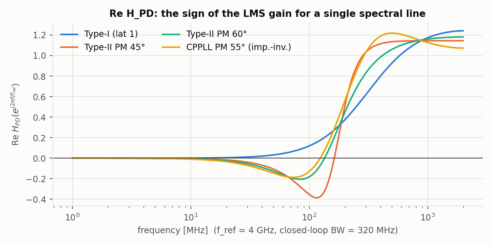
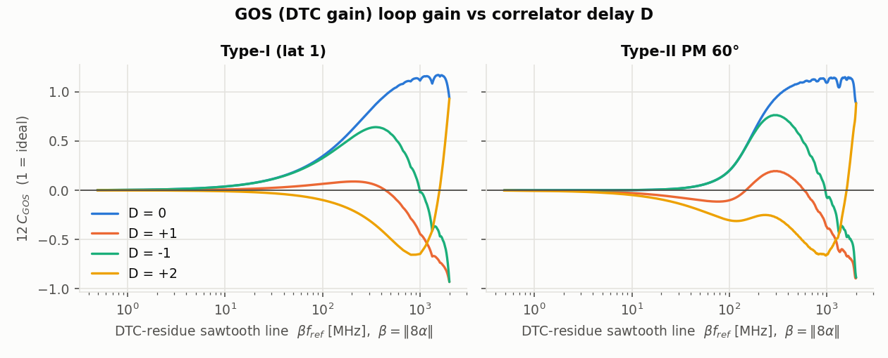
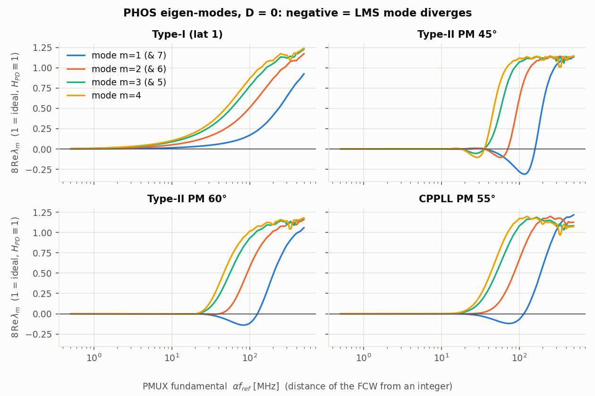
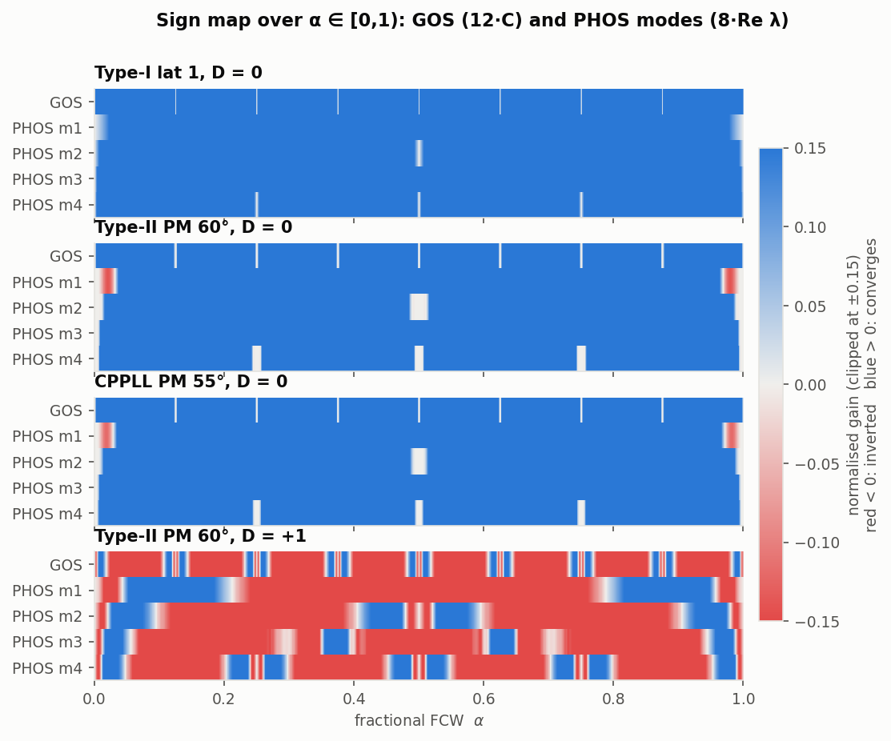

# DTC GOS / PMUX PHOS 的 LMS 為何會「反號」：regressor 相關理論

> 範圍：fractional-N sub-sampling PLL（SSPLL），$f_{ref}=4$ GHz，closed-loop $-3$ dB（$T=L/(1+L)$）$=320$ MHz，
> feedback 端 8-phase PMUX + reference 端 DTC，1-bit comparator + sign-error block LMS。
> 本資料夾回答：**從 GOS error / PHOS error 到 PD 輸出的 transfer function $H_{PD}=1/(1+L)$，是如何讓這些 LMS loop 的 mean update 變號（不收斂）**，並對 Type-I、Type-II SSPLL 與 conventional CPPLL 做同一套分析。
>
> 所有數字皆由本資料夾的程式算出（檔名標在每個結論旁）。標記：**[exact]** = 在所述模型內為嚴格結果（並有數值驗證）；**[approx]** = 漸近/線性化近似；**[numerical]** = 數值掃描結果（非定理）；**[conjecture]** = 推測。

---

## 0. 結論先講（TL;DR）

1. **一般判據 [exact]**：每個 regressor 的 mean update 由矩陣
   $$C_{ij}=\big\langle x_i[n-D]\,(h_{PD}*x_j)[n]\big\rangle=\frac{1}{2\pi}\int_{-\pi}^{\pi}S_{x_jx_i}(\Omega)\,H_{PD}(e^{j\Omega})\,e^{j\Omega D}\,d\Omega$$
   決定；$\delta_{k+1}=(I-\mu K_qC)\delta_k$。**某個 mode 不收斂 ⇔ $C$ 有 $\mathrm{Re}\,\lambda<0$**（或 $\lambda\approx 0$：dead zone）。對一條頻率 $f$ 的 spectral line，增益正比於 $\mathrm{Re}\{H_{PD}(e^{j2\pi f/f_{ref}})e^{j2\pi fD/f_{ref}}\}$ — **regressor 的能量落在 $\mathrm{Re}\,H_{PD}<0$ 的頻帶，就反號**。
2. **$\mathrm{Re}\,H_{PD}$ 的形狀**：
   * Type-I（$L=Kz^{-1}/(1-z^{-1})$）：$\mathrm{Re}\,H_{PD}=\dfrac{(2-K)(1-\cos\Omega)}{|1+(K-1)e^{-j\Omega}|^2}\ge 0$ **[exact]** → 永遠不反號（$D=0$）。latency 到 5 cycle、parasitic pole 都試過仍無反號 **[numerical]**。
   * Type-II（含 CPPLL）：低頻 $H_{PD}\approx (j\omega)^2/K_a<0$，$\mathrm{Re}\,H_{PD}<0$ 在 $0\sim f_x$：PM 60°：$f_x=134.8$ MHz（最小 $-0.205$ @ 84 MHz）；PM 45°：163 MHz；CPPLL PM 55°：123.9 MHz。
3. **PHOS（8 個 phase offset）[exact + numerical]**：$C_{PHOS}$ 是 circulant，用 8-point DFT 對角化；mode $m$ 的 eigenvalue
   $\lambda_m=\frac{8\sin^2(\pi m/8)}{\pi^2}\sum_{\ell\equiv m\,(8)}\frac{\Gamma(\ell\alpha)}{\ell^2}$。
   Mode 1/7（phase 誤差對 phase index 的「一次諧波」，例如 sinusoidal INL）有 **95%** 能量在單一條線 $f=\alpha f_{ref}$（PMUX 旋轉的基頻）。
   → **Type-II、FCW 小數部分離整數 22.5–125 MHz（PM 60°，即 $\alpha\in[0.0056,0.031]\cup[0.969,0.994]$）時 PHOS mode 1 反號**，最差 $8\,\mathrm{Re}\lambda_1=-0.140$（理想值 1，代表以理想速度 14% 的速率發散）。PM 45° 更糟（36.6–156.8 MHz，最差 $-0.31$）。比 22 MHz 更靠近整數時 $\lambda\to 0$（指數小，dead zone，不收斂也不發散）。
4. **GOS（DTC gain）[exact + numerical]**：regressor $\rho[n]=\mathrm{frac}(8n\alpha)$ 是頻率 $\beta=\|8\alpha\|$ 的鋸齒波，$C_{GOS}=\sum_{m\ge1}\frac{\mathrm{Re}\,\Gamma(m\beta)}{2\pi^2m^2}$（**對所有 $\alpha$ 都 exact**）。鋸齒的 reset 是寬頻（$1/m^2$ 衰減很慢）且 reset 瞬間 PD 看到完整的 step（$h_{PD}[0]=1$），所以 **$D=0$ 時所有測試的 loop（Type-I/II/CPPLL，PM 27–79°，latency 1–5）GOS 都不反號 [numerical]**；在 $\alpha\approx k/8$（near-grid）只是變成 dead zone：$C_{GOS}\simeq\beta^2/K_i$（Type-II）或 $\simeq\beta S_\infty/2$（Type-I）**[approx, 漸近 exact]**。
5. **真正讓 GOS 反號的是 correlator delay 錯位 $D\ne0$ [exact 漸近 + numerical]**：小 $\beta$ 時 $C_{GOS}\simeq\frac{\beta}{2}\big(S_\infty-2S_D\big)$，$S_D=\sum_{n<D}s_1[n]$，$s_1$ = $H_{PD}$ 的 step response，$s_1[0]=h_{PD}[0]=1$。Type-II 的 $S_\infty=0$，所以 **$D=+1$ 就讓 near-grid 的 GOS 反號**（PM 60°：$\beta f_{ref}<147$ MHz 與 $>585$ MHz 都反號），PHOS 也大片反號。
6. **GOS↔PHOS 交叉項 [exact]**：$\rho$ 的 Fourier 線只在 $\ell\in8\mathbb Z$，$x_k$ 在 $\ell\in8\mathbb Z\setminus\{0\}$ 的權重為 0（sinc 零點）→ 對 irrational $\alpha$ 或 $\alpha=P/Q$ 且 $8\,|\,Q$，**9×9 矩陣嚴格 block-diagonal**，joint eigenvalue = $\{C_{GOS}\}\cup\{\lambda_m\}$。只有 $8\nmid Q$ 的有理數才耦合；在反號頻帶內（$Q\ge25$）造成的 eigenvalue 偏移 $\le3\times10^{-4}$。
7. **共模 [exact]**：$\sum_kx_k\equiv1$ ⇒ $C\mathbf 1=\mathbf 1^TC=0$ ⇒ $\lambda_0=0$：8 個 phase 一起平移不可觀測（PLL 本身吸收，無害，但會 random-walk）。
8. **結論與 $f_{vco}$ 無關 [exact]**：$f_{vco}$ 只出現在 $(T_{vco}/8)$ 這個正的比例因子，符號只由 $\alpha$、$H_{PD}$、$D$ 決定。
9. **補救（已驗證）**：filtered-x LMS（regressor 先過 $\hat H_{PD}$）把判據改成 $\mathrm{Re}\{H\hat H^*e^{j2\pi fD}\}$；用 PM45/PM75/lat2/CPPLL 甚至 Type-I 的 $\hat H$ 都讓所有 mode 變正（`fxlms_results.json`）。

---

## 1. 模型與記號

* $\alpha=\mathrm{frac}(\mathrm{FCW})\in[0,1)$；$\varphi[n]=\mathrm{frac}(n\alpha)$；PMUX index $p[n]=\lfloor8\varphi[n]\rfloor$；DTC residue（以 $T_{vco}/8$ 為單位）$\rho[n]=8\varphi[n]-p[n]\in[0,1)$。
* GOS regressor：$x_g[n]=\rho[n]$；PHOS regressors：$x_k[n]=\mathbb 1\{p[n]=k\}$，$k=0..7$。程式中順序為 index 0 = $\rho$，1..8 = $x_0..x_7$。
* 注入誤差 $e_{inj}[n]=\sum_j\delta_jx_j[n]$，$\delta_j=a_j-w_j$（block 內視為常數）。$e_{PD}=h_{PD}*e_{inj}$，$H_{PD}(z)=1/(1+L(z))$，$L$ strictly causal ⇒ $h_{PD}[0]=1$。
* DTC 在 reference 側、PMUX 在 feedback 側，兩者都在 phase-comparison 加總點注入，正負號由 calibration 吸收（定義成 $H_{PD}\equiv1$ 時 update 正確）。
* $q[n]=\mathrm{sgn}(e_{PD}[n]+v[n])$，$v\sim\mathcal N(0,\sigma_v^2)$；sign-error block LMS：$w_i\leftarrow w_i+\mu_i\,G_i$，$G_i=\frac1N\sum_nq[n]x_i[n-D]$。
* $\Gamma(f)\equiv H_{PD}(e^{j2\pi f})e^{j2\pi fD}$，$f$ 以 $f_{ref}$ 正規化（cycles/sample）。
* 舉例單位：$f_{vco}=16$ GHz（**illustrative**）⇒ $T_{vco}/8=7.8125$ ps；LMS 模擬取 $\sigma_v=250$ fs（**illustrative**）。

## 2. 一般結果：GMAC 的平均值與符號（任務 1）

**Step 1（comparator 線性化）[approx]**：$\mathbb E_v[\mathrm{sgn}(e+v)]=\mathrm{erf}\!\big(e/\sqrt2\sigma_v\big)\approx K_qe$，$K_q=\sqrt{2/\pi}/\sigma_v$（$|e|\ll\sigma_v$；若 PD 還有其他近似高斯的雜訊 $\sigma_o$，Bussgang 給 $K_q=\sqrt{2/\pi}/\sqrt{\sigma_v^2+\sigma_o^2}$）。$|e|\le0.3\sigma_v$ 時線性化誤差 1.5%（`verify_results.json: Kq_check`）。

**Step 2（time average）**：
$$\mathbb E[G_i]\approx\frac{K_q}{N}\sum_n x_i[n-D]\,e_{PD}[n]=K_q\sum_j\delta_j\,C_{ij},\qquad C_{ij}=\big\langle x_i[n-D](h*x_j)[n]\big\rangle .$$

**Step 3（lag form）**：$(h*x_j)[n]=\sum_kh[k]x_j[n-k]$，令 $R_{xy}[m]\equiv\langle x[n+m]y[n]\rangle$，則 $\langle x_i[n-D]x_j[n-k]\rangle=R_{x_ix_j}[k-D]$：
$$C_{ij}=\sum_kh[k]\,R_{x_ix_j}[k-D].$$

**Step 4（frequency form，conjugation 要對）**：$S_{xy}(\Omega)=\sum_mR_{xy}[m]e^{-j\Omega m}$。代入得
$C_{ij}=\frac1{2\pi}\int S_{x_ix_j}(\Omega)H(e^{-j\Omega})e^{-j\Omega D}d\Omega$；令 $\Omega\to-\Omega$ 並用實序列的 $S_{x_ix_j}(-\Omega)=S_{x_jx_i}(\Omega)$：
$$\boxed{C_{ij}=\frac1{2\pi}\int_{-\pi}^{\pi}S_{x_jx_i}(\Omega)\,H_{PD}(e^{j\Omega})\,e^{j\Omega D}\,d\Omega}$$
Line spectrum（週期/準週期 regressor，$x_i[n]=\sum_\nu c^i_\nu e^{j2\pi f_\nu n}$）時 $S_{x_jx_i}=2\pi\sum_\nu c^j_\nu\overline{c^i_\nu}\delta(\Omega-2\pi f_\nu)$：
$$C_{ij}=\sum_\nu\overline{c^i_\nu}\,c^j_\nu\,\Gamma(f_\nu),\qquad C_{ii}=\sum_\nu|c^i_\nu|^2\,\mathrm{Re}\,\Gamma(f_\nu).$$

**數值驗證**（random FIR $h$，長 24；random 有色、非零均值序列；circular 恆等式）：`verify.py §1`

| $D$ | time domain | lag form | freq form（$S_{x_jx_i}$, $e^{+j\Omega D}$） | 錯誤：$S_{x_ix_j}$ | 錯誤：$e^{-j\Omega D}$ |
|---|---|---|---|---|---|
| −2 | 0.595416984095 | 0.595416984095 | 0.595416984095 | 1.432945 | 1.259648 |
| +1 | 1.025165954525 | 1.025165954525 | 1.025165954525 | 0.465404 | 0.707853 |
| +3 | 1.575079383779 | 1.575079383779 | 1.575079383779 | 0.909606 | 0.571628 |

**Step 5（mean 為何消失）[exact]**：$x_i=\mu_i+\tilde x_i$ ⇒ $C_{ij}=\tilde C_{ij}+\mu_i\mu_jH_{PD}(1)$。Type ≥ I 的 loop $L(1)=\infty$ ⇒ $H_{PD}(1)=0$：**loop 自己把任何 DC timing offset 追掉，PD 只看得到 regressor 的動態部分**。所以非負的 $\rho$（mean ≈ 1/2）與 one-hot $x_k$（mean 1/8）效果等同去均值的 regressor。數值：$H(1)=1.1834$ 時 raw−centered $=0.148020=\mu_i\mu_jH(1)$；$H(1)=0$ 時差 $=0.000000$（`verify.py §1b`，linear convolution，$N=2^{20}$）。
（旁註：若 comparator 有 offset $v_{os}$，它會經由非零均值的 $\rho$ 讓 $w_g$ 產生 bias $\propto v_{os}\langle\rho\rangle$；用去均值 regressor 可免。）

**Step 6（mean dynamics）**：$\delta_{k+1}=\delta_k-\mu K_qC\delta_k=(I-\mu K_qC)\delta_k$。特徵值 $1-\mu K_q\lambda$；小 $\mu$ 下 $|1-\mu K_q\lambda|<1\iff\mathrm{Re}\,\lambda>0$（精確條件 $0<\mu K_q<2\mathrm{Re}\lambda/|\lambda|^2$）。**純量 loop：$C_{ii}<0$ ⇔ 反號發散**；$C_{ii}\approx0$ ⇔ 失去 persistent excitation（dead zone）。（若 GOS/PHOS 用不同 $\mu$ 而 $C$ 又不是 block-diagonal，應看 $\mathrm{diag}(\mu)C$ 的 eigenvalue；在 §5 的 block-diagonal 情況下兩者等價。）

## 3. GOS regressor：鋸齒波（任務 2）

**3.1 化簡 [exact]**：$\rho[n]=\mathrm{frac}(8\,\mathrm{frac}(n\alpha))=\mathrm{frac}(8n\alpha)=\mathrm{frac}(n\beta')$，$\beta'=\mathrm{frac}(8\alpha)$。它是正規化頻率 $\beta'$ 的取樣鋸齒波。$\beta'$ 與 $1-\beta'$ 給出互為負號（加常數）的序列，而 $C_{GOS}$ 對 $\rho$ 是二次式且 $\mathrm{Re}\,\Gamma$ 為偶函數，所以只與 **$\beta=\|8\alpha\|=\min(\beta',1-\beta')\in[0,\tfrac12]$** 有關：GOS 的 sign map 對 $\alpha$ 週期 1/8，且對 $\alpha=k/8+1/16$ 對稱。

**3.2 Fourier series**：$\mathrm{frac}(t)=\tfrac12-\sum_{m\ge1}\frac{\sin2\pi mt}{\pi m}$（$t\notin\mathbb Z$），即 harmonic $m\beta'$ 的正弦振幅 $1/(\pi m)$，複數係數 $|c_{\pm m}|=1/(2\pi m)$。由 §2：
$$\boxed{C_{GOS}(\alpha)=\sum_{m\ge1}\frac{1}{2\pi^2m^2}\,\mathrm{Re}\big\{H_{PD}(e^{j2\pi m\beta})\,e^{j2\pi m\beta D}\big\}}$$
$\Gamma$ 對 $f$ 週期 1，所以 harmonic 的 aliasing 自動包含（第 $m$ 條線在 $\mathrm{frac}(m\beta)$）。理想 $H\equiv1$：$\sum1/(2\pi^2m^2)=1/12=\mathrm{var}(\rho)$。以下用 **$12\,C_{GOS}$**（1 = 理想速度）表示。

**3.3 有理 $\beta'=P/Q$（小分母）[exact]**：$\rho$ 週期 $Q$，取值 $\{0,\tfrac1Q,\dots,\tfrac{Q-1}Q\}$；直接算 DFT：頻率 $\mathrm{frac}(rP/Q)$ 的線，功率 $|d_r|^2=\dfrac{1}{4Q^2\sin^2(\pi r/Q)}$。由恆等式 $\sum_{k\in\mathbb Z}\frac1{(r+kQ)^2}=\frac{\pi^2}{Q^2\sin^2(\pi r/Q)}$，$|d_r|^2=\sum_k|c_{r+kQ}|^2$，即**取樣序列的線功率剛好等於所有 alias 到同一頻率的 harmonics 的「非同調」功率和**；$m\equiv0\ (\mathrm{mod}\ Q)$ 的 harmonics 落在 DC，被 $H(1)=0$ 消掉。因此
$$C_{GOS}=\sum_{r=1}^{Q-1}\frac{\mathrm{Re}\,\Gamma(\mathrm{frac}(rP/Q))}{4Q^2\sin^2(\pi r/Q)}$$
**與 3.2 的 harmonic sum 對每一個 $\alpha$（有理或無理）都完全相同**。數值：$\alpha=1/3,2/5,3/7,1/12,3/16,7/40,9/64,1001/4096,11/100$ 三種算法（DFT exact / closed form / $2^{20}$ 項 harmonic sum）一致到 $10^{-8}$（`verify_results.json: rational_exactness`）。$8\alpha\in\mathbb Z$（$\alpha=k/8$）⇒ $\rho\equiv0$ ⇒ $C_{GOS}=0$：完全沒有 excitation。

**3.4 小 $\beta$ 漸近（step-response 論證）[approx, 漸近 exact]**：令 $s_1$ = $H_{PD}$ 的 step response，$S_\infty=\sum_ns_1[n]=\lim_{z\to1}\frac{H_{PD}(z)}{1-z^{-1}}$（Type-I：$1/K_v$；Type-II：0），$S_D=\sum_{n=0}^{D-1}s_1[n]$（$s_1[0]=1$）。週期 $T=1/\beta$ 內，PD residual = reset 的 $-s_1[n]$ + ramp 的 velocity error（常數，與零均值 $\tilde\rho$ 不相關）：
$$\sum_n\tilde\rho[n-D](-s_1[n])\approx\tfrac12(S_\infty-2S_D)-\tfrac1T\sum_{n\ge D}(n-D)s_1[n]$$
$$\Rightarrow\ C_{GOS}\simeq\frac{\beta}{2}\big(S_\infty-2S_D\big)\quad;\quad\text{Type-II 且 }D=0:\ C_{GOS}\simeq\frac{\beta^2}{K_a},\ K_a=\lim_{z\to1}(1-z^{-1})^2L(z)=K_i .$$
（用 $\sum_nn\,s_1[n]=-F(1)$，$F=H_{PD}/(1-z^{-1})^2$，$F(1)=1/K_a$。）數值驗證（`verify.py §4`）：

| loop | $D$ | $\beta$ | $C_{GOS}$ exact | 預測 |
|---|---|---|---|---|
| T2 PM60 | 0 | 1/512 | 9.9722e-05 | $\beta^2/K_i$ = 9.9722e-05 |
| T2 PM60 | 1 | 1/8192 | −1.2168e-04 | $-\beta S_1$ = −1.2207e-04 |
| T2 PM60 | 2 | 1/8192 | −2.0396e-04 | −2.0435e-04 |
| T1 lat1 | 0 | 1/8192 | 1.5689e-04 | $\beta S_\infty/2$ = 1.5697e-04 |
| T1 lat1 | 2 | 1/8192 | −3.9709e-05 | −3.9707e-05 |

**物理解讀**：鋸齒的慢 ramp 本身確實落在 Type-II 的 $\mathrm{Re}H<0$ 頻帶，但 ramp 會被 Type-II 完全追蹤（zero velocity error），真正被 PD 看到的是**每次 reset 的 full-scale step**；step 的第一個 sample 就是 $h[0]=1$、與 regressor 同號。$D=0$ 時這個正貢獻勝出（鋸齒線權重 $1/m^2$ 衰減太慢，高頻線佔大部分功率，而高頻 $\mathrm{Re}H\approx1$）。$D\ge1$ 時 regressor 在 reset 之後才換邊，前 $D$ 個 sample 的 $s_1$ 以錯誤的號相關 → $-\beta S_D$。

**3.5 結果（`tables.json: gos_vs_beta`；`sign_maps.json` 的 `gos_vs_beta`）** — $12\,C_{GOS}$ vs 鋸齒線頻率 $\beta f_{ref}$：

| $\beta f_{ref}$ [MHz] | 1 | 5 | 10 | 20 | 40 | 84 | 150 | 300 | 1000 | 1999 |
|---|---|---|---|---|---|---|---|---|---|---|
| T1 lat1, D=0 | +0.004 | +0.019 | +0.038 | +0.076 | +0.148 | +0.296 | +0.489 | +0.801 | +1.113 | +0.933 |
| T2 PM45, D=0 | +0.000 | +0.000 | +0.001 | +0.005 | +0.021 | +0.094 | +0.319 | +1.063 | +1.073 | +0.858 |
| T2 PM60, D=0 | +0.000 | +0.000 | +0.002 | +0.008 | +0.031 | +0.138 | +0.453 | +0.937 | +1.092 | +0.886 |
| T2 PM60, D=+1 | −0.003 | −0.015 | −0.028 | −0.052 | −0.089 | −0.114 | +0.006 | +0.194 | −0.371 | −0.887 |
| T2 PM60, D=−1 | +0.000 | +0.000 | +0.002 | +0.008 | +0.031 | +0.139 | +0.449 | +0.762 | −0.072 | −0.885 |
| T2 PM60, D=+2 | −0.005 | −0.025 | −0.048 | −0.093 | −0.170 | −0.284 | −0.296 | −0.276 | −0.649 | +0.882 |
| T1 lat1, D=+1 | +0.001 | +0.004 | +0.008 | +0.016 | +0.031 | +0.057 | +0.082 | +0.073 | −0.445 | −0.930 |
| CPPLL PM55, D=0 | +0.000 | +0.001 | +0.003 | +0.011 | +0.045 | +0.195 | +0.545 | +1.067 | +1.046 | +0.805 |

$D=0$：dead zone（$|12C|<10^{-3}$）在 $\beta f_{ref}<6.3$ MHz（T2 PM60）、$<8.3$ MHz（PM45）、$<3.4$ MHz（PM75）。換成 $\alpha$：$|\alpha-k/8|\,f_{ref}<\beta f_{ref}/8$，例如 PM60 為 $|\alpha-k/8|f_{ref}<0.8$ MHz。

## 4. PHOS regressors：circulant 結構（任務 3）

**4.1 Fourier 與 circulant [exact]**：$x_k[n]=g(n\alpha-k/8)$，$g=\mathbb 1_{[0,1/8)}$（週期 1）。$c_\ell=\int_0^{1/8}e^{-j2\pi\ell t}dt=e^{-j\pi\ell/8}\frac{\sin(\pi\ell/8)}{\pi\ell}$，$c_0=1/8$。所以 $x_k[n]=\sum_\ell c_\ell e^{-j2\pi\ell k/8}e^{j2\pi\ell\alpha n}$：**每個 $x_k$ 都是同一組線（頻率 $\ell\alpha$）只差 phase $e^{-j2\pi\ell k/8}$** — 即 $x_k$ 是 $x_0$ 的「phase-domain 平移」。Irrational $\alpha$ 時 $\{\ell\alpha\}$ 兩兩相異，由 §2：
$$C_{ij}=\sum_\ell|c_\ell|^2e^{j2\pi\ell(i-j)/8}\,\Gamma(\ell\alpha)\quad\Rightarrow\quad C_{ij}=c(i-j\bmod8):\ \text{circulant}.$$

**4.2 DFT 對角化 [exact]**：$v_m[k]=e^{j2\pi mk/8}/\sqrt8$，
$$\boxed{\lambda_m=8\sum_{\ell\equiv m\,(\mathrm{mod}\,8)}|c_\ell|^2\,\Gamma(\ell\alpha)=\frac{8\sin^2(\pi m/8)}{\pi^2}\sum_{\ell\equiv m\,(8)}\frac{\Gamma(\ell\alpha)}{\ell^2}},\quad m=0..7$$
（$\ell$ 取所有正負整數，$\ell\ne0$；$\sin^2(\pi\ell/8)$ 在同一個 residue class 內為常數。$\mathrm{Re}\,\lambda_m$ 用 $\mathrm{Re}\,\Gamma$。）性質：
* $\lambda_0=8|c_0|^2H(1)=H(1)/8=0$；更強的是對**任何** $\alpha$，$\sum_kx_k\equiv1$ ⇒ $C\mathbf1=\mathbf1^TC=0$：**common mode（8 個 phase 同時平移）不可觀測**。
* $\lambda_{8-m}=\overline{\lambda_m}$（$\Gamma(-f)=\overline{\Gamma(f)}$）：$(m,8-m)$ 成對，實數形式是一個 rotation-scaling 2×2 block，穩定條件只看 $\mathrm{Re}\,\lambda_m$；$\lambda_4$ 為實數。
* $\alpha\to1-\alpha$：$\lambda_m\to\overline{\lambda_m}$ ⇒ $\mathrm{Re}\,\lambda_m$ 對 $\alpha=1/2$ 對稱。
* 理想 $H\equiv1$：$\lambda_m=1/8$（$m\ne0$）。以下用 **$8\,\mathrm{Re}\lambda_m$**（1 = 理想速度）。
* **單線主導**：mode $m$ 落在最低 harmonic $\ell=m$ 的功率比例 $=\frac{64\sin^2(\pi m/8)}{\pi^2m^2}$：$m=1$：**0.950**；$m=2$：0.811；$m=3$：0.615；$m=4$（$\ell=\pm4$）：0.811。所以 **PHOS mode 1/7 幾乎就是頻率 $\alpha f_{ref}$ 的單一 tone**，$8\mathrm{Re}\lambda_1\approx0.95\,\mathrm{Re}\,\Gamma(\alpha)+$（小的正項）。

**4.3 有理 $\alpha=P/Q$ [exact]**：直接算 $y_m[n]=\sum_kx_k[n]e^{j2\pi mk/8}=e^{j2\pi mp[n]/8}$ 的 DFT，得**對任意 $Q$** 都成立的 DFT-mode 對角元
$$\hat\lambda_m\equiv v_m^HCv_m=\frac{8\sin^2(\pi m/8)}{L^2}\sum_{\substack{k\equiv m\,(8)\\0\le k<L}}\frac{\Gamma(\mathrm{frac}(kP/Q))}{\sin^2(\pi k/L)},\qquad L=\mathrm{lcm}(8,Q)$$
（同 3.3 的 alias-power 恆等式；與 DFT 逐元素計算一致到 $7.6\times10^{-14}$。程式 `corr.phos_modes_rational`。）
* **$8\,|\,Q$**：每個 bin 恰有 $Q/8$ 個點，$x_{k+1}[n]=x_k[n-(Q/8)P^{-1}]$（嚴格 time shift）⇒ **C 嚴格 circulant**，$\hat\lambda_m$ 即 eigenvalue（數值 circulant defect $\le10^{-15}$）。
* **$8\nmid Q$，$Q\ge8$**：bin 大小為 $\lfloor Q/8\rfloor$ 或 $\lceil Q/8\rceil$，C 非 circulant（defect 0.02–0.9），eigenvalue 偏離 $\hat\lambda_m$，且與 GOS 耦合（§5）。
* **$Q<8$：PE failure**：只訪問 $Q$ 個 phase，其餘 $8-Q$ 個 $x_k\equiv0$ ⇒ 零 row/column。例：$\alpha=1/4$ 只訪問 {0,2,4,6}，PHOS rank 3；$\alpha=1/2$ rank 1；$\alpha=1/3$ rank 2；$\alpha=1/8$（$Q=8$）每 8 cycle 每個 phase 各一次，rank 7（滿），但此時 $\rho\equiv0$（GOS 無 excitation）。未訪問的 $w_k$ 不更新：不發散也不收斂。

**4.4 小 $\alpha$ 漸近 [approx, 漸近 exact]**：phase $k$ 停留 $W=1/(8\alpha)$ 個 sample，誤差是 staircase；以 step response 計算鄰近 window 的相關得
$$\mathrm{Re}\,\lambda_m\simeq\alpha\,(S_\infty-2S_D)\,\big(1-\cos\tfrac{2\pi m}{8}\big).$$
驗證：T1 lat1、$\alpha=2.44\times10^{-4}$、D=0：$1.839\times10^{-4}$ vs 預測 $1.839\times10^{-4}$；T2 PM60、D=1：$-1.429\times10^{-4}$ vs $-1.430\times10^{-4}$。**Type-II 且 $D=0$ 時主項為 0，剩下的是 step response 尾巴，指數小（數值 $10^{-11}$–$10^{-9}$）→ near-integer 的 dead zone。**

**4.5 反號機制（time domain 直觀）**：Type-II 的 step response 面積為 0（$S_\infty=0$）：每次 PMUX 換 phase，PD residual 先正、後出現一個負的 undershoot lobe。當 dwell time $1/(8\alpha)$ 與 undershoot lobe 的位置相當（$\alpha f_{ref}$ 落在 $\mathrm{Re}H<0$ 頻帶），phase $k$ 的誤差在 phase $k+1$ 的 window 內以負號出現，鄰近相關變負 → 平滑的 mode 1（相鄰 phase 誤差相近）反號；alternating 的 mode 4 則因每步跳躍大、寬頻而保持正。

**4.6 結果（exact，`tables.json: phos_vs_offset`）** — $8\,\mathrm{Re}\lambda_m$ vs PMUX 基頻 $\alpha f_{ref}$（= FCW 離整數的距離 × $f_{ref}$）：

| offset [MHz] | 5 | 10 | 20 | 30 | 50 | 70 | 84 | 100 | 125 | 150 | 200 | 500 |
|---|---|---|---|---|---|---|---|---|---|---|---|---|
| T1 lat1, m1 | +0.008 | +0.015 | +0.030 | +0.045 | +0.076 | +0.110 | +0.136 | +0.169 | +0.225 | +0.286 | +0.413 | +0.927 |
| T2 PM45, m1 | +0.000 | +0.000 | +0.002 | +0.008 | −0.045 | −0.135 | −0.207 | −0.280 | −0.299 | −0.109 | +0.538 | +1.134 |
| T2 PM45, m2 | +0.000 | −0.000 | −0.001 | +0.008 | −0.082 | −0.015 | +0.271 | +0.623 | +0.933 | +1.042 | +1.120 | +1.144 |
| T2 PM60, m1 | −0.000 | −0.000 | +0.000 | −0.011 | −0.069 | −0.126 | **−0.140** | −0.118 | −0.007 | +0.161 | +0.482 | +1.060 |
| T2 PM60, m2 | +0.000 | +0.000 | +0.000 | −0.004 | +0.036 | +0.231 | +0.401 | +0.572 | +0.765 | +0.881 | +1.015 | +1.160 |
| T2 PM75, m1 | −0.001 | −0.005 | −0.015 | −0.015 | +0.009 | +0.048 | +0.081 | +0.123 | +0.196 | +0.274 | +0.429 | +0.961 |
| T2 PM60 lat2, m1 | −0.000 | −0.005 | −0.025 | −0.038 | −0.021 | +0.037 | +0.093 | +0.170 | +0.306 | +0.456 | +0.743 | +1.409 |
| CPPLL PM55, m1 | −0.000 | −0.000 | −0.004 | −0.021 | −0.081 | −0.118 | −0.111 | −0.068 | +0.060 | +0.234 | +0.585 | +1.219 |
| CPPLL PM55 τ=T/2, m1 | −0.000 | −0.000 | −0.009 | −0.032 | −0.082 | −0.090 | −0.062 | −0.002 | +0.137 | +0.309 | +0.654 | +1.288 |
| T2 PM60, **D=+1**, m1 | −0.006 | −0.012 | −0.023 | −0.044 | −0.119 | −0.200 | −0.238 | −0.251 | −0.204 | −0.101 | +0.116 | +0.420 |

**顯著反號區間**（$8\mathrm{Re}\lambda<-10^{-3}$，exact zoom grid，`sign_maps.json → maps.*.summary.significant_inversion`）：

| loop (D=0) | Re H<0 band [MHz] | PHOS m1 反號 offset [MHz] | min 8Reλ₁ (@MHz) | m2 / m3 / m4 反號 offset [MHz]（近 α≈0） | GOS 反號 | GOS dead zone βf_ref [MHz] |
|---|---|---|---|---|---|---|
| Type-I lat1 | — | — | +0.001 (@1) | — / — / — | 無 | — |
| Type-I lat1.5 | — | — | +0.002 (@1) | — / — / — | 無 | — |
| Type-I lat2 | — | — | +0.002 (@1) | — / — / — | 無 | — |
| Type-I + pole 1 GHz | — | — | +0.002 (@1) | — / — / — | 無 | — |
| Type-I + pole 500 MHz | — | — | +0.002 (@1) | — / — / — | 無 | — |
| Type-II PM45 | 0.0–163.0 | 36.6–156.8 | -0.310 (@117) | 21.4–21.8, 36.0–70.7 / 18.0–35.4 / 10.7–10.7, 18.0–35.4 | 無 | 0.5–8.3 |
| Type-II PM60 | 0.0–134.8 | 22.5–125.2 | -0.140 (@84) | 25.5–39.9 / 13.4–19.6 / 12.7–20.0 | 無 | 0.5–6.3 |
| Type-II PM75 | 0.0–72.3 | 5.8–42.8 | -0.016 (@24) | — / — / — | 無 | 0.5–3.4 |
| Type-II PM60 lat1.5 | 0.0–105.7 | 11.9–91.7 | -0.081 (@58) | — / — / — | 無 | 0.5–4.4 |
| Type-II PM60 lat2 | 0.0–76.5 | 6.5–57.4 | -0.038 (@34) | — / — / — | 無 | 0.5–3.4 |
| Type-II PM60 + pole 1 GHz | 0.0–122.0 | 16.2–110.9 | -0.108 (@72) | — / — / — | 無 | 0.5–5.4 |
| CPPLL PM55 (τ=0) | 0.0–123.9 | 15.9–112.8 | -0.119 (@72) | — / — / — | 無 | 0.5–5.4 |
| CPPLL PM55 (τ=T/2) | 0.0–110.9 | 12.1–99.9 | -0.094 (@63) | — / — / — | 無 | 0.5–4.4 |

D ≠ 0（latency 錯位）：

| loop | D | GOS 反號 βf_ref [MHz] | PHOS m1 | m2 | m3 | m4 （offset [MHz]，α<1/8 範圍） |
|---|---|---|---|---|---|---|
| Type-I lat1 | -1 | 991.7–1999.5 | — | — | 335.8–500.0 | 292.3–500.0 |
| Type-I lat1 | +1 | 443.8–1999.5 | — | 330.0–500.0 | 186.4–500.0 | 165.1–500.0 |
| Type-I lat1 | +2 | 1.5–1581.5 | 2.6–500.0 | 0.8–500.0 | 0.5–466.5 | 0.5–366.1 |
| Type-II PM60 | -1 | 965.3–1999.5 | 21.4–114.8 | 24.6–38.6 | 13.2–19.0, 330.0–500.0 | 12.3–19.3, 282.4–500.0 |
| Type-II PM60 | +1 | 0.5–147.0, 585.4–1999.5 | 0.9–170.9 | 0.5–82.6, 385.6–500.0 | 0.5–49.1, 225.5–500.0 | 0.5–41.3, 192.9–500.0 |
| Type-II PM60 | +2 | 0.5–1595.2 | 0.5–500.0 | 0.5–500.0 | 0.5–474.7 | 0.5–372.5 |
| Type-II PM60 lat2 | -1 | 793.5–1999.5 | 6.5–56.4 | 458.5–500.0 | 282.4–500.0 | 229.4–500.0 |
| Type-II PM60 lat2 | +1 | 0.5–37.6, 972.2–1999.5 | 0.9–90.1 | 0.5–29.7 | 0.5–17.1, 330.0–500.0 | 0.5–14.9, 282.4–500.0 |
| Type-II PM60 lat2 | +2 | 0.5–1652.8 | 0.5–168.0, 385.6–500.0 | 0.5–500.0 | 0.5–500.0 | 0.5–392.4 |
| CPPLL PM55 (τ=0) | -1 | 925.3–1999.5 | 15.4–103.5 | — | 302.6–500.0 | 263.5–500.0 |
| CPPLL PM55 (τ=0) | +1 | 0.5–110.8, 757.3–1999.5 | 0.9–156.8 | 0.5–70.7, 466.5–500.0 | 0.5–40.6, 272.8–500.0 | 0.5–35.4, 233.4–500.0 |
| CPPLL PM55 (τ=0) | +2 | 0.5–1615.7 | 0.5–245.9, 297.4–500.0 | 0.5–500.0 | 0.5–491.4 | 0.5–379.0 |

另外在 $\alpha\approx j/\ell_0$ 附近，第 $\ell_0$ 個 harmonic 變慢，所以 mode $m\equiv\pm\ell_0\ (\mathrm{mod}\ 8)$ 也可能反號：T2 PM60 的 mode 2 在 $\alpha\in[0.490,0.4934]\cup[0.5066,0.510]$（$\alpha\approx1/2$，最差 −0.005），mode 4 在 $\alpha\approx1/4,1/2,3/4$ 兩側寬約 0.0014（最差 −0.005）；PM45 時這些變強（mode 2、4 最差 −0.10）。**$\alpha\approx k/8$ 對 PHOS 無害**：$\ell=8r$ 的權重 $\sin^2(\pi\ell/8)=0$ — 那些線剛好是 GOS 的線。

## 5. Joint GOS+PHOS 9×9（任務 4）

**[exact]** $\rho(\varphi)=\mathrm{frac}(8\varphi)$ 對 $\varphi$ 週期 1/8 ⇒ Fourier 線只在 $\ell\in8\mathbb Z$；$x_k$ 的 $|c_\ell|^2\propto\sin^2(\pi\ell/8)$ 在 $\ell\in8\mathbb Z\setminus\{0\}$ 為 0；$\ell=0$ 的 DC 被 $H(1)=0$ 消掉。Irrational $\alpha$（$\ell\alpha$ 互異）或 $8\,|\,Q$（可證 $\rho$ 只有 $l\equiv0\ (8)$ 的 DFT 線、$x_k$ 在這些線為 0）⇒ **交叉項嚴格為 0**：
$$C=\begin{pmatrix}C_{GOS}&0\\0&C_{PHOS}\end{pmatrix},\qquad \mathrm{eig}(C)=\{C_{GOS}\}\cup\{\lambda_0=0,\lambda_1,\dots,\lambda_7\}.$$
數值：2048 點主 grid（$Q=4096$）最大 |cross| = 0.0，circulant defect $5.4\times10^{-16}$，eigenvalue 與 DFT modes 差 $6.8\times10^{-16}$；irrational $\alpha$ 的時域（$N=2^{21}$）|cross| $\le2\times10^{-6}$（有限 $N$ 起伏）。

**耦合只發生在 $8\nmid Q$**。例：$\alpha=1/3$：cross norm 0.37；$1/5,2/5$：0.30；$1/7$：0.25（同時有 PE failure）；這些 offset $\ge571$ MHz，不在反號頻帶。反號頻帶內的 near-integer 有理數（`tables.json: joint_inband_rationals`，T2 PM60，D=0）：

| $\alpha$ | offset [MHz] | cross norm | min Re eig（exact 9×9） | circulant/harmonic 預測 |
|---|---|---|---|---|
| 1/33 | 121.2 | 0.037 | −0.00307 | −0.00336 |
| 1/45 | 88.9 | 0.026 | −0.01712 | −0.01708 |
| 1/50 | 80.0 | 0.026 | −0.01732 | −0.01728 |
| 1/57 | 70.2 | 0.015 | −0.01576 | −0.01573 |
| 1/100 | 40.0 | 0.011 | −0.00463 | −0.00466 |
| 1/175 | 22.9 | 0.0007 | −0.00017 | −0.00018 |

結論：in-band 時 9×9 耦合只是 $\le3\times10^{-4}$ 的微擾，符號完全由 §4 的 $\lambda_1$ 決定。

## 6. Loop models（generic，本資料夾自己建；`corr.py`）

* **Type-I**：$L=Kz^{-\text{lat}}/(1-z^{-1})\cdot\frac{1-p}{1-pz^{-1}}$；非整數 latency 用 ZOH 延遲起始的精確分拆 $(1-\tau)z^{-1}+\tau z^{-2}$。
* **Type-II**：$L=(K_p+\frac{K_i}{1-z^{-1}})\frac{z^{-\text{lat}}}{1-z^{-1}}$（可加 pole）；$K_i/K_p$ 解 PM，增益解 $f_{3dB}=320$ MHz。
* **CPPLL**：$L(s)=K\frac{1+s/\omega_z}{s^2(1+s/\omega_p)}$，$\omega_z=\omega_c/b,\ \omega_p=b\,\omega_c$，**impulse-invariant**（CP 每個 cycle 送出 ∝ 取樣相位誤差的電荷）：$L(z)=T\sum_{n\ge1}l(nT-\tau)z^{-n}$，$\tau=0$ 或 $T/2$（$e^{-sT/2}$ variant）；離散 $L$ 與 CT $L$ 比值：1 MHz 1.0000、10 MHz 1.0002、100 MHz 1.0069。
* 所有 model 都解到 closed-loop $-3$ dB = 320.00 MHz。

| model | 參數 | PM [°] | f_c [MHz] | peaking [dB] | Re H_PD<0 [MHz] | min Re H_PD (@MHz) | S_∞ |
|---|---|---|---|---|---|---|---|
| Type-I lat1 | K=0.3888 | 78.8 | 249.1 | -0.00 | — | +0.000 (@0) | 2.572 |
| Type-I lat1.5 | K=0.3226 | 71.7 | 203.6 | -0.00 | — | +0.000 (@0) | 3.100 |
| Type-I lat2 | K=0.2623 | 67.4 | 167.5 | -0.00 | — | +0.000 (@0) | 3.813 |
| Type-I + pole 1 GHz | K=0.3621 | 74.6 | 227.0 | -0.00 | — | +0.000 (@0) | 2.762 |
| Type-I + pole 500 MHz | K=0.3407 | 66.7 | 202.7 | -0.00 | — | +0.000 (@0) | 2.935 |
| Type-II PM45 | Kp=0.2232, Ki=0.05791 | 45.0 | 199.4 | 3.90 | 0.0–163.0 | -0.385 (@116) | 0.000 |
| Type-II PM60 | Kp=0.2877, Ki=0.03825 | 60.0 | 209.6 | 2.13 | 0.0–134.8 | -0.205 (@84) | -0.000 |
| Type-II PM75 | Kp=0.3635, Ki=0.01054 | 75.0 | 236.8 | 0.52 | 0.0–72.3 | -0.053 (@33) | -0.000 |
| Type-II PM60 lat1.5 | Kp=0.2795, Ki=0.02002 | 60.0 | 187.9 | 1.57 | 0.0–105.7 | -0.147 (@59) | -0.000 |
| Type-II PM60 lat2 | Kp=0.2466, Ki=0.00918 | 60.0 | 161.9 | 1.08 | 0.0–76.5 | -0.100 (@38) | 0.000 |
| Type-II PM60 + pole 1 GHz | Kp=0.2932, Ki=0.02875 | 60.0 | 201.6 | 1.83 | 0.0–122.0 | -0.173 (@72) | 0.000 |
| CPPLL PM55 (τ=0) | b=ω_p/ω_c=3.287（impulse-invariant） | 55.0 | 191.5 | 2.04 | 0.0–123.9 | -0.187 (@73) | 0.000 |
| CPPLL PM55 (τ=T/2) | b=ω_p/ω_c=4.080（含 e^{-sT/2}） | 55.0 | 181.1 | 1.80 | 0.0–110.9 | -0.162 (@63) | 0.000 |

Type-I lat1 的 $\mathrm{Re}H_{PD}\ge0$ 封閉式與數值相差 $7\times10^{-16}$。連續時間直觀：Type-II $\mathrm{Re}H(j\omega)=-\frac{\omega^2(\omega_n^2-\omega^2)}{(\omega_n^2-\omega^2)^2+(2\zeta\omega_n\omega)^2}<0$（$\omega<\omega_n$）。

**穩健性掃描（`gos_robustness.json`）[numerical]**：Type-I lat 1–5（lat 5 已有 9.7 dB peaking、$\mathrm{Re}H<0$ 在 0–107 MHz）PHOS/GOS 仍全正；Type-II PM 30–75°、lat 1–3、加 pole；CPPLL PM 40/55/65、$\tau=0,T/2$：**$D=0$ 的 GOS 全部 $\ge0$**，PHOS mode 1 全部在一段頻帶內反號：下緣 $\approx(0.08\sim0.22)f_x$（更低為 dead zone），上緣 $\approx(0.6\sim0.99)f_x$（PM 越高、latency 越大，上緣離 $f_x$ 越遠，因 side lines 的正貢獻相對變大）（例：Type-II PM30：15–180 MHz，最差 −0.62；CPPLL PM65：10.9–88.9 MHz，最差 −0.061）。

## 7. Sign maps（任務 5）

`sign_maps.json`（`make_maps.py` 產生）：
* `alpha`：$\alpha_i=(2i+1)/4096$，2048 點（每點週期 $Q=4096$，$8\,|\,Q$ ⇒ circulant 與零交叉項是嚴格的；同時用 DFT-exact 與 harmonic sum 兩種獨立方法計算，最大差 $\le2\times10^{-5}$）。
* `maps.<model>_D<d>`：`C_gos`、`re_lam`（m=1..4；$\mathrm{Re}\lambda_{8-m}=\mathrm{Re}\lambda_m$）、`im_lam`（m=1..3）、`joint_min_re`、`gos_vs_beta`（$\beta=(2j+1)/8192$）、`lam_zoom_re`（exact，offset 0.5–500 MHz log grid）、`summary`（反號區間、dead zone、極值）。
* models：`T1_lat1, T1_lat1.5, T1_lat2, T1_lat1_pole1G, T1_lat1_pole500M, T2_pm45/60/75_lat1, T2_pm60_lat1.5, T2_pm60_lat2, T2_pm60_lat1_pole1G, CP_pm55, CP_pm55_tauHalf`（D=0），以及 `T1_lat1, T2_pm60_lat1, T2_pm60_lat2, CP_pm55` 的 D = −1, +1, +2。
* `rational_small_Q`：所有 $Q\le24$ 的 $P/Q$ 的 exact 9×9（visited phases、cross norm、circulant defect、eigenvalues）。

* 圖：`fig_ReH.png`、`fig_phos_modes.png`、`fig_gos_beta.png`、`fig_signmap.png`（`make_figs.py`）。

## 8. Sign-error LMS 行為模擬（`lms_sim.py` → `lms_sim_results.json`）

線性 $H_{PD}$ + 1-bit comparator（$\sigma_v=250$ fs）+ block $N=256$ 的 sign-error LMS。
**小訊號（誤差 20–40 fs ≪ $\sigma_v$，8 seeds ensemble mean）**：每 block 的 log-slope 預測 $-\mu K_q\mathrm{Re}\lambda$ vs 觀測：

| case | GOS pred / obs | m1 pred / obs | m2 | m3 | m4 |
|---|---|---|---|---|---|
| T2_pm60 D0 70MHz | -1.16e-05 / -1.14e-05 | +2.00e-06 / +1.95e-06 | -3.68e-06 / -3.37e-06 | -1.11e-05 / -1.08e-05 | -1.34e-05 / -1.31e-05 |
| T1_lat1 D0 70MHz | -1.11e-05 / -1.07e-05 | -1.75e-06 / -1.74e-06 | -5.74e-06 / -5.50e-06 | -9.39e-06 / -9.15e-06 | -1.08e-05 / -1.06e-05 |
| T2_pm60 D+1 1/8-grid beta 80MHz | +1.22e-06 / +1.32e-07 | -6.51e-06 / -6.48e-06 | +3.54e-06 / +3.45e-06 | +1.40e-05 / +1.38e-05 | +1.83e-05 / +1.80e-05 |
| T2_pm45 D0 100MHz | -1.17e-05 / -1.19e-05 | +4.47e-06 / +4.24e-06 | -9.95e-06 / -9.43e-06 | -1.71e-05 / -1.67e-05 | -1.79e-05 / -1.73e-05 |
| T2 PM60 D+1 β=80 MHz，GOS-only，40000 blocks（上一列 GOS 成長太慢，4000 blocks 內無法解析，故另跑） | +6.10e-06 / +7.10e-06 | | | | |

**大訊號**（初始 PHOS 誤差 150 fs/mode，GOS 2%）：T2 PM60、offset 70 MHz、D=0：mode 1 從 245 fs 長到 7537 fs（slope 預測 $+1.565\times10^{-4}$，觀測 $+1.567\times10^{-4}$），其餘 mode 收斂；但 mode 1 大到讓 comparator 飽和後，sign 非線性的 3 次諧波把 mode 3 從 22 fs 拉到 619 fs（**非線性耦合，不在線性理論內**）。同一 $\alpha$ 的 Type-I：全部收斂。T2 PM60、$\alpha\approx1/8$（$\beta f_{ref}=80$ MHz）：D=0 全收斂；D=+1 時 GOS（0.020→0.0325）與 PHOS mode 2/3/4 發散（mode 4 到 30.9 ps）。

## 9. 怎麼避免（設計含意）

* **對齊 $D$** [exact]：$D$ 必須等於 regressor 到 comparator 的實際 pipeline 差；錯一個 cycle（$D=+1$）就讓 near-grid GOS 與大片 PHOS 反號（§3.5、§4.6）。
* **Filtered-x LMS** [numerical, `fxlms_check.py`]：用 $x^f=\hat h_{PD}*x$ 當 regressor，判據變成 $\mathrm{Re}\{H\overline{\hat H}e^{j2\pi fD}\}$；$\hat H=H$ 時 $C$ 是 Gram matrix（PSD）。T2 PM60 的真 loop 配上 $\hat H$ = PM45 / PM75 / lat2 / CPPLL / 甚至 Type-I model，全 $\alpha$ 最小 $8\mathrm{Re}\lambda$ 由 −0.140 變成 +0.0003～+0.0027（仍有 near-integer dead zone，但不再反號）。
* **calibration 期間用 Type-I-like 的 loop**（暫停 integral path）：Type-I lat1 的 $\mathrm{Re}H_{PD}\ge0$ [exact]，整張 map 無反號 [numerical]。
* **避開 near-integer FCW**：PHOS mode 1 只在 $\alpha f_{ref}\in(\approx0.08\text{–}0.22\,f_x,\ \approx0.6\text{–}0.99\,f_x)$ 反號（$f_x$ = Re$H_{PD}$ 的零交越）；更靠近整數則是 dead zone。
* **DSM/dither 化 PMUX、DTC 序列** [conjecture]：把 regressor 功率推到高頻（$\mathrm{Re}H\approx1$）應能消除反號；本資料夾未模擬 DSM。

## 10. 檔案

| 檔案 | 內容 |
|---|---|
| `corr.py` | loop models（Type-I/II/CPPLL）、regressors、`C_exact`（DFT）、`C_time`（lfilter）、`gos_harmonic`、`gos_rational_closed_form`、`phos_eigs_harmonic`、`phos_modes_rational`、`joint_harmonic` |
| `verify.py` → `verify_results.json` | 所有恆等式與漸近式的數值驗證 |
| `make_maps.py` → `sign_maps.json` | sign maps（≥2000 點） |
| `tables.py` → `tables.json` | README 的表格 |
| `gos_robustness.py` → `gos_robustness.json` | 極端 loop 的穩健性掃描 |
| `lms_sim.py` → `lms_sim_results.json` | sign-error LMS 行為模擬 |
| `fxlms_check.py` → `fxlms_results.json` | filtered-x 補救 |
| `make_figs.py` → `fig_*.png` | 圖 |

## 11. 假設與限制

* 線性化 comparator（$|e_{PD}|\lesssim\sigma_v$）；大訊號時有效 $K_q$ 下降並出現 mode 間非線性耦合（§8）。
* $\delta$ 在一個 GMAC block 內不變；時間平均 = 長時間平均。若 $\alpha$ 非常接近小分母有理數 $P/Q$（$|\alpha-P/Q|\ll1/(\text{LMS 時間常數})$），實際行為依 $P/Q$ 的 exact 結果（§4.3），不是 irrational 極限。
* 一階 accumulator（無 DSM randomisation）；DTC/PMUX 的 nonlinearity 只考慮 gain 與 per-phase offset。
* $H_{PD}$ 為 generic 的 sampled-data model（此資料夾自建）；其他 loop 可直接以 callable `H(Ω)` 或 impulse response `h` 丟入 `corr.C_exact / C_time / gos_harmonic / phos_eigs_harmonic`。
