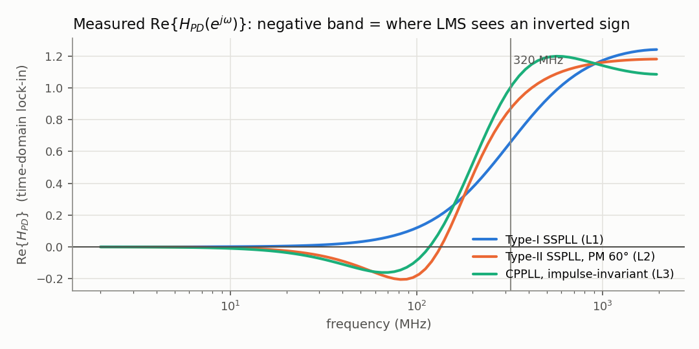
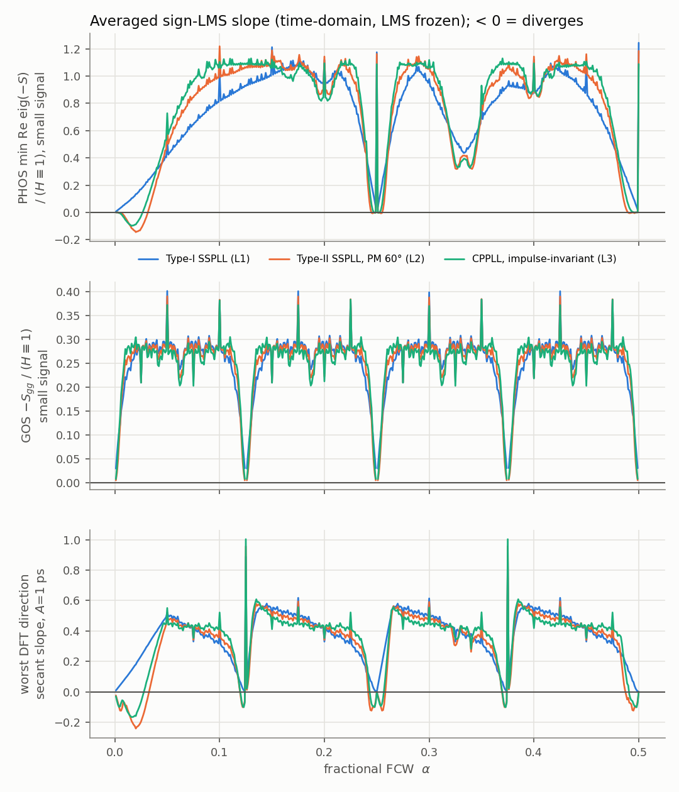
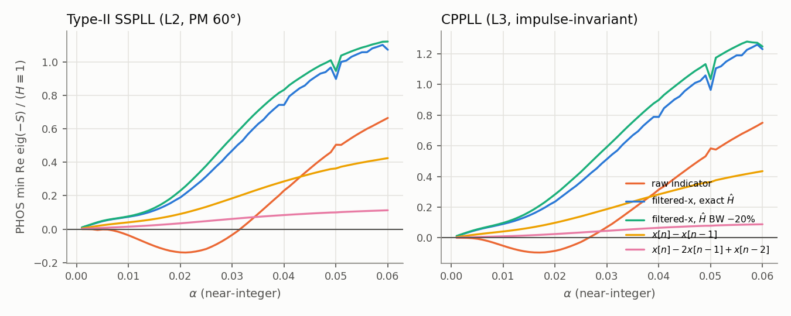
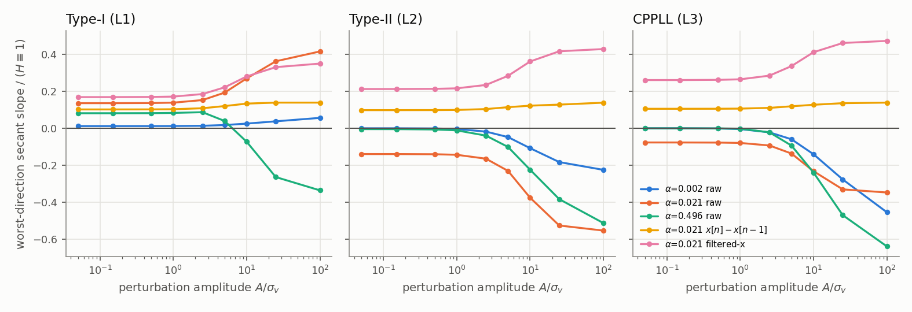
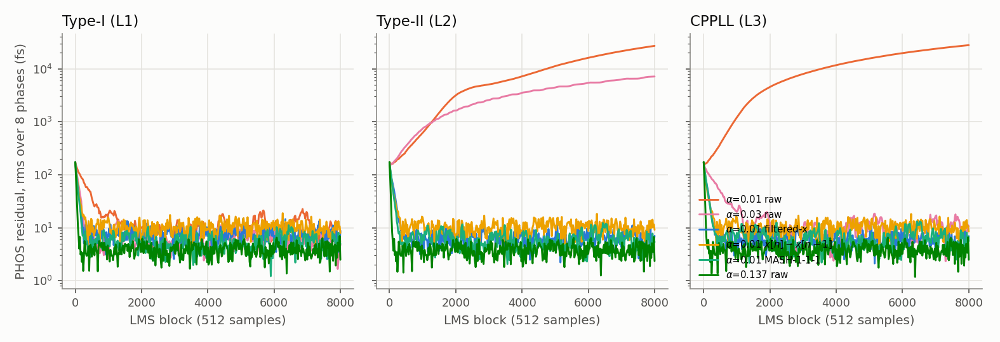
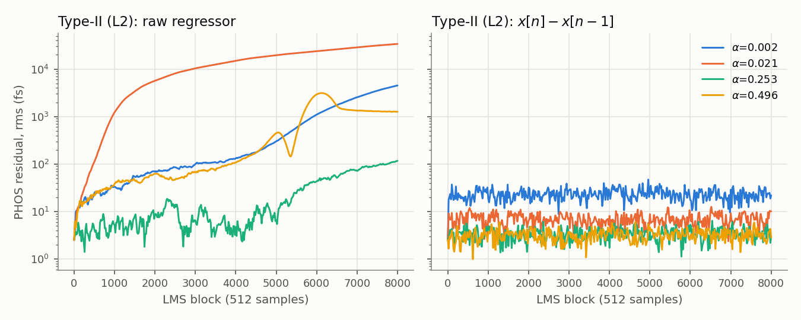

# SSPLL / CPPLL 的 DTC-GOS 與 PMUX-PHOS sign-LMS：為什麼會「變號」而不收斂？——獨立時域行為模擬

本資料夾是一個**獨立的時域行為模擬 (time-domain behavioural simulation)**，用來檢查「GOS / PHOS 誤差經 PD 的 transfer function 使 LMS loop 變號」這個預測。
所有判斷**正負號**的數字都來自逐週期 (one step per reference cycle) 的 PLL 遞迴模擬加上凍結 LMS 的擾動量測，**沒有使用任何頻域相關公式**。頻率響應只用在兩個地方：(i) 迴路**設計**（找 $K$、$K_p,K_i$、$\omega_c$），(ii) 一個事後的一致性比對（第 3.3 節，標示為「事後解讀」）。

- 程式：`sim.py`（固定 seed，可重現）、`figures.py`（只讀 `results.json` 畫圖）、`tables.py`（只讀 `results.json` 印出本文表格）
- 結果：`results.json`（約 27 MB），圖：`fig/`
- 重現：`python3 sim.py all`（stage 1–11，18 核機器約 20 分鐘），接著 `python3 figures.py`、`python3 tables.py`
  （本次的 `results.json` 是分段產生的：`sim.py all` 跑 stage 1–8 用 1025 s，`sim.py extra` 跑 stage 9–10 用 210 s，再 `sim.py check1d`、`sim.py post`。這些 stage 用的核心函式在分段之間沒有改動。）

---

## 0. 結論摘要

| | Type-I SSPLL (L1) | Type-II SSPLL (L2) | CPPLL (L3) |
|---|---|---|---|
| 量到的 $\mathrm{Re}\{H_{PD}\}<0$ 頻帶 | **無**（DC 到 $f_{ref}/2$ 都 $\ge 0$） | DC–130 MHz（PM 60°），最小值 −0.205 @ 82 MHz | DC–112 MHz，最小值 −0.161 @ 65 MHz |
| GOS（DTC 增益）小訊號 | 500 個 α 全部 restoring | 500 個 α 全部 restoring（near-grid 只剩 2%） | 500 個 α 全部 restoring |
| PHOS（8 相 offset）小訊號 | 500 個 α 全部 restoring | **反向**：α∈[0.004, 0.031]、≈1/4±0.005、≈1/2（0.490–0.496）；最差 κ = −0.145 @ α=0.020 | **反向**：α∈[0.004, 0.026]、≈1/4±0.002；最差 κ = −0.099 @ α=0.016 |
| 大訊號（誤差 ≫ σ_v，sign 比較器） | PHOS 仍 restoring；GOS 在每個 k/8 **正下方**的窄帶（約 0.008 寬）於 5 ps 擾動時反向 | 反向區變寬，**α→0 也反向**（小訊號只是中性），1/8、3/8 正下方也出現 | 同 L2 |
| 閉迴路 sign-LMS（8000 blocks） | 全部收斂 | α=0.01 / 0.03 / 0.002 / 0.496 **發散到 ps 級**（6.6–44 ps） | α=0.01 / 0.002 / 0.496 發散（1.3–50 ps） |

1. **變號的只有 PHOS（在 Type-II 與 CPPLL）**，不是 GOS。GOS 的 regressor 是殘差 $\rho\in[0,1)$ 的鋸齒波，reset 的陡邊把能量推到 $\mathrm{Re}\{H_{PD}\}>0$ 的高頻，所以 500 個 α × 14 種迴路的小訊號斜率全部是 restoring。
2. PHOS 反向的條件可以用時域量測直接看出來：**PMUX 旋轉頻率 $\alpha f_{ref}$（或它在 1/4、1/2 附近的 alias $|4\alpha-1|f_{ref}$、$|2\alpha-1|f_{ref}$）落在量到的 $\mathrm{Re}\{H_{PD}\}<0$ 頻帶裡**。最差的 α 和 $\mathrm{Re}\{H_{PD}\}$ 最小值的位置對得上：L2 是 80 vs 82 MHz，L3 是 64 vs 65 MHz，L2-PM45 是 120 vs 112 MHz，L2-PM75 是 24 vs 32 MHz，L2-lat2 是 32 vs 38 MHz。被反向的是 DFT 空間模態 **m=1**（相位偏移的「線性斜坡」型樣）。
3. Type-I（K=0.389，$z^{-1}$ latency）的 $\mathrm{Re}\{H_{PD}\}$ 量起來在全頻帶都 $\ge 0$。加上 2 GHz–400 MHz 的寄生極點或多一拍 latency 也一樣，小訊號沒有任何 α 反向。
4. **sign 比較器的大訊號效應不能忽略**。小訊號下「中性」（κ≈0）的 α，例如 α=0.002、0.253、0.496，在誤差超過約 σ_v 之後會變成強烈反向（−0.2 到 −0.6）。所以 Type-II 從**已校準的點**出發時，雜訊造成的 random walk 也會讓誤差逃出去：α=0.002 漂到 3.7 ps，α=0.496 漂到 1.3 ps（第 5、6 節）。
5. 對策（時域量測）：
   - **filtered-x**（$x_f=\hat H_{PD}*x$，即使 $\hat H$ 頻寬誤差 ±20%）：14 種迴路 × 500 個 α，小訊號與大訊號（1 ps、5 ps）都 0 個反向，LMS 全部收斂。
   - **一階差分 regressor $x[n]-x[n-1]$**（本模擬額外發現，不在原清單裡）：同樣 0 個反向，大訊號也 0 個，不需要迴路模型。代價是相關器延遲必須**精確對齊**：D=±1 時 generic α 全部翻成反向（κ_PHOS 約 −0.4 到 −2.6）。
   - **二階差分**：只修好 near-integer，卻把 generic α 弄成反向（L2 有 145/500 個 α 反向；α=0.137 的 LMS 發散到 0.8 ps）。**不建議**。
   - **相關器延遲 D≠0**：災難性。D=1 時有 469–500/500 個 α 反向。
   - **MASH-1-1-1**：小訊號幾乎全部修好（100 個 α 中只有 L2-PM45 在 α=0.030 有 1 個邊際反向），但需要 4Δ（=T_vco/2）的 DTC range，而且 L2-PM45 在 α=0.03 的 LMS 仍然發散。**PMUX 隨機旋轉 (M=8)**：全部修好，但需要 8Δ = T_vco 的 DTC range。**LSB dither**：無效。**dithered quantizer**：只有部分有效。
   - **freeze**：從已校準狀態進入 keep-out α 時凍結權重，誤差維持 2.5 fs；不凍結的話會發散到 5.7–25.5 ps。

---

## 1. 模型與假設

### 1.1 數值（插圖用的值都有標示）

| 項目 | 值 |
|---|---|
| $f_{ref}$（SSPD 取樣率） | 4 GHz，$T_{ref}=250$ ps |
| closed-loop −3 dB of $T=L/(1+L)$ | 320 MHz（所有迴路都經過**時域**正弦注入驗證，量到 $\lvert T\rvert=0.7071$） |
| $f_{vco}$ | **16 GHz，僅供插圖** → $T_{vco}=62.5$ ps，$\Delta=T_{vco}/8=7.8125$ ps；另用 12 / 24 GHz 驗證結論與它無關 |
| DTC 增益誤差 $a$ | 3%（實際 DTC 增益 = $(1-a)$ × nominal） |
| PMUX 相位 offset $\varepsilon_k$（以 feedback edge **早到**為正） | seed 7，$\mathcal N(0,250\,\text{fs})$ 去均值後為 [+29, +103, −40, −194, −85, −219, +43, +364] fs（非共模 rms 173 fs） |
| 比較器雜訊 $\sigma_v$ | **200 fs（插圖用）**；另驗證 100 / 400 fs |
| 量測 $S$ 用的擾動 $\delta$ | ±30 fs（0.15 σ_v） |
| 分數累加器 | 32-bit，$\alpha$ 量化到 $2^{-32}$ |

### 1.2 相位域方程（每個 reference cycle 一步）

分數相位 $\Phi[n]=8n\alpha$（以 $\Delta$ 為單位）。PMUX 總指標 $P[n]$，$p[n]=P[n]\bmod 8$。DTC code $c[n]=\Phi[n]-P[n]$（加上固定 offset）。baseline（一階累加器）為

$$p[n]=\lfloor 8\,\mathrm{frac}(n\alpha)\rfloor,\qquad c[n]=\rho[n]=8\,\mathrm{frac}(n\alpha)-p[n]\in[0,1).$$

比較節點的注入時序誤差（ps）。讀法照全站約定（`docs/assumptions.md` §2a、網站 `/case/sspll` §2）：PMUX 第 $p$ 相的 feedback edge 比理想時刻**早到** $c\Delta+\varepsilon_p$（$\varepsilon_p>0$ 代表早到），所以**需要的補償量**是 $c\Delta+\varepsilon_p$；reference 端的 DTC 只能延遲，它從固定的基準延遲 $T_0$ 往回扣，**實際的補償量**是 $(1-a)(1+w_g)\big(c\Delta+w_p\big)$。$u$＝需要的補償量 − 實際的補償量，也就是 VCO 修正前的 $t_{ref}'-t_{fb}$（去掉常數 $T_0$；reference 端太晚時為正）：

$$u[n]=c[n]\Delta+\varepsilon_{p[n]}-(1-a)(1+w_g)\big(c[n]\Delta+w_{p[n]}\big).$$

固定點是 $w_g^*=a/(1-a)$、$w_k^*=\varepsilon_k$。（如果你的電路把 $\varepsilon_p$ 記成 PMUX 多出來的延遲，也就是晚到為正，那麼 $\varepsilon_p$ 與 $w_p$ 都要變號、$w_k$ 改成加在 DTC 的延遲上，更新式變成 $w_k\leftarrow w_k-\mu_p G_k$；$u$ 的式子與本資料夾所有數值都不變，只是正負號的約定不同。）在 $w=0$ 時 $u=a\rho\Delta+\varepsilon_p$，也就是使用者的 $e=(a-w_g)\rho+(\varepsilon_k-w_k)$ 的一階形式。極性定義成 $H_{PD}\equiv1$ 時更新方向是正確的；這點有直接檢查：開迴路參考值 $-S$ 全部為正。

PLL（明確的狀態空間遞迴，不是 `lfilter`）：

$$x_v[n]=C\,s[n],\qquad e_{PD}[n]=u[n]-x_v[n],\qquad s[n+1]=A\,s[n]+B\,g(e_{PD}[n]),$$

其中 $g$ 是線性 PD（預設），或 SSPD 正弦特性 $g(e)=\frac{T_{vco}}{2\pi}\sin(2\pi e/T_{vco})$（檢查用）。因為 $L(z)=C(zI-A)^{-1}B$ 嚴格 proper，所以 $e_{PD}=H_{PD}\,u$，$H_{PD}=1/(1+L)$，而且 $h_{PD}[0]=1$。DTC（reference 側）與 PMUX（feedback 側）都注入在同一個比較節點，所以兩者看到同一個 $H_{PD}$。

比較器、GMAC 與 sign-error LMS（每 block $N$ 個樣本）：

$$q[n]=\mathrm{sgn}(e_{PD}[n]+v[n]),\quad G_g=\tfrac1N\textstyle\sum q[n]\,c[n-D],\quad G_k=\tfrac1N\sum q[n]\,\mathbb 1\{p[n-D]=k\},$$
$$w_g\leftarrow w_g+\mu_g G_g,\qquad w_k\leftarrow w_k+\mu_p G_k .$$

預設 $D=0$，代表已對齊 latency。LMS 用 $N=512$，步長設定成 $H\equiv1$ 等效時間常數 $\tau=25$ blocks：$\mu_p=8/(\tau c)$、$\mu_g=12/(\tau c\Delta)$，$c=\sqrt{2/\pi}/\sigma_v$。各 regressor 變體再依自身功率做 NLMS 式正規化，讓不同變體的名目速度相同。

### 1.3 迴路（全部設計成 closed-loop −3 dB = 320 MHz）

- **L1 Type-I SSPLL**：$L(z)=K z^{-1}/(1-z^{-1})$。另有 $z^{-2}$（多一拍 latency）與寄生極點 $(1-\beta)/(1-\beta z^{-1})$ 的變體，極點在 2 GHz / 1 GHz / 640 MHz / 400 MHz，每個變體都重新調 K 回到 320 MHz。
- **L2 Type-II SSPLL**：$L(z)=\big(K_p+\frac{K_i}{1-z^{-1}}\big)\frac{z^{-1}}{1-z^{-1}}$。用 2-D root find 同時滿足 PM 目標與 −3 dB = 320 MHz。PM 取 45°/60°/75°，另有 PM 60° 加 $z^{-2}$ 的變體。
- **L3 CPPLL**：連續時間 $L(s)=K\frac{1+s/\omega_z}{s^2(1+s/\omega_p)}$，$\omega_z=\omega_c/\sqrt b$、$\omega_p=\omega_c\sqrt b$、$b=\big(\frac{1+\sin\phi}{\cos\phi}\big)^2$，連續 PM $\phi$ 取 55° 或 60°。取樣化（以 $T_{ref}$ 為時間單位、精確矩陣指數）：
  - `imp`：CP 電荷是 $t=nT$ 的 impulse，在 $(n+1)T$ 取樣，$\Gamma=e^{A_cT}B_cT$。這是 Hein–Scott impulse-invariant 模型，帶有自然的一拍 latency。
  - `zoh`：PD 輸出 hold 一整個週期，$\Gamma=\int_0^Te^{A_c(T-t)}B_c\,dt$。
  - `halfT`：impulse 在 $nT+T/2$，即 $e^{-sT/2}$ 型的延遲，$\Gamma=e^{A_cT/2}B_cT$。
  - 取樣化之後縮放 $\omega_c$（保持形狀），使離散閉迴路 −3 dB = 320 MHz。

`tables.py` 輸出（td = 時域正弦注入 + lock-in 量測）：

| loop | 型態 / 參數 | PM (deg) | f_c (MHz) | peaking (dB, td) | abs T(320 MHz) (td) | Re{H_PD}<0 band (MHz, td) | min Re{H_PD} (td) |
|---|---|---|---|---|---|---|---|
| L1 | K=0.3888, lat=1 | 78.8 | 249.1 | -0.00 | 0.7071 | none | +0.000 |
| L1_lat2 | K=0.2623, lat=2 | 67.4 | 167.5 | -0.00 | 0.7071 | none | +0.000 |
| L1_pole2G | K=0.3833, lat=1, pole 2000 MHz | 78.0 | 244.7 | -0.00 | 0.7071 | none | +0.000 |
| L1_pole1G | K=0.3621, lat=1, pole 1000 MHz | 74.6 | 227.0 | -0.00 | 0.7071 | none | +0.000 |
| L1_pole640M | K=0.3452, lat=1, pole 640 MHz | 70.2 | 210.6 | -0.00 | 0.7071 | none | +0.000 |
| L1_pole400M | K=0.3436, lat=1, pole 400 MHz | 62.8 | 197.7 | 0.06 | 0.7071 | none | +0.000 |
| L2_pm60 | Kp=0.2877, Ki=0.03825, lat=1 | 60.0 | 209.6 | 2.12 | 0.7071 | DC-130 | -0.205 |
| L2_pm45 | Kp=0.2233, Ki=0.05791, lat=1 | 45.0 | 199.3 | 3.90 | 0.7071 | DC-152 | -0.383 |
| L2_pm75 | Kp=0.3635, Ki=0.01054, lat=1 | 75.0 | 236.8 | 0.52 | 0.7071 | DC-70 | -0.053 |
| L2_pm60_lat2 | Kp=0.2466, Ki=0.00918, lat=2 | 60.0 | 161.9 | 1.08 | 0.7071 | DC-76 | -0.100 |
| L3_imp_pm60 | imp, PM_ct=60, f_c,ct=193.5 MHz, f_z=51.8, f_p=722.2 MHz | 58.6 | 195.9 | 1.73 | 0.7071 | DC-112 | -0.161 |
| L3_imp_pm55 | imp, PM_ct=55, f_c,ct=188.4 MHz, f_z=59.4, f_p=597.4 MHz | 53.9 | 190.5 | 2.14 | 0.7071 | DC-121 | -0.195 |
| L3_zoh_pm60 | zoh, PM_ct=60, f_c,ct=177.6 MHz, f_z=47.6, f_p=662.8 MHz | 52.0 | 177.1 | 2.05 | 0.7071 | DC-112 | -0.180 |
| L3_halfT_pm60 | halfT, PM_ct=60, f_c,ct=179.7 MHz, f_z=48.2, f_p=670.6 MHz | 52.6 | 178.8 | 2.03 | 0.7071 | DC-112 | -0.179 |

（量測的頻率網格是 2 MHz–1.95 GHz，共 90 點。「DC-130」代表從最低量測點 2 MHz 到 130 MHz 都是負的。PM 與 $f_c$ 是設計值，由頻率響應計算。）

---

## 2. 斜率矩陣 $S$ 的量測方法（LMS 凍結）

參數向量 $\theta=[w_g\Delta,\;w_0,\dots,w_7]$，單位都是 ps。在校準點 $\theta^*$ 上，每個 $\theta_j$ 擾動 $\pm\delta$，共 18 條 lane。PLL 先 settle（$2^{13}$ 個樣本），再對 GMAC 做長時間平均（grid 用 $2^{19}$ 個樣本，fine sweep 用 $2^{16}$，長 MC 用 $2^{21}$），得到

$$S_{ij}=\frac{E[G_i(\theta^*+\delta e_j)]-E[G_i(\theta^*-\delta e_j)]}{2\delta},\qquad \tilde S=S\,\frac{\sigma_v}{\sqrt{2/\pi}} .$$

三種 estimator 用在**同一筆** PD 紀錄上：

- `mc`：真的 $\mathrm{sgn}(e+v)$，所有 lane 共用同一個 $v$（common random numbers）。
- `erf`：$E_v[\mathrm{sgn}(e+v)]=\mathrm{erf}(e/\sqrt2\sigma_v)$，是比較器雜訊的**精確平均**。
- `lin`：$\sqrt{2/\pi}\,e/\sigma_v$，小訊號極限。

95% CI 是對 16 個 super-batch 做 delete-one jackknife，套在平均矩陣的特徵分析上，避免 noisy min-eig 的偏差。

判讀方式：
- GOS：$-\tilde S_{gg}>0$ 為 restoring。
- PHOS：在 PHOS 的**可觀測子空間**（由 regressor 共變異數的非零特徵向量張成；全部 8 相都有走訪時就是 7 個非共模模態）上取 $\mathrm{eig}(-\tilde S_{pp})$，所有 Re>0 才算 restoring。
- Joint：9×9 系統去掉不可觀測方向（共模；某些有理 α 下還有 GOS–PHOS 的線性相依）後的 8 個模態。不可觀測方向對應的 $S$ 欄為 0，所以這樣限制下來的特徵值是嚴格的。
- κ = 上述值除以同一 α 的開迴路（$H_{PD}\equiv1$）參考值。開迴路參考 GOS ≈ 0.30–0.32（≈$(1-a)E[\rho^2]$），PHOS ≈ 0.12（≈1/8）。

三個 estimator 互相吻合。例如 L2、α=0.01 的 PHOS 最小特徵值：erf −0.004620 [−0.004620, −0.004619]，lin −0.004635，**mc（$2^{21}$ 個樣本，真的 sign 比較器）−0.004614 [−0.004778, −0.004450]**。

此外，LMS 的發散速率與 $S$ 的預測一致（第 5 節）。

---

## 3. 結果 A：小訊號斜率（grid α）

每格是 **κ_PHOS / κ_GOS**（erf estimator；粗體 = κ_PHOS < −1%，即穩健反向）：

| loop | 0.002 | 0.01 | 0.03 | 0.123 | 0.127 | 0.247 | 0.253 | 0.496 | 0.504 | 0.137 | 0.3183 | 0.4142 | 0.618 |
|---|---|---|---|---|---|---|---|---|---|---|---|---|---|
| L1 | +0.012 / +0.058 | +0.063 / +0.221 | +0.223 / +0.301 | +0.917 / +0.057 | +0.933 / +0.058 | +0.121 / +0.082 | +0.121 / +0.085 | +0.086 / +0.108 | +0.086 / +0.107 | +0.961 / +0.231 | +0.642 / +0.284 | +1.027 / +0.285 | +0.924 / +0.168 |
| L2_pm60 | -0.000 / +0.020 | **-0.039** / +0.257 | **-0.035** / +0.297 | +1.054 / +0.020 | +1.061 / +0.020 | -0.003 / +0.045 | -0.003 / +0.046 | -0.005 / +0.084 | -0.005 / +0.084 | +1.065 / +0.260 | +0.633 / +0.282 | +1.054 / +0.280 | +1.019 / +0.195 |
| L3_imp_pm60 | -0.000 / +0.031 | **-0.054** / +0.280 | +0.073 / +0.291 | +1.085 / +0.030 | +1.085 / +0.031 | +0.002 / +0.066 | +0.002 / +0.068 | +0.000 / +0.109 | +0.000 / +0.107 | +1.082 / +0.282 | +0.662 / +0.272 | +1.004 / +0.270 | +1.092 / +0.213 |
| L2_pm45 | -0.000 / +0.013 | **-0.022** / +0.287 | **-0.321** / +0.291 | +1.131 / +0.013 | +1.133 / +0.013 | -0.002 / +0.029 | -0.002 / +0.030 | +0.000 / +0.047 | +0.000 / +0.047 | +1.115 / +0.281 | +0.580 / +0.282 | +1.004 / +0.278 | +1.071 / +0.223 |
| L2_pm75 | -0.003 / +0.048 | -0.006 / +0.229 | +0.189 / +0.300 | +0.952 / +0.047 | +0.966 / +0.048 | +0.064 / +0.077 | +0.064 / +0.079 | +0.027 / +0.106 | +0.027 / +0.105 | +0.989 / +0.237 | +0.643 / +0.283 | +1.035 / +0.284 | +0.949 / +0.174 |
| L2_pm60_lat2 | -0.002 / +0.066 | **-0.037** / +0.319 | +0.290 / +0.283 | +0.893 / +0.064 | +0.893 / +0.066 | +0.072 / +0.111 | +0.072 / +0.114 | +0.022 / +0.157 | +0.022 / +0.154 | +0.917 / +0.317 | +0.750 / +0.250 | +0.910 / +0.250 | +0.912 / +0.253 |
| L1_pole400M | +0.014 / +0.068 | +0.071 / +0.292 | +0.214 / +0.284 | +1.055 / +0.066 | +1.055 / +0.068 | +0.138 / +0.097 | +0.138 / +0.100 | +0.097 / +0.130 | +0.097 / +0.128 | +1.054 / +0.295 | +0.655 / +0.270 | +0.989 / +0.263 | +1.063 / +0.214 |
| L3_zoh_pm60 | -0.000 / +0.037 | **-0.063** / +0.318 | +0.089 / +0.281 | +1.012 / +0.036 | +1.012 / +0.037 | +0.005 / +0.077 | +0.005 / +0.079 | +0.000 / +0.126 | +0.000 / +0.124 | +1.016 / +0.311 | +0.721 / +0.267 | +0.949 / +0.260 | +1.022 / +0.249 |

（$|\kappa|\lesssim 1\%$ 的格子屬於邊際區：sign 在 erf / lin / mc 之間、在 σ_v 100 / 400 fs 之間可能翻轉，見第 7 節；這裡的 mc CI 寬約 ±0.4%。這些邊際格子在大訊號下會**全部變成反向**，見第 4 節。另有 L2_pm60_lat2 在 α=0.002 的 −0.0024：比較器邏輯判為 inverted，但不到 1% 的穩健門檻。）

- **joint 9×9**：最小特徵值等於 min(PHOS, GOS 耦合後的值)。PHOS 反向的格子 joint 也反向；PHOS restoring 的格子 joint 也 restoring。near-grid 的 joint 最小值由 GOS 主導，例如 L2 α=0.123 為 +0.052（以 PHOS 參考值正規化）。
- **哪個空間模態反向**（L2，Rayleigh quotient / ($H\equiv1$)）：
  - α=0.01：m1 = −0.039、m2 = −0.002、m3 = +0.23、m4 = +0.37。
  - α=0.247：m4 = −0.003（偶/奇相交錯）。
  - α=0.496：m2 ≈ 0、m4 = −0.005。
  - L2_pm45、α=0.03：m1 = −0.32。

### 3.1 fine α sweep（α = 0.001…0.500，步距 0.001，所有 14 種迴路）

| loop | PHOS small-signal inverted α (fine sweep, step 0.001) | worst κ_PHOS @ α | GOS small-signal inverted |
|---|---|---|---|
| L1 | none | +0.006 @ 0.001 | 0 / 500 |
| L1_lat2 | none | +0.009 @ 0.001 | 0 / 500 |
| L1_pole2G | none | +0.006 @ 0.001 | 0 / 500 |
| L1_pole1G | none | +0.007 @ 0.001 | 0 / 500 |
| L1_pole640M | none | +0.007 @ 0.001 | 0 / 500 |
| L1_pole400M | none | +0.007 @ 0.001 | 0 / 500 |
| L2_pm60 | [0.004, 0.031], [0.245, 0.249], [0.251, 0.255], [0.49, 0.493], [0.495, 0.496] | -0.145 @ 0.02 | 0 / 500 |
| L2_pm45 | [0.005, 0.039], [0.242, 0.245], [0.247, 0.249], [0.251, 0.253], [0.255, 0.258], [0.483, 0.495] | -0.321 @ 0.03 | 0 / 500 |
| L2_pm75 | [0.002, 0.01] | -0.016 @ 0.006 | 0 / 500 |
| L2_pm60_lat2 | [0.002, 0.014] | -0.040 @ 0.008 | 0 / 500 |
| L3_imp_pm60 | [0.004, 0.026], [0.248, 0.249], [0.251, 0.252] | -0.099 @ 0.016 | 0 / 500 |
| L3_imp_pm55 | [0.005, 0.029], [0.248, 0.249], [0.251, 0.252] | -0.131 @ 0.02 | 0 / 500 |
| L3_zoh_pm60 | [0.004, 0.026], [0.248, 0.249], [0.251, 0.252] | -0.115 @ 0.016 | 0 / 500 |
| L3_halfT_pm60 | [0.004, 0.026], [0.248, 0.249], [0.251, 0.252] | -0.114 @ 0.016 | 0 / 500 |

（反向的判定門檻是 κ < −0.1%。α=0.001–0.003 屬於「中性」：$|\kappa|<0.1\%$。$1-\alpha$ 與 $\alpha$ 對稱，所以只掃到 0.5。）

### 3.2 PHOS near-integer 區放大與對策

### 3.3 事後解讀（不是模擬判據，是對量測結果的解釋，屬「推測但與資料一致」）

- PHOS 的 m=1 模態 regressor 是頻率 $\alpha f_{ref}$ 的「8 階梯正弦」，基頻占了它 AC 能量的大部分。反向帶的上緣（L2 是 0.031×4 GHz = 124 MHz，L3 是 104 MHz，L2-PM45 是 156 MHz，L2-PM75 是 40 MHz，L2-lat2 是 56 MHz）落在量到的 $\mathrm{Re}\{H_{PD}\}<0$ 帶緣（130 / 112 / 152 / 70 / 76 MHz）附近或以下。最差 α 對應的 $\alpha f_{ref}$ 幾乎等於 $\mathrm{Re}\{H_{PD}\}$ 最小值的頻率（第 0 節第 2 點）。κ 的最差值（L2 −0.145）小於 $\min\mathrm{Re}\{H_{PD}\}=-0.205$，與「基頻 + 少量高頻諧波（$\mathrm{Re}H\approx1$）」的稀釋一致。
- 為什麼 GOS 不變號：$\rho$ 是「斜坡 + reset 步階」。Type-II 會完全追上斜坡；reset 步階的 $H_{PD}$ 步階響應總面積為 0（$H_{PD}$ 在 DC 有雙零點），但一階矩不為 0，主導項 $\propto 1/(P^2K_i)>0$（$P$ 為鋸齒週期）。Type-I 的步階響應 $(1-K)^n>0$，主導項 $\propto 1/(KP)>0$。這是我自己的時域推導，屬推測等級；模擬只顯示 500 個 α 全部為正，其中 near-grid 的值最小，約 2%。
- Type-I 為什麼永遠 restoring：在 $z^{-1}$ latency 下 $\mathrm{Re}\{1+L\}=1-K/2=0.806>0$，所以 $\mathrm{Re}\{H_{PD}\}\ge0$。時域量測也是全頻帶 ≥0。

---

## 4. 結果 B：大訊號（sign 比較器的非線性）——小訊號中性 ≠ 安全

沿單位方向 $v$（GOS 或 PHOS 的實 DFT 模態 m=1c / 1s / 2c / 3c / 4）量 secant slope：

$$g_v(A)=-\frac{v^\top\big[E G(\theta^*+Av)-E G(\theta^*-Av)\big]}{2A}\cdot\frac{\sigma_v}{\sqrt{2/\pi}},\qquad A=0.01\ldots20\text{ ps}.$$

$A\gg\sigma_v$ 時，因為 $\mathrm{sgn}$ 有 scale invariance，$g_v(A)$ 就是「已經遠離固定點」的 LMS 所看到的斜率。

| loop | A = 1 ps (5σ_v) inverted α | A = 5 ps (25σ_v) inverted α | worst (5 ps) |
|---|---|---|---|
| L1 | none | [0.116, 0.124], [0.241, 0.249], [0.366, 0.374], [0.491, 0.499] | -0.294 @ 0.122 |
| L1_lat2 | [0.122, 0.124], [0.247, 0.249], [0.372, 0.374], [0.497, 0.499] | [0.118, 0.124], [0.243, 0.249], [0.368, 0.374], [0.493, 0.499] | -0.435 @ 0.498 |
| L1_pole400M | [0.121, 0.124], [0.246, 0.249], [0.371, 0.374], [0.496, 0.499] | [0.118, 0.124], [0.243, 0.249], [0.368, 0.374], [0.493, 0.499] | -0.424 @ 0.498 |
| L2_pm60 | [0.001, 0.032], [0.12, 0.124], [0.242, 0.249], [0.251, 0.258], [0.37, 0.374], [0.488, 0.499] | [0.001, 0.032], [0.118, 0.124], [0.24, 0.249], [0.251, 0.26], [0.368, 0.374], [0.485, 0.499] | -0.564 @ 0.02 |
| L2_pm45 | [0.001, 0.04], [0.119, 0.124], [0.24, 0.249], [0.251, 0.26], [0.369, 0.374], [0.482, 0.499] | [0.001, 0.04], [0.118, 0.124], [0.126, 0.129], [0.239, 0.249], [0.251, 0.261], [0.322, 0.322], [0.368, 0.374], [0.377, 0.379], [0.481, 0.499] | -0.710 @ 0.024 |
| L3_imp_pm60 | [0.001, 0.027], [0.12, 0.124], [0.244, 0.249], [0.251, 0.256], [0.37, 0.374], [0.491, 0.499] | [0.001, 0.028], [0.118, 0.124], [0.241, 0.249], [0.251, 0.259], [0.368, 0.374], [0.488, 0.499] | -0.471 @ 0.004 |

（14 種迴路的完整表格在 `results.json → large_signal_fine[*].summary`，或執行 `tables.py`。）

觀察：
- **Type-II / CPPLL 的 PHOS**：α→0 時小訊號 κ≈0（中性），但 $A\gtrsim\sigma_v$ 時是強烈反向（L2：α=0.002 在 20 ps 時為 −0.23）。α=0.253 的 m4 與 α=0.496 的 m2、m4 也一樣，小訊號只有 ≈0 到 −0.5%，大訊號變成 −0.35 到 −0.64。
- **GOS（所有迴路，含 Type-I）**：只在每個 $k/8$ **正下方**（$8\alpha$ 略小於整數，$\rho$ 是遞減鋸齒）且 $A\gtrsim 5\sigma_v$ 時反向。正上方沒有，這種不對稱來自 regressor 的 DC（$E\rho=0.5$）與 sign 的交互作用。證據：mean-removed GOS regressor（`ac`）在 Type-I 消除了全部大訊號反向（L1：36 → 0）。但在 Type-II 它沒有幫助 PHOS，也會把部分 GOS 反向移到 $k/8$ 正上方。
- 推測的機制（與資料一致）：Type-II 的 $H_{PD}$ 步階響應有一個很短的正尖峰和一段較長的負 undershoot，兩者面積相等。線性相關器看「面積」，得到 0；sign 相關器看「持續時間」，得到負值。比較器雜訊 σ_v 等於一種 dither，會把 sign 線性化，所以反轉發生在 $A\sim\sigma_v$。

---

## 5. 結果 C：閉迴路 sign-LMS

- 初值 $w=0$：GOS 誤差 234 fs（code=1 時），PHOS 非共模 rms 173 fs。
- $N=512$，8000 blocks（4.1 M 樣本 ≈ 1.02 ms），每條 lane 有獨立的比較器雜訊（seed 3–8）。

表中數值是最後 10% 的 PHOS rms 中位數（fs）：

| run | α | raw | filtered-x exact | fx BW-20% | fx BW+20% | 2nd diff | 1st diff | MASH-1-1-1 | rot8 |
|---|---|---|---|---|---|---|---|---|---|
| L1 | 0.01 | 7 | 8 | 7 | 9 | 16 | 9 | 5 | 4 |
| L1 | 0.03 | 6 | 5 | 4 | 5 | 8 | 6 | 4 | 4 |
| L1 | 0.002 | 25 | 17 | 18 | 19 | 36 | 20 | 6 | 4 |
| L1 | 0.253 | 5 | 3 | 4 | 4 | 4 | 3 | 4 | 4 |
| L1 | 0.496 | 8 | 4 | 4 | 4 | 23 | 3 | 4 | 4 |
| L1 | 0.137 | 4 | 4 | 4 | 4 | 513 | 3 | 4 | 4 |
| L2_pm60 | 0.01 | **24758** | 7 | 6 | 7 | 18 | 9 | 5 | 4 |
| L2_pm60 | 0.03 | **6641** | 5 | 4 | 4 | 9 | 6 | 5 | 4 |
| L2_pm60 | 0.002 | **11165** | 16 | 17 | 16 | 38 | 19 | 6 | 4 |
| L2_pm60 | 0.253 | 5 | 4 | 4 | 3 | 5 | 3 | 4 | 4 |
| L2_pm60 | 0.496 | **43757** | 5 | 4 | 5 | 26 | 3 | 4 | 4 |
| L2_pm60 | 0.137 | 4 | 4 | 4 | 4 | **824** | 3 | 4 | 4 |
| L3_imp_pm60 | 0.01 | **26252** | 6 | 6 | 6 | 21 | 9 | 5 | 4 |
| L3_imp_pm60 | 0.03 | 10 | 4 | 3 | 4 | 13 | 6 | 5 | 4 |
| L3_imp_pm60 | 0.002 | **49732** | 14 | 16 | 15 | 42 | 20 | 6 | 4 |
| L3_imp_pm60 | 0.496 | **1312** | 5 | 5 | 5 | 34 | 3 | 4 | 4 |
| L3_imp_pm60 | 0.137 | 4 | 4 | 4 | 4 | **1507** | 3 | 4 | 4 |
| L2_pm45 | 0.03 | **33064** | 4 | 3 | 4 | 11 | 6 | **10696** | 4 |
| L3_zoh_pm60 | 0.002 | **48958** | 13 | 14 | 13 | 70 | 20 | 6 | 4 |
| L1_pole400M | 0.137 | 4 | 4 | 4 | 4 | **2281** | 3 | 4 | 4 |

（完整 6 種迴路 × 7 個 α 見 `tables.py`。GOS 誤差在 PHOS 發散時也會被拖走，例如 L2 α=0.496 的 GOS 到 5.8 ps。）

**從已校準點出發**（先在 α=0.137 收斂，再換 α；表中為 PHOS fs）：

| loop | α | raw | mean-removed GOS (ac) | 1st diff | filtered-x |
|---|---|---|---|---|---|
| L1 | 0.002 | 25 | 20 | 23 | 17 |
| L1 | 0.496 | 9 | 6 | 3 | 4 |
| L2_pm60 | 0.002 | **3708** | 153 | 23 | 16 |
| L2_pm60 | 0.021 | **31787** | 31005 | 7 | 5 |
| L2_pm60 | 0.253 | **98** | 92 | 3 | 4 |
| L2_pm60 | 0.496 | **1280** | 3915 | 3 | 4 |
| L3_imp_pm60 | 0.002 | **7809** | 187 | 23 | 14 |
| L3_imp_pm60 | 0.021 | **18094** | 18202 | 7 | 5 |

**發散速率與 $S$ 的定量一致性**（小訊號預測 e-fold = $\tau/(8|\lambda|)$ blocks，$\lambda$ 是 $-\tilde S$ 的最小特徵值；量測值取 15–300 fs 之間 $\ln$(PHOS rms) 的斜率）：

| 情況 | 預測 e-fold | 量到 e-fold |
|---|---|---|
| L2，α=0.021 | 179 | 189 blocks |
| L3，α=0.021 | 326 | 294 blocks |
| L2-PM45，α=0.021 | 121 | 132 blocks |
| L2，α=0.03 | 742 | 655 blocks |
| L3，α=0.01 | 482 | 611 blocks |
| L2，α=0.01 | 676 | 1276 blocks（起點埋在 ~4 fs 雜訊底，擬合較粗） |

---

## 6. 結果 D：對策（remedies a–e）

fine sweep 中 **joint（GOS+PHOS）反向的 α 個數 / 500**。大訊號欄是 6 個 DFT/GOS 方向中最差的那個；MASH 與 rot8 欄用步距 0.005 的 100 個 α：

| loop | raw | x[n]-x[n-1] | x[n]-2x[n-1]+x[n-2] | filtered-x exact | filtered-x BW-20% | filtered-x BW+20% | D=1 | MASH-1-1-1 | rot8 | large-signal raw (1 ps / 5 ps) | large-signal 1diff | large-signal fx |
|---|---|---|---|---|---|---|---|---|---|---|---|---|
| L1 | 0 | 0 | 106 | 0 | 0 | 0 | 487 | 0 / 100 | 0 / 100 | 0 / 36 | 0 / 0 | 0 / 0 |
| L1_lat2 | 0 | 0 | 441 | 0 | 0 | 0 | 469 | 0 / 100 | 0 / 100 | 12 / 28 | 0 / 0 | 0 / 0 |
| L1_pole400M | 0 | 0 | 208 | 0 | 0 | 0 | 476 | 0 / 100 | 0 / 100 | 16 / 28 | 0 / 0 | 0 / 0 |
| L2_pm60 | 44 | 0 | 145 | 0 | 0 | 0 | 500 | 0 / 100 | 0 / 100 | 70 / 81 | 0 / 0 | 0 / 0 |
| L2_pm45 | 62 | 0 | 168 | 0 | 0 | 0 | 500 | 1 / 100 | 0 / 100 | 90 / 103 | 0 / 0 | 0 / 0 |
| L2_pm75 | 9 | 0 | 119 | 0 | 0 | 0 | 500 | 0 / 100 | 0 / 100 | 26 / 55 | 0 / 0 | 0 / 0 |
| L2_pm60_lat2 | 13 | 0 | 456 | 0 | 0 | 0 | 491 | 0 / 100 | 0 / 100 | 36 / 53 | 0 / 0 | 0 / 0 |
| L3_imp_pm60 | 27 | 0 | 188 | 0 | 0 | 0 | 500 | 0 / 100 | 0 / 100 | 58 / 72 | 0 / 0 | 0 / 0 |
| L3_imp_pm55 | 29 | 0 | 200 | 0 | 0 | 0 | 500 | 0 / 100 | 0 / 100 | 63 / 75 | 0 / 0 | 0 / 0 |
| L3_zoh_pm60 | 27 | 0 | 388 | 0 | 0 | 0 | 500 | 0 / 100 | 0 / 100 | 58 / 69 | 0 / 0 | 0 / 0 |
| L3_halfT_pm60 | 27 | 0 | 379 | 0 | 0 | 0 | 500 | 0 / 100 | 0 / 100 | 58 / 69 | 0 / 0 | 0 / 0 |

（L1_pole2G / 1G / 640M 與 L1 同型：raw 0、1diff 0、fx 0、2diff 118–182、D=1 478–486、大訊號 raw 0–12 / 32–36。）

**(a) 相關器延遲 D**：grid 測了 D ∈ {−2, −1, 1, 2, 3, 4, 6, 8, 12, 16}。
- 沒有任何 D 能穩健修正；在 generic α，D=±1 會讓 κ_PHOS ≈ −1（例如 L2 α=0.137：D=−1 為 −0.94、D=1 為 −1.01）。
- 原因：generic α 的 PMUX 指標每個樣本都在換，錯一拍就等於把 regressor 換成別相。
- 個別點上 D=−2 偶爾有幫助（L2 α=0.03：+0.12），但沒有通用性。
- 結論：D 必須等於實際 code-to-comparator latency，**不是**對策；對齊錯誤本身就是另一種變號來源（D=1 時 469–500/500 個 α 反向）。

**(b) filtered-x**：
- 用模型 $\hat H_{PD}$ 跑一份數位複本（同樣的時域遞迴）去濾 regressor。
- $\hat H$ 精確、BW −20%、BW +20% 三種情況，在 14 種迴路 × 500 個 α 的小訊號與大訊號（1 ps、5 ps）下都是 **0 反向**，LMS 全部收斂（4–17 fs）。
- near-integer 的速度提升（L2 α=0.01：κ 從 −0.039 變成 +0.077）。α→0 時仍然很慢，因為 regressor 能量本來就幾乎全在 $|H_{PD}|\approx0$ 的極低頻。

**(c) 二階差分 $x[n]-2x[n-1]+x[n-2]$**：
- near-integer 的確修好了（L2 α=0.01：+0.015）。
- 但在 $f_{ref}/4$（1 GHz）以下、$H_{PD}\approx1$ 的頻段，$(1-z^{-1})^2$ 的相位接近 $\pi$，會把 generic α 反向。L2 α=0.137 為 −0.224，LMS 發散到 824 fs；L1、L2、L3 有 106–456/500 個 α 反向。**不建議**。

**額外：一階差分 $x[n]-x[n-1]$（我加的）**：
- 小訊號、大訊號、閉迴路 LMS（含從校準點出發）全部 restoring / 收斂，不需要迴路模型。
- 推測原因：一階差分只在 PMUX 換相 / 鋸齒 reset 的那一拍有值，而 $h_{PD}[0]=1$。迴路的 latency ≥ 1 拍，所以那一拍的 $e_{PD}$ 就是誤差步階本身，與迴路動態無關。
- 限制：
  - 需要 $D$ 精確對齊。`check_1diff_delay` 顯示 D=±1 時 generic α 的 κ_PHOS 約為 −0.4 到 −2.6。
  - 若 comparator 前面有類比濾波（$h[0]<1$），這個論證會失效，屬未驗證。
  - near-integer 時換相很稀疏，收斂慢、穩態雜訊略高：α=0.002 為 20 fs，α=0.137 為 3 fs。

**(d) 隨機化 / dither**（grid 的 κ_PHOS，以 acc1 的開迴路參考正規化）：

| 方法 | DTC range（構造上精確） | L2 α=0.01 / 0.03 / 0.253 / 0.496 | 判讀 |
|---|---|---|---|
| raw（一階累加器） | 1Δ | −0.039 / −0.035 / −0.003 / −0.005 | 反向 |
| LSB dither（16-bit 累加器 ±1 LSB） | 1Δ | −0.039 / −0.035 / −0.003 / −0.005 | 無效 |
| dithered quantizer $P=\lfloor\Phi+u\rfloor$ | 2Δ | +0.019 / +0.013 / +0.63 / +0.31 | 部分有效；L3 α=0.01 仍為 −0.000 |
| MASH-1-1-1（殘差 $-(1-z^{-1})^2e_3\in(-2,2)$） | 4Δ = T_vco/2 | +0.26 / +0.25 / +0.97 / +0.79 | 小訊號 0 反向（100 個 α）；但 **L2-PM45 α=0.03 的 LMS 發散到 10.7 ps** |
| PMUX 隨機旋轉 M=4 | 4Δ | +0.58 / +0.58 / +1.00 / +1.04 | 有效 |
| PMUX 隨機旋轉 M=8 | 8Δ = T_vco | +1.04 / +1.04 / +1.00 / +1.04 | 最強，regressor 近乎白化；LMS 全部 4 fs |

**(e) freeze**：
- 在 α=0.137 收斂（PHOS 3.6 fs）後切到 α=0.01 / 0.03，PHOS 初值 2.5 fs。
- LMS 繼續跑：L2 在 α=0.01 到 13.7 ps、α=0.03 到 5.7 ps；L3 在 α=0.01 到 25.5 ps（α=0.03 對 L3 不在 keep-out 內，仍維持 4 fs）。
- 凍結：三種迴路都維持 2.5 fs，GOS 維持 1.3–1.6 fs。
- 前提：keep-out 清單要用**大訊號**的表（第 4 節）來列，而不是小訊號的表；凍結期間也無法追蹤 PVT 漂移。

---

## 7. 穩健性檢查

| 檢查 | 結果 |
|---|---|
| $f_{vco}$ = 12 / 16 / 24 GHz | 13 個 grid α × 3 種迴路的 κ_PHOS、κ_GOS 到小數第 3 位完全相同，符號結論與 $f_{vco}$ 無關 |
| SSPD 正弦 PD 非線性（L1、L2-PM60、L2-PM45） | 與線性 PD 到小數第 3 位相同（誤差只有幾百 fs，遠小於 $T_{vco}$） |
| σ_v = 100 / 400 fs | 穩健反向的格子（|κ|>1%）不變。邊際格子（L3 α≈0.25：+0.002）會在 −0.004（100 fs）與 +0.004（400 fs）之間翻轉，屬於「中性」，大訊號下則為反向 |
| 長 MC（真 sign 比較器，$2^{21}$ 樣本，CRN） | 與 erf 精確平均一致。所有 |κ|>1% 的格子 CI 不跨 0；|κ|≲0.3% 的格子 CI 跨 0（undetermined） |
| 開迴路極性 | 所有 α、所有 estimator 的 $H\equiv1$ 參考值都 restoring（GOS ≈ 0.32，PHOS ≈ 0.124） |
| 共模 / 不可觀測模態 | 由 regressor 共變異數自動剔除。α=k/8 時 GOS 不可觀測（ρ≡0）；某些有理 α 只會走訪部分相位 |

---

## 8. 精確 / 近似 / 推測 分類

- **精確（在本模型內）**：
  - 時域遞迴（狀態空間，float64）。
  - erf estimator（比較器雜訊的精確平均）與 lin estimator。在 $\theta^*$ 附近，因為迴路線性，± 擾動的差分是精確的；有限紀錄長度造成的誤差見 CI，通常 < 1e-5。
  - 迴路設計值（f3dB、PM、K）。
  - 時域量測的 $\lvert T(320\,\text{MHz})\rvert=0.7071$。
  - 各 dither 模式的 DTC range（構造上）。
- **近似 / 統計**：
  - mc estimator 與 LMS 軌跡（隨機）。
  - 反向區間的端點：受 α 步距 0.001、κ<−0.1% 門檻、紀錄長度 $2^{16}$ 影響。
  - 大訊號只沿 6 個方向量，不是完整非線性穩定性分析；PHOS 的 DFT 模態也不是精確特徵向量。
  - 發散速率 vs 預測的比較（擬合窗口的選擇）。
- **推測（事後解讀，與資料一致但非本模擬證明）**：
  - 「PMUX 旋轉頻率落入 $\mathrm{Re}\{H_{PD}\}<0$ 帶」的機制。
  - GOS 鋸齒 $1/(P^2K_i)$ 的論證。
  - sign 相關器的「持續時間 vs 面積」機制。
  - 一階差分有效是因為 $h_{PD}[0]=1$。
- **模型未含**：
  - VCO / reference 相位雜訊（等效併入 σ_v）。
  - DTC INL / 非線性、PMUX offset 的時變。
  - comparator 前的類比濾波。
  - 有限精度 LMS 字長。
  - SSPD 以外的 PD 非線性（例如 CP mismatch）。

---

## 9. 檔案

| 檔案 | 內容 |
|---|---|
| `sim.py` | 全部模擬。stage 1 設計；2 時域驗證；3 grid S；4 fine sweep；5 dither；6 robustness；7 LMS；8 freeze；9 大訊號；10 從校準點出發的 LMS；11 一階差分對齊檢查 |
| `results.json` | 所有數值。鍵：`config`、`loops`、`grid`、`fine`、`fine_summary`、`dither_grid`、`dither_fine`、`checks`、`lms`、`freeze`、`large_signal`、`large_signal_fine`、`lms_extra`、`check_1diff_delay` |
| `figures.py` → `fig/fig1…fig6` | 圖 |
| `tables.py` | 印出本 README 的表 |
| `run_all.log`、`run_extra.log` | 執行紀錄 |
