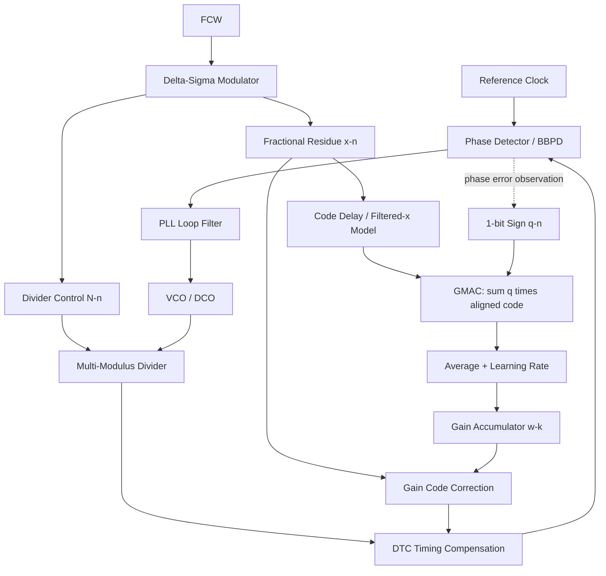
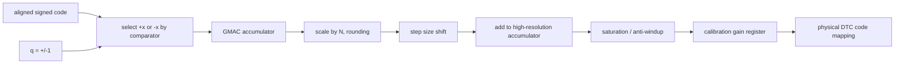
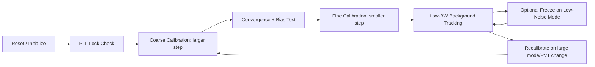

# LMS × Fractional-N PLL：完整互動教學與工程研究規格書

> **本文用途**：這是一份 **可直接交給 Claude Code** 的主規格文件。請以它建立可以在瀏覽器中閱讀、調參、繪圖、重新執行模擬與檢查公式的工程教學網站。內容分成「已推導的基礎」、「有明確假設的簡化模型」及「待建立/驗證的延伸研究」。不要把示例參數當成實際晶片規格，也不要把一階模型的穩定界限當成整顆 PLL 的 sign-off 結論。

## 導覽

- **Part A｜基礎數學**：1. 為何叫 LMS；2. MSE、MAE 與 Sign-LMS；3. 收斂、Mean Stability、Mean-Square Stability。
- **Part B｜PLL 校正實作**：4. Fractional-N PLL + DTC/GMAC 方塊圖；5. Comparator 雜訊下的資訊；6. PLL Error Path 與更新極性；7. Delay Alignment 與 Filtered-x；8. Calibration Phase Margin 與雙迴路耦合；9. Persistent Excitation；10. 多參數 LMS 與 Preconditioning。
- **Part C｜誤差與晶片限制**：11. Correlated Error / Bias / INL；12. Calibration Noise → PLL Phase Noise；13. Quantization / Limit Cycle / Dither / ΔΣ；14. Learning Rate / Accumulation Length 最佳化。
- **Part D｜驗證與實作**：15. Behavioral Models；16. RTL、Fixed Point 與 Sign-off；17. 已推導數值回歸測試。
- **Part E｜網站產品規格**：18. 網站頁面與交互圖；19. 軟體架構與可交付項目；20. 分階段實作計畫；21. Claude Code 主 Prompt。
- **附錄**：公式速查、假設/限制、術語、研究閱讀資料、待續研究題目。

## 0. 全文共用約定（非常重要）

為避免不同段落的符號、極性、單位打架，全部網站使用以下約定。

| 符號 | 意義 | 單位或註記 |
|---|---|---|
| $a$ | 理想校正係數/真實參數 | 依校正對象決定 |
| $w_k$ | 第 $k$ 個 GMAC Block 使用的校正係數 | 同 $a$ |
| $\delta_k=a-w_k$ | 剩餘參數誤差 | 注意極性 |
| $x[n]$ | 原始 DTC/DSM/PHOS/GOS regressor | 可正規化，通常有號 |
| $u[n]=(h*x)[n]$ | 經 PLL Error Path 到 PD 的有效 regressor | 和 PD Error 單位一致 |
| $e[n]$ | Comparator 前的 phase/time-equivalent error | fs 或 rad，不能混用 |
| $v[n]$ | Comparator 前雜訊 | 可為白雜訊、colored、相關雜訊 |
| $q[n]=\mathrm{sign}(e[n])$ | 1-bit Comparator 的雙極性輸出 | $+1/-1$；若硬體 0/1，先映射 $q=2b-1$ |
| $G_k$ | GMAC 一個 Block 的平均相關輸出 | $G_k=\frac1N\sum qx$，若實際硬體用總和要再乘 $N$ |
| $N$ | GMAC 每次更新前累加的樣本數 | 正整數 |
| $f_s$ | Comparator/Regressor 每秒取樣次數 | Hz；**不保證等於** $f_\mathrm{ref}$ |
| $f_u$ | Calibration Block Update Rate | 理想情況 $f_s/N$ |
| $\mu,\alpha$ | 學習率/更新係數 | 必須標示單位與 Scaling |
| $K_q$ | 1-bit Comparator 統計小訊號增益 | 若 PD 誤差為 fs，則 fs$^{-1}$ |
| $L(s)$ | 主 PLL 的開迴路增益 | 符號選擇與注入位置要明確 |
| $H_{\mathrm{PD}}$ | DTC 誤差到 PD residual 的轉移函數 | 簡化模型 $1/(1+L)$，注入點依架構核對 |
| $T=L/(1+L)$ | DTC 相位誤差到 PLL Output 相關的 closed-loop transfer | 加上除數/時間-相位縮放 |
| $\mathbf R$ | 有效 regressor 自相關矩陣 | $E[\mathbf u\mathbf u^T]$ |
| $\mathbf C$ | 原始與有效 regressor 交叉相關矩陣 | $E[\mathbf x\mathbf u^T]$；不必對稱 |
| $\mathbf J$ | GMAC 對校正係數的局部 Jacobian | $\partial E[\mathbf G]/\partial\mathbf w$ |

### 0.1 三層結論標籤

網站每個結論顯示一個簡單的文字標籤：

- **[精確｜指定模型]**：在條件說明的模型中可代數推導。
- **[近似｜需驗證]**：獨立性、Gaussian、小誤差、長時間平均或時間尺度分離後的近似。
- **[研究假說／延伸]**：需以 behavioral simulation、SPICE 或實測證明。

不要寫「LMS 一定穩定」；必須說明是 **平均收斂**、**均方穩定**、**機率性有界**、**局部線性穩定** 還是 **全域非線性**。

---

# Part A｜LMS 的數學基礎

## 1. LMS 為什麼叫 Least Mean Squares？

先用高中數學的黑盒子例子：

$$y=ax+v,\qquad \hat y=wx,\qquad e=y-\hat y.$$

其中 $a$ 不知道，$w$ 是我們可以修改的參數。希望根據一筆一筆進來的 $(x,y)$，逐步估計 $a$。

- **Least**：找出讓誤差指標最小的係數。
- **Mean**：看長期平均，而不是單次量測。
- **Squares**：用誤差平方，避免正負誤差互相抵消。

目標：

$$\boxed{J_2(w)=E[(y-wx)^2]},\quad w^*=\arg\min_w J_2(w).$$

「使用平方」並非唯一選擇；它的好處是對線性模型得到平滑的二次成本函數，易於求導、分析收斂與設計硬體。

### 1.1 公式從哪來？

將單筆成本定義為 $j_n=\tfrac12 e_n^2$：

$$\frac{\partial j_n}{\partial w}=-e_nx_n.$$

沿著負梯度更新，得到：

$$\boxed{w_{n+1}=w_n+\mu e_nx_n.}$$

LMS 是用**單筆隨機梯度估計**近似平均成本 $J_2$ 的 Gradient Descent，不是每次都直接求出全資料最佳解。

### 1.2 一個手算例子

真正 $y=3x$，初始 $w_0=1$，$x=2$，$y=6$，$\mu=0.1$：

- 第一次：$e_0=6-1\times2=4$，$w_1=1+0.1\times4\times2=1.8$。
- 第二次：$e_1=6-1.8\times2=2.4$，$w_2=1.8+0.1\times2.4\times2=2.28$。
- 固定 $x=2$ 時，$w$ 逐漸趨近 3（在適當步長下）。

**網站互動**：$a,w_0,x,\mu$ 可調；同步顯示資料流、誤差、Cost Curve、更新公式與逐步數值。

## 2. 為什麼用平方？可以用絕對值嗎？

**可以。** 使用哪種誤差定義，會改變演算法目標與更新規則。

### 2.1 MSE / L2

$$j_2=\frac12e^2\quad\Longrightarrow\quad\boxed{\Delta w=\mu ex}.$$

大型誤差帶來較大的更新，成本函數平滑。在某些 Gaussian Noise 模型下，平方誤差還具有適合的統計估計特性。

### 2.2 MAE / L1

$$j_1=|e|\quad\Longrightarrow\quad\boxed{\Delta w=\mu\,\mathrm{sign}(e)x}.$$

這是對絕對損失使用隨機（次）梯度的 Sign-Error LMS 形式。$e=0$ 處不具唯一導數，可用次梯度；硬體只需要 Error 的正負號。

### 2.3 三者必須區分

| 方法 | 更新量 | 只需 Error Sign？ | 注意 |
|---|---|---|---|
| Conventional LMS | $\mu ex$ | 否 | MSE，受 Outlier 較大影響 |
| Sign-Error LMS | $\mu\mathrm{sign}(e)x$ | 是 | MAE 目標，固定步長易在最佳值附近跳動 |
| Sign-Sign LMS | $\mu\mathrm{sign}(e)\mathrm{sign}(x)$ | 是 | 連 Regessor 幅度也丟掉，別和 Sign-Error 混淆 |

例子 $y=[0,0,0,10]$ 且只估一個常數 $w$：最小平方解為均值 2.5；最小絕對解可取中位數 0。**Outlier 抵抗能力與統計最佳解會改變。**

**網站互動**：畫 $e^2$、$|e|$、Huber Loss（後續可做），以相同資料比較參數更新與極端樣本的影響。

## 3. LMS 穩定性：先從固定輸入的確切解開始

無雜訊、固定非零 $x$：

$$e_n=(a-w_n)x.$$

代入 LMS 更新，令 $\delta_n=w_n-a$：

$$\boxed{\delta_{n+1}=(1-\mu x^2)\delta_n.}$$

定義離散 Pole：

$$p=1-\mu x^2.$$

若要所有初始誤差都趨近零：

$$|p|<1\quad\Longleftrightarrow\quad\boxed{0<\mu<\frac{2}{x^2}}.$$

- $0<p<1$：不變號、單調收斂。
- $-1<p<0$：正負交替、震盪收斂。
- $p=\pm1$：邊界，不保證收斂到 0。
- $|p|>1$：發散。

例子 $x=2$：$0<\mu<0.5$；$\mu=0.25$ 時 $p=0$，理想模型一步到答案。

### 3.1 隨機輸入：Mean 與 Mean-Square 不同

假設樣本 $x_n$ 為 iid、且和前一輪係數誤差獨立，定義 $P_x=E[x^2]$。

**平均誤差**：

$$E[\delta_{n+1}]=(1-\mu P_x)E[\delta_n]$$

得到平均收斂條件：

$$\boxed{0<\mu<\frac{2}{P_x}}.$$

**均方誤差**（先無外加量測雜訊）：

$$E[\delta_{n+1}^2]=E[(1-\mu x^2)^2]E[\delta_n^2].$$

要求二次矩衰減：

$$\boxed{0<\mu<\frac{2E[x^2]}{E[x^4]}}.$$

若 $x\sim\mathcal N(0,1)$，$E[x^2]=1$、$E[x^4]=3$：Mean Condition 為 $0<\mu<2$，Mean-Square Condition 更嚴格為 $0<\mu<2/3$。

**網站不可把平均 Pole 在 Unit Circle 內，直接標成「雜訊下完全穩定」。**

---

# Part B｜把 LMS 放進 Fractional-N PLL

## 4. 完整概念系統：DSM → DTC → PD → GMAC → Gain Update

> 此圖是用於教學與 Behavioral Modeling 的**架構參考**，不是特定晶片的已知 Netlist。請在網站中提供：PLL 主迴路、LMS 慢迴路、Noise 注入路徑、可開關的 DTC Nonlinearity。



### 4.1 硬體對應

| 主要元件 | 功能 | 硬體概念 |
|---|---|---|
| Fractional Residue Generator | 用 FCW、DSM divider sequence 推得欲補償之 phase/time residue | Counter、Accumulator、Fixed-Point |
| DTC | Code → Delay | Analog delay / interpolation |
| PD / BBPD | 觀察 residual phase error | 類比相位檢測，可能含 comparator |
| Code Alignment | 匹配 PD Error 的樣本來源與延遲 | Pipeline/FIFO/Tap MUX |
| GMAC | $\sum qx$ | 若 $q=\pm1$，可用有條件取負與加法器取代一般乘法 |
| Normalize | $\sum$ / $N$、shift、gain scale | Arithmetic Shift、rounding |
| Gain Accumulator | 更新 $w$，保留足夠 fractional bits | 加法器、暫存器、飽和 |
| Correction DAC/DTC | 用 $w$ 修正 Delay Mapping | Multiplier / LUT / Control Logic |

需明確標示不同 Clock Domains 與 Latency：sample clock、GMAC block、gain commit，以及何時新的 gain 真正反映到 PD。

### 4.2 RTL 級資料流



GMAC **直接累加總和**與**計算平均值**差 $N$ 倍有效增益。網站必須讓使用者選擇 sum/average，並顯示對 stability 的影響。

## 5. 1-bit Comparator：1 fs Error 埋在 100 fs RMS Noise 裡還有資訊嗎？

假設：

$$e=s+v,\qquad v\sim\mathcal N(0,\sigma_v^2),\qquad q=\mathrm{sign}(e).$$

則：

$$P(q=+1)=\Phi\left(\frac{s}{\sigma_v}\right),$$

$$\boxed{E[q]=2\Phi(s/\sigma_v)-1=\mathrm{erf}\left(\frac{s}{\sqrt2\sigma_v}\right)}.$$

若 $s=1\,\mathrm{fs}$、$\sigma_v=100\,\mathrm{fs}$：

- $P(+1)\approx50.3989\%$，$P(-1)\approx49.6011\%$。
- $E[q]\approx0.0079787$，不是零。
- 單次結果幾乎隨機，但多次累加可保留統計方向資訊。

對 $G_N=\sum_{i=1}^Nq_i$，若樣本獨立，令 $m=E[q]$：

$$E[G_N]=Nm,\quad \mathrm{Var}(G_N)=N(1-m^2).$$

中央極限定理近似：

$$P(G_N>0)\approx\Phi\left(\frac{m\sqrt N}{\sqrt{1-m^2}}\right).$$

| $N$ | 正確辨識固定正 Error 方向的近似機率 |
|---:|---:|
| 100 | 53.2% |
| 1,000 | 60.0% |
| 10,000 | 78.8% |
| 約 42,500 | 95% |
| 約 85,000 | 99% |

**限定**：這是在辨識**一個固定的非零偏移之符號**，不是完整 LMS Loop 在 $N$ 次後收斂的機率。若 Noise 有時間相關、Comparator Offset 或 Sample Correlation，不能直接使用這些數字。

### 5.1 Comparator 等效小訊號增益

當 $|s|\ll\sigma_v$：

$$\boxed{E[q]\approx K_qs,\qquad K_q=\sqrt{\frac2\pi}\frac1{\sigma_v}.}$$

對 $\sigma_v=100\,\mathrm{fs}$：

$$K_q\approx0.00797885\,\mathrm{fs}^{-1}.$$

這個結果很有意思：適當的連續雜訊讓 Comparator 的**平均**輸出在零附近成為可微的 S 曲線；但雜訊越大，局部斜率越小，估計所需樣本越多。不能因為 dither 可改善某些量化非線性，就推論越多雜訊越好。

**網站互動**：Gaussian 分布、Comparator Threshold、$s/\sigma_v$、樣本數、正確率；動畫顯示每個 $q_i$ 累加與信賴區間。

## 6. PLL Error Transfer Function 的 Phase Shift 會讓 LMS 發散嗎？

會，在正規化的慢速單參數模型中，PLL Phase Shift 有機會讓相關增益**變號**，導致更新方向從負回授變正回授。

令：

$$e_{\mathrm{DTC}}[n]=(a-w)x[n],\qquad u[n]=(h*x)[n].$$

在 PD 量到：

$$e_{\mathrm{PD}}[n]=(a-w)u[n]+v[n].$$

若 GMAC 使用**原始** $x$：

$$G\approx K_q(a-w)\underbrace{E[xu]}_{C}.$$

等效更新 Pole：

$$\boxed{p=1-\mu K_qC.}$$

- $C>0$：正 Learning Rate 存在局部平均收斂區間。
- $C=0$：沒有平均恢復力，資訊不足（Noise 下可漂移）。
- $C<0$：正 Learning Rate 造成反向更新，局部平均發散；**只減小 Learning Rate 不會改變符號**。

### 6.1 單頻例子

若 $x[n]=A\cos(\Omega n)$，$H(e^{j\Omega})=|H|e^{j\phi}$：

$$\boxed{E[xu]=\frac{A^2}{2}|H|\cos\phi.}$$

相位 0° 正常；60° 有效增益減半；90° 變零；120° 變負。**這裡的 ±90° 是單頻相關性符號界線，不等於傳統 Bode Phase Margin。**

例如二階 Type-II 風格的簡化誤差傳遞函數：

$$H_{\mathrm{PD}}(s)=\frac{s^2}{s^2+2\zeta\omega_ns+\omega_n^2},\quad \zeta=0.7.$$

在 $\omega=0.3\omega_n$，$H\approx-0.0815+j0.0376$，相位約 $155.2^\circ$，實部為負。**主 PLL 自身穩定**不保證未補償的原始 Code LMS 更新方向正確。

### 6.2 多頻輸入的正確判據

若 $x$ 為廣義平穩、LTI 路徑穩定：

$$\boxed{C=\frac1{2\pi}\int_{-\pi}^{\pi}S_{xx}(e^{j\Omega})\operatorname{Re}\{H_{\mathrm{PD}}(e^{j\Omega})\}\,d\Omega.}$$

因此是 PSD、Magnitude、Phase 的**加權總和**，不是只看某個頻率的 PM。真正 DSM 循環週期會有離散譜線；網站要能分析 FFT/週期性估計以及有限樣本相關值。

## 7. Delay Alignment vs. Filtered-x LMS

**Delay Alignment**：GMAC 改用 $x_D[n]=x[n-D]$，則單頻時：

$$\boxed{C_D=\frac{A^2}{2}|H|\cos(\phi+\Omega D).}$$

若 $\phi=-120^\circ$，$\Omega=30^\circ/\mathrm{sample}$，選 $D=4$：總相位為 0°，相關性轉正。但同一 Delay 對別的頻率不一定有效。

多頻：

$$C_D=\frac1{2\pi}\int_{-\pi}^{\pi}S_{xx}(\Omega)\operatorname{Re}\{H_{\mathrm{PD}}(\Omega)e^{j\Omega D}\}\,d\Omega.$$

**Filtered-x**：用 $u[n]=H_{\mathrm{PD}}x[n]$，或模型 $u_f[n]=\hat Hx[n]$，作為 GMAC 的 Regressor：

$$w_{k+1}=w_k+\mu E[q[n]u_f[n]].$$

若 $\hat H=H$，小誤差下：

$$E[qu]\approx K_q(a-w)E[u^2],\qquad E[u^2]\ge0.$$

這能修正原始 Code 與有效 Error Path 不對齊的 Gradient；但模型不精確、無激勵能量、長延遲時，仍有穩定性/速度/Noise 問題。

**網站互動**：疊畫 $x$、$u$、$x_D$、$u_f$、相關性 vs. Delay、FCW 模擬；提供「raw-x / delayed-x / filtered-x」三模式切換。

## 8. 「更新極性裕度」與真正 Calibration Phase Margin 是兩種不同概念

### 8.1 單頻 Polarity Margin（自行定義的工程指標）

在 $\theta=\phi+\Omega D$ 的單頻模型，局部恢復力要求 $\cos\theta>0$。

$$M_{\mathrm{polarity}}=90^\circ-|\mathrm{wrap}_{180}(\theta)|.$$

若 $M_{\mathrm{polarity}}<0$，原極性不合；例如目標至少 45° 只是可選**設計守則**，非通用保證。

### 8.2 LMS 的真正 Open-Loop Transfer

若 $G_k=K(a-w_k)$，$K>0$，且：

$$w_{k+1}=w_k+\mu G_k,$$

以 GMAC **Block Rate** 的 Z Transform 得：

$$\boxed{L_{\mathrm{cal}}(z)=\frac{g}{z-1},\qquad g=\mu K.}$$

對 $0<g<2$：

$$\boxed{PM_{\mathrm{cal}}=90^\circ-\sin^{-1}(g/2).}$$

| $g$ | Pole $1-g$ | PM |
|---:|---:|---:|
| 0.2 | 0.8 | 84.3° |
| 0.5 | 0.5 | 75.5° |
| 1.0 | 0 | 60.0° |
| 1.5 | −0.5 | 41.4° |
| 1.8 | −0.8 | 25.8° |
| 2.0 | −1 | 0°，臨界 |

$PM\ge60^\circ$ 對這個理想模型相當於 $g\le1$；但實際需要另外檢查低恢復力、Noise、Bias 與輸入激勵。

### 8.3 更新延遲會縮小穩定範圍

若 GMAC $d$ 個整個 Block 的純延遲才作用於參數：

$$\delta_{k+1}=\delta_k-g\delta_{k-d}.$$

| $d$ | 穩定正增益範圍（指定模型） |
|---:|---|
| 0 | $0<g<2$ |
| 1 | $0<g<1$ |
| 2 | $0<g<2\sin(\pi/10)\approx0.618$ |

一般純延遲模型的臨界 $g=2\sin\{\pi/(4d+2)\}$；只對這一特定特徵方程有效。真實 GMAC Pipeline 必須定義 sample/commit/apply timing，不能簡單猜 $d$。

### 8.4 主 PLL 與 LMS 的耦合／時間尺度分離

用最簡單二維觀測狀態：

$$s_{k+1}=rs_k+b\delta_k,\qquad \delta_{k+1}=\delta_k-\mu cs_k.$$

$$\boxed{\begin{bmatrix}s_{k+1}\\\delta_{k+1}\end{bmatrix}=\begin{bmatrix}r&b\\-\mu c&1\end{bmatrix}\begin{bmatrix}s_k\\\delta_k\end{bmatrix}.}$$

範例 $r=0.8,b=0.2,c=1$：若假設觀測已完全穩態，得到 $s=\delta$，一階模型認為 $0<\mu<2$。但真正特徵方程是：

$$z^2-1.8z+0.8+0.2\mu=0.$$

完整模型的範圍為 $0<\mu<1$；$\mu=1.2$ 時極點 $0.9\pm j0.4796$，$|z|=\sqrt{1.04}>1$，**完整模型發散**。

這個 $s$ 是抽象觀測狀態，不是特定 PLL VCO 控制電壓。一般化：

$$\begin{aligned}
\mathbf s_{k+1}&=\mathbf A\mathbf s_k+\mathbf B\delta_k,\\
G_k&=\mathbf C\mathbf s_k+D\delta_k,\\
\delta_{k+1}&=\delta_k-\mu G_k.
\end{aligned}$$

$$\boxed{\mathbf A_{\mathrm{combined}}=\begin{bmatrix}\mathbf A&\mathbf B\\-\mu\mathbf C&1-\mu D\end{bmatrix}.}$$

需檢查 $\rho(\mathbf A_{\mathrm{combined}})<1$。對應動態：

$$F(z)=D+\mathbf C(z\mathbf I-\mathbf A)^{-1}\mathbf B,$$

$$\boxed{L_{\mathrm{cal}}(z)=\frac{\mu F(z)}{z-1}.}$$

**網站互動**：簡化/完整兩模型同時顯示 Poles、Unit Circle、step response、PM；使用者控制 $r,b,c,\mu$。


## 9. Persistent Excitation：迴路穩定，不代表學得到每個參數

單一參數 LMS 即使有正確更新方向，也需要輸入能量；多參數 LMS 還需要**不同參數造成的 Error 可以被區分**。

令：

$$e[n]=\mathbf u^T[n](\mathbf a-\mathbf w)+v[n],\qquad\mathbf R=E[\mathbf u\mathbf u^T].$$

理想匹配的平均 LMS：

$$\boxed{\boldsymbol\delta_{k+1}=(\mathbf I-\mu\mathbf R)\boldsymbol\delta_k.}$$

沿著第 $i$ 個 Eigenvector，Pole 為：

$$\boxed{p_i=1-\mu\lambda_i(\mathbf R).}$$

**例子**：$\mathbf R=\begin{bmatrix}1&\rho\\\rho&1\end{bmatrix}$，Eigenvalues 是 $1+\rho$ 與 $1-\rho$。$\rho=0.99,\mu=0.5$ 時：

- $\lambda_{\max}=1.99$，快速 Pole = 0.005。
- $\lambda_{\min}=0.01$，慢速 Pole = 0.995。
- 慢模式誤差要衰減 95%，約需 $\lceil\log(0.05)/\log(0.995)\rceil=598$ 次更新。

若 $\rho=1$，一個 Eigenvalue 為 0，對應參數方向完全無法辨識。

### 9.1 Persistent Excitation 的有限窗口定義

存在窗口長度 $N_0$ 及常數 $\alpha,\beta>0$，對所有 $k$：

$$\boxed{\alpha\mathbf I\preceq\sum_{n=k}^{k+N_0-1}\mathbf u[n]\mathbf u^T[n]\preceq\beta\mathbf I.}$$

實際 Behavioral Model 可以輸出滑動窗口：

$$\mathbf R_k=\frac1{N_0}\sum_{n=k}^{k+N_0-1}\mathbf u[n]\mathbf u^T[n]$$

及 $\lambda_{\min}(\mathbf R_k)$、$\kappa(\mathbf R_k)$、Singular Values。只測某個有限時間段，不能證明所有未來窗口必定滿足 PE。

### 9.2 GOS / PHOS 的 Common-Mode Gauge Freedom

假設四個 One-Hot Phase Offsets $a_0\ldots a_3$，還有 Global Offset $b$：

$$y=b+\sum_{i=0}^3a_ix_i,\quad \sum_i x_i=1.$$

若 $b'=b+c$、$a_i'=a_i-c$，則 $y$ 完全不變。這代表 **Global Offset 與四個 One-Hot Offset 不可同時唯一辨識**，不是累加樣本不夠。

處理方式：固定一個 Phase 當 Reference、強制 $\sum_i a_i=0$，或加入能獨立觀察 Global Offset 的路徑。PLL DC Error Suppression 可能使 Common-Mode 更難觀察。

**網站互動**：二係數 Correlation Ellipse、Eigenvectors、$\rho$ Slider、慢速/快速模式的收斂；四相 One-Hot 小實驗證明多組不同參數卻同樣輸出。

## 10. 多參數 Sign-LMS、Jacobian 與 Preconditioner

若 $\mathbf G\approx K_q\mathbf R(\mathbf a-\mathbf w)$，三種參數的 GMAC 會互相耦合。即使 $w_1$ 正確，只要 $R_{12}\ne0$ 且 $w_2$ 錯誤，$G_1$ 還可能不為 0。

一般更新：

$$\mathbf w_{k+1}=\mathbf w_k+\mathbf M\mathbf G_k.$$

- 原始 LMS：$\mathbf M=\mu\mathbf I$。
- 分別設定不同 Learning Rate：$\mathbf M=\mathrm{diag}(\mu_1,\ldots,\mu_M)$。
- 理想 Preconditioning：$\mathbf M=\gamma(K_q\mathbf R)^{-1}$，在 $\mathbf R$ 正定且模型匹配時，平均參數 Pole 全為 $1-\gamma$。
- Noise Robust Preconditioning：可使用 $(\mathbf R+\lambda\mathbf I)^{-1}$ 或對 Jacobian 使用 Regularized Pseudoinverse。

### 10.1 強耦合的實際代價

若 $\mathbf R=\begin{bmatrix}1&0.99\\0.99&1\end{bmatrix}$，一般 LMS $\mu=0.5$ 的慢模式 Pole 為 0.995（約 598 次才下降 95%）；取 $\mathbf M=0.5\mathbf R^{-1}$ 時，所有模式 Pole 為 0.5（5 次下降 95%），但反矩陣元素約 $\pm25$，很容易放大 GMAC Noise。

在理想獨立、高斯、近平衡模型且 $\mathrm{Cov}(\eta)\approx\mathbf R/N$ 時，完整 Preconditioning 第 $i$ 個模式的穩態變異：

$$\boxed{\mathrm{Var}(\delta_i)\approx\frac{\gamma}{K_q^2N\lambda_i(2-\gamma)}.}$$

若 $\lambda_i\to0$，係數估計越敏感；$\lambda_i=0$ 則無法求逆。**Preconditioner 可以加速，但不能製造缺失的資訊。**

### 10.2 比理想 R 更實際的是量測 Jacobian

先 Freeze Gain，在相同 Operating Condition 下分別 perturb 每個校正參數：

$$\boxed{J_{ij}\approx\frac{G_i(\mathbf w+\Delta_j\mathbf e_j)-G_i(\mathbf w-\Delta_j\mathbf e_j)}{2\Delta_j}.}$$

線性化：

$$\mathbf G(\mathbf w)\approx\mathbf J(\mathbf w-\mathbf w^*),$$

$$\boxed{\mathbf A_{\mathrm{cal}}=\mathbf I+\mathbf M\mathbf J.}$$

可以用：

$$\boxed{\mathbf M=-\gamma(\mathbf J^T\mathbf J+\lambda\mathbf I)^{-1}\mathbf J^T.}$$

Jacobian 若在固定點附近有效，該 Regularized Pseudoinverse 的每個非零 Singular Value $\sigma_i$ 對應平均 Pole：

$$p_i=1-\gamma\frac{\sigma_i^2}{\sigma_i^2+\lambda}.$$

**反例**：$\mathbf J=\begin{bmatrix}-1&2\\2&-1\end{bmatrix}$，對角都負，但特徵值是 $+1,-3$；$\mathbf M=0.2\mathbf I$ 產生 Pole 1.2、0.4，因此一起更新時發散。**每個 loop 單獨穩定不代表 MIMO 一起穩定。**

### 10.3 三種架構比較

| 方法 | 特色 | 硬體代價／限制 |
|---|---|---|
| Scalar LMS / independent gains | 最簡單 | Eigenvalue Spread 很大時慢，易 Cross-Coupling |
| NLMS / Sign-NLMS | 對 regressor 的能量做正規化 | 不會自動使高度相關的 regressors 可辨識 |
| Regularized Preconditioner | 抑制耦合、控制 Noise Amplification | Matrix/LUT、定點量化、Corners 的模型誤差 |
| Sequential Calibration | GOS、PHOS、DTC 分階段 | 可能錯把不可辨識誤差歸給先校正的參數 |

**網站互動**：2×2 / 3×3 Matrix Inspector；顯示 Eigen/Singular Values、更新方向、Covariance Ellipse、原始/Regularized/Sequential 的收斂速度及 Noise Penalty。

---

# Part C｜真實電路中的 Noise、Bias、量化與 Spurs

## 11. GMAC 歸零不代表 DTC Error 為零

總誤差模型（在本段假設 PLL 動態已吸收到誤差路徑；先用靜態表達）：

$$e[n]=(a-w)x[n]+b+d(x[n])+u[n]+v[n].$$

- $b$：Static PD/Comparator Offset。
- $d(x)$：DTC INL、Code-Dependent Delay。
- $u$：與 DSM、PLL、Supply 或 Clock Phase Pattern 相關的誤差。
- $v$：與 Code 不相關的 Random Noise。

在高斯 Noise 主導且小誤差時，Sign-LMS 的 GMAC 固定點近似：

$$0\approx(a-w^*)E[x^2]+bE[x]+E[xd(x)]+E[xu].$$

因此：

$$\boxed{w^*=a+\frac{bE[x]+E[xd(x)]+E[xu]}{E[x^2]}.}$$

這個結果說明：**穩定收斂也可能帶有偏差**，而且 GMAC 只知道 Error 與 Code 的相關性，並不知道誤差的物理來源。

### 11.1 Comparator Offset 的假 Gain Bias

$$w^*=a+b\frac{E[x]}{E[x^2]}.$$

若 regressor 均值非零，Offset 可能被 LMS 當成 Gain Mismatch。Code Centering 可以降低這種交叉耦合，但必須正確變換 DTC 的 Offset/Gain Parameterization；Comparator 若飽和，中心化也不能自動解決。

### 11.2 DTC 三階非線性

假設：

$$e=(a-w)x+cx^3,\quad a=1,c=0.1,$$

$x$ 等機率取 $\{-2,-1,0,1,2\}$，$E[x^2]=2$、$E[x^4]=6.8$。

$$w^*=a+c\frac{E[x^4]}{E[x^2]}=1.34.$$

真實線性 Gain 是 1，但單係數 LMS 的最佳擬合 Gain 是 1.34。這是**可解釋的最小化結果**，不是隨機發散：

$$E[xe]=0\quad\not\Rightarrow\quad e[n]=0.$$

### 11.3 Code-Correlated Jitter 與 Identifiability

若 $u[n]=cx[n]$，則 $E[xu]=cE[x^2]$，得到 $w^*=a+c$。單一觀測路徑無法把這個干擾和真實 Gain 分開；應額外設計 Training、額外觀測者或 Parameter Constraints。

### 11.4 Near-Integer / Near-Grid

FCW 影響 DSM Residue 分布、頻譜與有效相關增益。若 $C(\mathrm{FCW})\to0$，而干擾 Bias $B$ 不為零，線性化固定點 $w^*=a+B/C$ 可能異常敏感。Near-Grid 不應只以固定 ppm 概括，應同時檢查：

1. 有效 GMAC Sensitivity / Polarity。
2. PE 的最小 Eigenvalue。
3. Gain Bias、Calibration Noise、收斂時間。
4. Fractional Spur / Output Jitter。

**實驗建議**：FCW Sweep → Freeze Gain → 做 $w\pm\Delta$ → 求 GMAC 斜率 $S=\partial E[G]/\partial w$，搭配信賴區間及真實閉環測試。

## 12. Comparator Noise 如何經 LMS 變成 PLL Jitter / Spurs？

接近最佳 Gain，定義 $\delta w_k=w_k-w^*$：

$$G_k\approx-K\delta w_k+\eta_k.$$

$$\boxed{\delta w_{k+1}=p\delta w_k+\mu\eta_k,\quad p=1-\mu K.}$$

若 $\eta_k$ 是廣義平穩雜訊，忽略初始狀態：

$$\boxed{H_{\eta\to w}(z)=\frac{\mu}{z-p}=\frac{\mu z^{-1}}{1-pz^{-1}}.}$$

$$\boxed{S_w(e^{j\Omega})=\frac{\mu^2}{|1-pe^{-j\Omega}|^2}S_\eta(e^{j\Omega}).}$$

若 $0<p<1$，係數 Noise Transfer 呈 Low-Pass。$p\approx1$ 時、$f_u=f_s/N$：

$$f_{\mathrm{cal,BW}}\approx\frac{1-p}{2\pi}f_u\approx\frac{-\ln p}{2\pi}f_u.$$

當 $p$ 不夠靠近 1 時，應使用 exact discrete-time −3 dB 頻率，而不是把近似硬套。

### 12.1 白色 GMAC Noise 下的穩態變異

若 $\eta_k$ iid、方差 $\sigma_\eta^2$，且 $|p|<1$：

$$\boxed{\sigma_w^2=\frac{\mu^2\sigma_\eta^2}{1-p^2}.}$$

在正規化、獨立、近平衡 Sign-GMAC 例子可近似 $\sigma_\eta^2=1/N$。

**示例**：$f_s=4$ GHz、$N=4096$、$\mu=10$ fs、$\sigma_v=100$ fs、$E[x^2]=C=1$：

- $K=\sqrt{2/\pi}/100\approx0.00797885$ fs$^{-1}$。
- $p=1-\mu K\approx0.92021$。
- $f_u=4\,\mathrm{GHz}/4096\approx976.56$ kHz。
- 校正 Noise BW 約 12.9 kHz（近似）。
- $\sigma_w=\mu/\sqrt{N(1-p^2)}\approx0.399$ fs。

**0.399 fs 是 Gain-Equivalent Noise，不是直接可宣稱的 Output Jitter。**

### 12.2 Gain Noise × DSM Code：頻譜混合

真正注入 DTC 的 Timing Error：

$$\boxed{\delta t[n]=x[n]\delta w[n].}$$

若 $x(t)=A\cos(2\pi f_xt)$、$\delta w(t)=B\cos(2\pi f_wt)$，則：

$$\boxed{\delta t(t)=\frac{AB}{2}[\cos2\pi(f_x+f_w)t+\cos2\pi(f_x-f_w)t].}$$

若 $x$ 與 $\delta w$ 是**獨立、零均值、廣義平穩**的離散時間過程，則：

$$R_{\delta t}[\ell]=R_x[\ell]R_w[\ell]$$

$$\boxed{S_{\delta t}(e^{j\Omega})=\frac1{2\pi}\int_{-\pi}^{\pi}S_x(e^{j\nu})S_w(e^{j(\Omega-\nu)})\,d\nu.}$$

若 Code 有 DC：$x=m+\tilde x$，則存在 $m\delta w$ 的低頻直接項。真正 LMS 中 $x$ 與 $\delta w$ 不必獨立，GMAC Rate 與 DTC Sample Rate 也不同；正式模擬須使用完整 joint / cyclostationary / multirate 模型。

### 12.3 PD High-Pass 與 PLL Output Low-Pass 不能混淆

若 DTC phase error 在 Feedback Comparison Path 注入，簡化平均線性 PLL：

$$\boxed{H_{\mathrm{PD}}(s)=\frac1{1+L(s)},\qquad T(s)=\frac{L(s)}{1+L(s)}.}$$

DTC Time Error 到 Output Phase（在此注入極性約定下）：

$$\boxed{\phi_{\mathrm{out}}(s)=-2\pi f_{\mathrm{out}}T(s)\delta t(s).}$$

同一份 DTC 擾動，對 PD residual 可能是 High-Pass，但對 PLL Output 相位通常經過類似 Low-Pass 的 $T(s)$。**PD Error 小不等於 Output Noise 小。**

使用一致的單邊 PSD 定義：

$$\boxed{S_{\phi,\mathrm{out}}^{(1)}(f)=(2\pi f_{\mathrm{out}})^2|T(f)|^2S_{\delta t}^{(1)}(f).}$$

$$\mathcal L(f)\approx10\log_{10}\left(S_{\phi,\mathrm{out}}^{(1)}(f)/2\right)\quad\mathrm{dBc/Hz}.$$

$$\boxed{\sigma_{t,\mathrm{out}}^2=\int_{f_L}^{f_H}|T(f)|^2S_{\delta t}^{(1)}(f)df.}$$

這裡的 $S_{\delta t}$ 已是 time-jitter PSD；進行 Output Timing Jitter 換算時，相位尺度因子會抵消。直接 PD Noise 路徑與 LMS 間可能相關，完整 Noise Budget 要包含 Cross-Spectrum。

### 12.4 Spur 範例（不是實測）

$f_{\mathrm{out}}=13$ GHz，$x(t)=\cos(2\pi100\mathrm{kHz}t)$，係數週期擾動 $\delta w(t)=1\,\mathrm{fs}\cos(2\pi10\mathrm{kHz}t)$。

輸出 DTC Timing Error 在 90 kHz、110 kHz 各有 **0.5 fs peak**。若 $|T|\approx1$：

$$\beta=2\pi\cdot13\,\mathrm{GHz}\cdot0.5\,\mathrm{fs}\approx4.08\times10^{-5}\,\mathrm{rad}.$$

小角相位調變，每個單邊 Spur：

$$\boxed{20\log_{10}(\beta/2)\approx-93.8\,\mathrm{dBc}.}$$

**重要區別**：隨機係數波動通常造成噪音裙擺／展寬，不一定生成離散 Spur；Spur 需要相干或週期性成分。

## 13. 校正係數只有 6-bit：Quantization、Limit Cycle、Dither、Noise Shaping

> **這章是之前答應繼續研究、現在補齊的核心內容。** 可先做可運行的簡化數值實驗，再逐步加到 Fractional-N PLL。

假設理想最佳 Gain：

$$w^*=32.4\,\mathrm{LSB},\qquad w_{\mathrm{physical}}\in\{0,1,\dots,63\}.$$

### 13.1 方法 A：Freeze 在最近的 Code

選 $w=32$，Static Error 為 $-0.4$ LSB。優點是沒有 Code Toggle Noise；缺點是系統性 Gain Error 會與 DSM Residue 相乘，產生 residual phase error、甚至 periodic Spurs。

### 13.2 方法 B：在 32 與 33 之間切換

若用周期 5 的序列 $[32,32,33,32,33]$，平均：

$$\overline w=(3\cdot32+2\cdot33)/5=32.4.$$

雖然 **平均 Gain 正確**，但五週期 Toggle 帶有 $f_{\mathrm{toggle}}/5$ 及其諧波成分，這些成分再與 DSM Code 相乘，可能出現 Spurs。平均正確不等於頻譜理想。

### 13.3 方法 C：Stochastic Rounding / 隨機切換

以 0.4 機率輸出 33、0.6 機率輸出 32：

$$E[w_Q]=32.4,\quad\mathrm{Var}(w_Q)=0.4(0.6)=0.24\,\mathrm{LSB}^2.$$

若每次獨立，量化偏差平均為零，卻引入 RMS $\sqrt{0.24}\approx0.490$ LSB 的 Code Noise。可降低強烈的決定性音調，但提升背景雜訊；有限長度 PRBS 仍可能產生週期音調。

### 13.4 方法 D：高解析度內部 Accumulator + 1st-order ΔΣ Quantizer

保留高精度內部目標 $w_H[n]$，物理輸出只有 6-bit。理想化一階 Error-Feedback Quantizer：

$$\begin{aligned}
 v[n]&=w_H[n]+r[n-1],\\
 y[n]&=Q_6(v[n]),\\
 r[n]&=v[n]-y[n].
\end{aligned}$$

因此：

$$\boxed{y[n]=w_H[n]+r[n-1]-r[n].}$$

把 $r$ 當成有界的內部量化誤差，輸出誤差含有 $1-z^{-1}$ 的一階 High-Pass 特性（Noise-Transfer Function 觀點）；**但這個等式本身不保證 $r$ 是白雜訊，也不保證沒有 Limit Cycle**。常數有理輸入時，仍可能產生週期性序列。

### 13.5 Dither + Noise Shaping 不一定勝過 Freeze

要判斷是否適合，至少比較：

1. **Static Residual Gain Error**（Freeze 的弱點）。
2. **Output Spur**（決定性 Toggle / Limit Cycle）。
3. **Output Integrated Jitter**（Stochastic Rounding / Dither 的代價）。
4. **PVT Tracking Ability**（Freeze 無法即時追蹤）。
5. **量化輸出作用頻率**（每個 Reference Cycle 改變、或每個 GMAC Block 改變，結果非常不同）。
6. **PLL $T(f)$ 與 DSM Residue 相乘後的 Mixing**（量化誤差可能被搬回通帶）。

**完整推薦實驗**：相同 $w^*=32.4$、相同 DSM 序列、相同 Noise Seeds 下，比較 5 種策略：nearest-freeze、deterministic-toggle、stochastic-rounding、1st-order noise shaping、noise-shaping + dither。提供 code trace、PSD、spur table、integrated jitter、偏差與追蹤速度。

### 13.6 工程上必須額外處理的非理想

- 6-bit Code Saturation、Wrap vs. Saturate、Anti-Windup。
- 內部 accumulator 高精度但實體控制只有 6-bit 時，是否存在 Dead Zone。
- Rounding、Truncation、Stochastic Rounding 的差別。
- DTC glitch / switching kick / code-dependent settling；toggle 會增加動態干擾。
- 兩個 Clock Domains，更新頻率是否造成 aliasing。
- dither randomness、PRBS 長度、initial seed、定點寄存器溢位。
- 高階 ΔΣ 的 stability / overload 必須單獨驗證，不能直接套用一階公式。

**網站互動**：6-bit DAC Code 示波圖、內部高解析 accumulator、直方圖、FFT、PSD、Limit Cycle Period Detector、Spur 標記、Freeze/Track 切換。

## 14. 如何設計 Learning Rate、Accumulation Length、Tracking Schedule？

在單一參數、近鎖定、Block Noise iid 的模型，令 $g=\mu K$，$p=1-g$，初始誤差 $\delta_0$，執行 $B$ 次 GMAC Block：

$$\boxed{E[\delta_B^2]\approx\delta_0^2p^{2B}+\frac{\mu^2\sigma_\eta^2(1-p^{2B})}{1-p^2}.}$$

第一項：初始誤差還沒有收斂。第二項：更新 Noise。先要求局部穩定，再在總樣本 Budget $NB$ 下最佳化最終 RMS。

**注意優化目標不同，最佳 $\mu$ 也不同：**最快初期收斂、最小終點 RMS、最小全程積分誤差、最小 Output Spur、最佳 PVT 追蹤並不是同一個問題。

### 14.1 Corner-Based 的可行區間

若固定更新極性 $K_i=-\partial E[G_i]/\partial w>0$，並在理想一階無額外延遲模型中，要求 $B$ 次更新將平均誤差降至 $\epsilon$：

$$\mu\ge\frac{1-\epsilon^{1/B}}{K_{\min}}\qquad(0<\mu K_i\le1).$$

若額外要求理想模型 $PM\ge60^\circ$，則 $\mu\le1/K_{\max}$。

$$\boxed{\frac{1-\epsilon^{1/B}}{K_{\min}}\le\mu\le\frac1{K_{\max}}.}$$

如果沒有交集，就不是單純「找個更好的 $\mu$」；可能需要延長時間、改善 PE、變動步長、降低延遲或更動相關器架構。

### 14.2 建議的 Calibration State Machine



需要設計 hysteresis、mode change guard、lock detect、max update、clip detection、bad-FCW policy、退回上次已知良好係數的恢復策略。

---
# Part D｜Behavioral Model、RTL 與自動驗證

## 15. Behavioral Model：每一層應怎麼寫、怎麼驗證？

### 15.1 對應真實硬體的模型層級

| Level | 模型 | 時間基準 | 要驗證的能力 |
|---|---|---|---|
| L0 | Scalar exact LMS / Sign-Error LMS | 每 Sample | MSE/MAE、固定 x、一步更新 |
| L1 | Block GMAC + Gaussian Comparator | 每 Sample + Block | $N$、$\mu$、統計增益、sample correlation |
| L2 | DTC Residue + $H_{\mathrm{PD}}$ / $T$ | Reference / Comparator Clock | Phase Shift、Delay Alignment、Polarity、FCW |
| L3 | Multi-Parameter GOS/PHOS/Gain + Jacobian | Sample + Block | PE、Cross-Coupling、SVD、Preconditioner |
| L4 | Noise PSD + Output Timing Error + Jitter | 多速率 | Phase Noise、Spur、相干性、Output Transfer |
| L5 | Quantized / RTL-like Control | 精確 clock cycles | overflow、rounding、update latency、limit cycle |
| L6 | Advanced reference PLL / DSM / FCW | PLL time step 或 reference events | 周期性、fractional pattern、仿真與物理模型比對 |

**一定要分清楚「教學用的 L0~L2」和「可做架構 sign-off 的 L4~L6」。** 可用簡化解析模型當作下限或 sanity check，但不能冒稱與 Spectre/AMS 完全等效。

### 15.2 最小 Block Sign-LMS 參考模型（偽程式，可做 Python 實作）

```python
# All time quantities in fs. Code/regressor normalized.
# q is bipolar +/-1, not 0/1.
for k in range(num_updates):
    gm = 0.0
    for n in range(N):
        x = code_generator.next()
        u = pll_pd_error_path.filter(x)        # use physically modeled path
        e = (a_true - w) * u + noise_source.next()
        q = +1.0 if e >= 0 else -1.0
        x_ref = aligned_or_filtered_regressor(x, u)
        gm += q * x_ref
    G = gm / N
    w = saturate_or_update_high_precision(w + mu * G)
    record(k, w, G)
```

上面的 `pll_pd_error_path.filter()` 只是示意；真實 PLL 是狀態持續的動態系統，不能每個 Block 任意重置濾波器。對誤差量化、非線性 DTC、DSM、主 PLL 回授要使用一致的 event timeline。

### 15.3 需提供的模型參數

建議網站支援 JSON 載入、修改與儲存：

```json
{
  "model": "sign_error_block_lms",
  "seed": 20261010,
  "units": { "time": "fs", "frequency": "Hz" },
  "sample_rate_hz": 4000000000,
  "output_frequency_hz": 13000000000,
  "gm_accum_samples": 4096,
  "gain_initial": 0,
  "gain_true": 3,
  "gain_step": 10,
  "code_normalization": "unit_rms",
  "gm_mode": "average",
  "pd_noise_rms_fs": 100,
  "comparator_offset_fs": 0,
  "comparator_encoding": "bipolar_pm_one",
  "gm_code_delay_samples": 0,
  "cal_update_delay_blocks": 0,
  "pll_error_path": { "kind": "identity", "parameters": {} },
  "seeded_pattern": { "kind": "iid_pm_one", "parameters": {} },
  "gain_register": { "internal_bits": 20, "physical_bits": 6, "rounding": "nearest", "overflow": "saturate" },
  "mode": "exploratory"
}
```

此 JSON 是**示意 API**。每個模組須對參數做範圍檢查；例如若 `gain_step` 對當前 code/時間單位太大導致不穩定，UI 要警告。`physical_bits=6` 只有在量化實驗開啟時真正生效。對更完整的 PLL，增加 f_ref、平均 divider、DSM 架構、DTC INL、BBPD 觀測路徑、PVT mode，而不是硬塞到 L1 的簡化模型。

### 15.4 Simulation / Analytics Engine 的輸出

每個實驗標準輸出：

- 時域：$x[n]$、$u[n]$、$e[n]$、$q[n]$、每個 Block 的 $G_k$、$w_k$、輸出相位誤差。
- 參數統計：mean gain、bias、standard deviation、MSE、settling/convergence time、saturation count、limit-cycle count。
- 穩定性：$K$、$C_D$、$S=\partial G/\partial w$、$\lambda_{\min}$、$\kappa$、Jacobian eigenvalues、$\rho(A)$、理想/完整 PM。
- 頻域：Code PSD、Gain-Code PSD、DTC Time Error PSD、PLL Output Phase Noise、Integrated Jitter、Spur Frequencies / dBc。
- 不確定性：Monte Carlo 多 seeds、confidence intervals、effective sample size、如有相關雜訊則 autocorrelation。
- 來源可追溯性：參數 JSON、formula ID、模型層級、seed、simulation version、git commit。

### 15.5 不能只靠一條 FFT 曲線說有 Spur

必須明確指定：sampling frequency、window、segment length、coherent / noncoherent sampling、bin resolution、PSD normalization、one-sided vs. two-sided、peak amplitude vs. RMS、dBc vs. dBc/Hz、integration bandwidth。

對真正帶有 DSM 長週期的訊號，建議提供 Whole-Record FFT、Welch PSD、coherent tone measurement 三種模式。短資料窗可能把 Tone 看成 Noise，也可能誤判 leakage 為 spur。

## 16. RTL 與 Sign-off：從教學模型到工程品質

### 16.1 必須檢查的硬體細節

1. **Comparator polarity**：硬體 $0/1$ 如何轉成 $\pm1$，對應 PD 正負極性。
2. **Time/Code alignment**：sample $n$ 的 Error 是否對應 Code $n-d$；Mode 切換後是否重新對齊。
3. **GMAC accumulator bits**：輸入位元數 $B_x$、累加 $N$ 筆，整數位需含 sign 和 guard bits；以最壞情況避免 overflow。
4. **GMAC sum vs average**：Right Shift 與 learning rate 的有效 Scaling，不能只用形式相同的 RTL 名字。
5. **Rounding / truncation**：對平均 GMAC 接近零時有沒有 Systematic Bias。
6. **Quantized calibration state**：internal fractional state vs physical output width。
7. **Update enable and block boundary**：最後一筆 sample 是否真的納入 GMAC；Clear / Commit / Reset 時序。
8. **Saturation / Anti-windup**：超出調整範圍如何復原，會不會永遠卡在 Rail。
9. **Clocks and CDC**：Comparator、GMAC、calibration register、DTC control 不同 clock domain 的握手。
10. **PLL lock and reacquire**：失鎖、重設、模式切換、PVT 突變時 calibration 如何 freeze / reinitialize。
11. **Injection-coupled modes**：Injection ON/OFF、不同 VCO frequency、不同 divider / PMUX pattern 的 Error Transfer 可能不同。
12. **Noise tracing**：相同 comparator noise 在主 PLL 直接路徑與 LMS 間的相關性。

### 16.2 Sign-off Matrix

| Case | 必須驗證的內容 | 判斷方式 |
|---|---|---|
| 基本正確性 | Error 極性、$w$ 更新方向 | freeze + $\pm\Delta w$ perturbation |
| Corner | TT/SS/FF、不同 V/T、不同 BW | Jacobian、Poles、Noise、Bias |
| FCW | Integer、Near-Integer、Near-Grid、隨機 Rational | PSD、PE、$S_{GMAC}$、spur |
| Noise | White、colored、correlated、comparator offset | 多 seeds、confidence intervals |
| 非線性 | DTC INL、Clipping、BBPD Saturation | fixed point、limit cycle、bias |
| 多參數 | GOS/PHOS/Gain cross-coupling | singular values、combined eigenvalues |
| 校正策略 | background、freeze、coarse/fine、relock | gain code + output PN/jitter/spur |

### 16.3 「何時可以宣稱穩定」的語句範例

- ✅「在明定的一階平均模型、$0<g<2$ 下，局部平均誤差漸近收斂。」
- ✅「在此固定點的線性化雙迴路模型中，所有 closed-loop eigenvalues 都位於 Unit Circle 內。」
- ✅「指定的 FCW/PVT sweep、Monte Carlo seeds 均未觀察到溢位或發散。」
- ❌「Phase Margin 大於 60°，因此所有 Sign-LMS、所有 FCW 都保證校正正確。」
- ❌「GMAC Output 等於零，因此 DTC Gain 沒有偏差且 Spurs 都消失。」

## 17. 必做的數學與數值回歸測試（Acceptance Reference Values）

網站至少需要下列表格的 Unit Tests。誤差容忍度須依浮點/抽樣設定決定；理論封閉式要用高精度，隨機統計則使用多 seeds 和信賴界限。

| ID | 輸入條件 | 期望值 / 驗證 |
|---|---|---|
| T01 | $a=3,w_0=1,x=2,\mu=.1$ | $w_1=1.8,w_2=2.28$ |
| T02 | 固定 $x=2$ | 穩定條件 $0<\mu<0.5$ |
| T03 | scalar Gaussian $E[x^2]=1,E[x^4]=3$ | mean-square 上限 $2/3$，mean 上限 2（依獨立模型） |
| T04 | $s=1$ fs，$\sigma=100$ fs | $P(q=+1)\approx0.503989$；$K_q\approx0.00797885/$fs |
| T05 | 上述 comparator、$N\approx42500$ | 方向判斷成功率約 95%（iid/CLT） |
| T06 | $x=A\cos\Omega n,\phi=120^\circ$ | $C<0$；原正步長平均發散 |
| T07 | $\phi=-120^\circ,\Omega=\pi/6,D=4$ | 殘餘 phase 0°，單頻相關性正最大 |
| T08 | $g=1$、無延遲一階模型 | Pole 0；PM 60° |
| T09 | 二狀態 $r=.8,b=.2,c=1,\mu=1.2$ | $|z|\approx1.01980>1$ |
| T10 | $R=[[1,.99],[.99,1]]$ | eigenvalues 1.99、0.01；condition number 199 |
| T11 | $\mu=.5,\lambda_{min}=.01$ | 慢 pole .995、95% 衰減約 598 blocks |
| T12 | 五值 $x=\{-2,-1,0,1,2\},c=.1,a=1$ | 三階 INL 最佳線性 gain 1.34 |
| T13 | 100 fs noise，$N=4096,\mu=10$ fs | $p\approx.92021$、$\sigma_w\approx.399$ fs |
| T14 | 同上，$f_s=4$ GHz | $f_u=976.5625$ kHz，Noise BW 約 12.9 kHz |
| T15 | $f_{out}=13$ GHz，0.5 fs peak output time tone | Spur 約 −93.8 dBc（$|T|=1$） |
| T16 | constant target 32.4，5-step pattern 32,32,33,32,33 | mean = 32.4，周期 5 |
| T17 | randomized 32/33，$P(33)=.4$ | mean 32.4，variance $0.24\,\mathrm{LSB}^2$ |
| T18 | $\mathbf J=[[-1,2],[2,-1]],\mathbf M=.2I$ | eigenvalues of $I+MJ$：1.2、0.4；發散模式 |

另須加入**反面測試**：極性反轉、完全缺乏 PE、Code Misalignment、$N$ 改變卻忘記 Scaling、定點 Overflow、錯誤位元符號、PLL 誤差與輸出路徑混淆、低取樣率的 aliasing，以及「模型公式有錯，UI 卻顯示成功」的情境。

---

# Part E｜給 Claude Code 的網站建置規格

## 18. 網站目標、受眾與介面

### 18.1 產品定位

建立一個 **LMS / Sign-LMS × DTC-Based Fractional-N PLL Interactive Textbook & Calibration Lab**。

主要讀者：

1. 高中程度、願意用數學逐步學習的使用者。
2. SerDes / PLL / Mixed-Signal 工程師，要知道公式的真實假設與電路意義。
3. 架構師，希望能把 Code、PLL Transfer、Noise、GMAC 組合成可重現的 Behavioral Simulation。

### 18.2 三種學習模式

- **Beginner**：中文直覺、一步一步的推導、先看動畫與數值，不一次塞滿公式。
- **Engineer**：直接看到 Block Diagram、假設、單位、極性、Equations、Bode/PSD、可計算實驗。
- **Research**：Jacobian、PE/SVD、Monte Carlo、Bias/Variance、Cyclostationary、Fixed-Point 與可下載資料。

三種模式必須共用相同計算核心；只能改變呈現細節，不可對同一組參數算出三種不同答案。

### 18.3 資訊架構（網站左側目錄）

```text
LMS & Fractional-N PLL Lab
├─ Dashboard / Learning Roadmap
├─ 01 LMS 起源與 MSE / MAE
├─ 02 Gradient Descent & Sign-LMS
├─ 03 Mean / Mean-Square Stability
├─ 04 DTC / DSM / PLL + GMAC Signal Flow
├─ 05 1-bit Comparator Statistics
├─ 06 PLL Error Transfer & Polarity
├─ 07 Delay Alignment / Filtered-x
├─ 08 LMS Phase Margin & Dual Loops
├─ 09 Persistent Excitation & Eigenvalues
├─ 10 Multi-Parameter Preconditioning
├─ 11 Calibration Bias & DTC INL
├─ 12 Coefficient Noise → PLL Output
├─ 13 Quantization / Limit Cycles / ΔΣ
├─ 14 Learning Rate & N Optimizer
├─ Calibration Lab（整合式互動模擬）
├─ Experiment Gallery（預設實驗集）
├─ Sign-off Checklist / Design Review
├─ Formula & Unit Reference
├─ Papers / Reading
└─ Research Backlog / Roadmap
```

### 18.4 UI 原則

- 文字一律以 **繁體中文**為主；保留重要英文術語、可切換公式英語標示。
- 導覽要能從高中程度一路上到硬體 sign-off；每章 **「直覺 → 圖 → 公式 → 範例 → 探索 → 注意假設」**。
- 深色／淺色主題、桌面優先但手機可閱讀；高密度工程圖表不能在手機破版。
- 使用 KaTeX/MathJax 顯示數學，Mermaid/React Flow 顯示系統圖，Plotly/ECharts 等顯示即時圖。
- 每個公式有可展開的 Derivation、Symbols、Units、Assumptions、Model Level。
- 任何可調參數要顯示合法範圍、單位、對應 Hardware Reg 或 Behavioral Parameter。
- 圖表至少能 hover 讀數、zoom、reset、下載 SVG/PNG/CSV；有 log frequency axis 的 PSD 需正確處理零與 DC。
- 所有範例須標示 **illustrative / simulation / literature / measured**；本文預設皆為 illustrative。

## 19. 每個互動實驗的精確需求

| 模組 | 交互控制 | 立即更新圖表 | 核心驗證 |
|---|---|---|---|
| LMS Playground | $a,x,w_0,\mu$、sample noise | $w_n,e_n,J(w)$、更新表 | T01/T02 |
| MSE vs MAE | loss type、outlier ratio | loss curve、gradient、w vs step | 目標平均/中位數 |
| Comparator Lab | $s,\sigma_v,N,threshold$ | Gaussian PDF、$P(+1)$、accum histogram | T04/T05 |
| Polarity Explorer | $|H|,\phi,\Omega,D$ | waveform overlay、$C_D$、pole | T06/T07 |
| Phase Margin Lab | $g,d$ | Open-loop Bode、Nyquist、closed-loop poles | T08 + delay bounds |
| Dual-Loop Explorer | $r,b,c,\mu$ | simple vs full dynamics、Unit Circle | T09 |
| PE / Eigen Lab | $\rho,\mu,N_0$ | correlation ellipse、eigenmodes、$\lambda_{min}$ | T10/T11 |
| MIMO LMS | $\mathbf R,\mathbf J,\lambda,\gamma$ | weight vector trajectory、condition / covariance | T18 |
| Bias & INL Lab | $b,c_2,c_3$, code distribution | mean GMAC、w*、residual vs code | T12 |
| LMS Noise Lab | $N,f_s,\mu,K,S_\eta$ | $S_w$, BW, RMS, convergence | T13/T14 |
| Code Mixing Lab | $f_x,f_w,A,B,T$ | time product、FFT、spurs | T15 |
| Quantized Gain Lab | gain 32.4, bits, toggle/dither | code timeline、histogram、PSD | T16/T17 |
| Training Sequence Lab | FCW, DSM pattern, code randomization | PSD, correlation, Jacobian rank, spur | PE, no fabricated chip claims |
| Unified Lab | PLL error/output transfer, FCW, N, µ, gain bits, noise | full pipeline trace and report | cross-stage consistency |

**特別的設計要求**：

- 所有滑桿都有數字輸入欄位，支持精確輸入如 0.00001。
- 允許多實驗比較：Case A / B / C 同圖；同一 seed 的 paired simulation。
- 允許 Freeze / Reset / Single Step / Run-to-Convergence。
- 無解時要解釋：例如 $C\le0$ 不可只寫「無法計算」，而要標出 polarity 問題；$\lambda_{min}=0$ 標示不可辨識。
- 隨機數每個 Seed 可重現；輸出「模擬條件摘要」。
- 每個模型提供 **Analytic / Monte Carlo / Fixed-Point** 交叉比對；若沒有實作後兩者，明確顯示 `Not implemented` 而非隱藏。

### 19.1 網站首頁應呈現的三條主要學習路線

- **數學路線**：MSE → Gradient → Scalar Stability → Sign-LMS → PE → MIMO。
- **PLL 架構路線**：DSM Code → DTC → PD → GMAC → H(z) → Polarity → Dual Loop。
- **晶片驗證路線**：Noise → Bias → Quantization → Spur/Jitter → Fixed Point → Sign-off。

### 19.2 Experiment Gallery 必備 Presets

1. $w_0=1,a=3,x=2,\mu=.1$：從手算理解 LMS。
2. $1$ fs Error + $100$ fs RMS Noise：1-bit 仍保留微弱資訊。
3. 原始相關器 Phase = $120^\circ$：正 Learning Rate 發散。
4. $\phi=-120^\circ,D=4$：Delay 修正極性。
5. 雙迴路 $r=.8,b=.2,c=1,\mu=1.2$：靜態預測穩定、完整模型發散。
6. $\rho=.99$：慢 Eigenmode。
7. $a=1,c_3=.1$：三階 INL，最佳線性 Gain 1.34。
8. $f_s=4$ GHz、$N=4096$、$\sigma=100$ fs、$\mu=10$ fs：Gain Noise 約 0.399 fs。
9. $13$ GHz Output + 0.5 fs peak tone：約 −93.8 dBc Spur。
10. 6-bit target 32.4：Freeze vs periodic toggle vs dither vs first-order noise shaping。
11. 四相 One-Hot + Global Offset：不可辨識性。
12. 兩個 GMAC 對角斜率正確，但 off-diagonal 耦合造成發散。

## 20. 軟體架構、品質與可交付內容

### 20.1 技術建議（允許 Claude Code 依實際環境微調）

- Frontend：**React + TypeScript + Vite**。
- UI：Tailwind CSS 或乾淨的 CSS Tokens；圖表 Plotly 或 ECharts；數學 KaTeX；系統圖 Mermaid/React Flow。
- Simulation Core：**Python 3 + NumPy + SciPy**，繪圖統一由前端圖表層呈現；需要原理模擬時可用 FastAPI 提供本機 API。
- Frontend 單獨啟動時，L0 的封閉式計算及部分輕量 TypeScript 模型應可運作；需 Python 的 Monte Carlo / PSD / DSM 分析用清楚的狀態顯示。
- 安裝與執行：一份 `README.md`，提供 `npm install`、`npm run dev`、`pip install -r ...`、啟動 API、執行測試指令；不依賴雲端 API Key 才能使用核心功能。
- 物理單位、One-Sided/Two-Sided PSD、phase rad vs. time fs、RMS vs. peak 嚴格區分。

### 20.2 專案建議結構

```text
lms-pll-lab/
├── README.md
├── package.json
├── src/
│   ├── app/                  # Layout / Routing / Theming
│   ├── chapters/             # 教學頁面、Markdown／MDX 內容
│   ├── components/           # Equation, Diagram, Chart, ParameterControl
│   ├── experiments/          # 各互動實驗 controller
│   ├── simulation/           # 小型 TypeScript 參考算式
│   ├── data/presets/         # 已驗證例子的 JSON
│   └── tests/                # Frontend unit/integration tests
├── backend/
│   ├── app/                  # FastAPI / input validation
│   ├── models/               # LMS, comparator, DSM, PLL, DTC, quantizer
│   ├── experiments/          # 多 seeds / sweeps / PSD / report
│   ├── tests/                # Python numerical regression tests
│   └── requirements.txt
├── docs/
│   ├── theory.md
│   ├── assumptions.md
│   ├── validation.md
│   ├── model-lineage.md
│   └── research-roadmap.md
└── outputs/                  # 圖 / JSON / CSV / HTML 報告
```

### 20.3 每個 Experiment 的 API 契約

輸入：`experiment_id`、`parameters`（含 units、seed、model level、update mode）。

輸出：

```json
{
  "experiment_id": "one_bit_comparator",
  "model_level": "L1",
  "status": "success",
  "assumptions": ["gaussian iid noise", "fixed scalar error"],
  "input_parameters": { "signal_fs": 1, "noise_rms_fs": 100, "samples": 10000 },
  "metrics": { "p_positive": 0.503989, "mean_q": 0.007979 },
  "plots": [],
  "warnings": [],
  "seed": 20261010,
  "units": { "mean_q": "dimensionless" }
}
```

需用 Zod/Pydantic 等進行輸入驗證；大型模擬需提供合理的同步執行限制、停止/取消和結果下載。以檔案或 session 暫存為主，不應依賴不可靠的全域 Python state。

### 20.4 測試與自動檢查

- `pytest`：封閉式公式數值回歸、Monte Carlo confidence tolerance、seed determinism、PSD power conservation / Parseval、定點 saturate/rounding。
- Frontend：Vitest / Playwright 之類的工具檢查章節可導航、控制值改變後圖表同步、數學公式可渲染、沒有空白圖表和 console errors。
- 對照：Analytic vs. simulation，差距超出預設 tolerance 時展示 warning。
- Model versioning：報告內必須記錄 commit hash、timestamp、seed、單位、假設和參數。
- Performance：大型 sweep 使用 vectorization / decimation / cache；不要每拖動一個 slider 就重新執行數百萬點 FFT。

### 20.5 可交付內容（Definition of Done）

1. 可在本機啟動的網站，而非只有截圖或靜態 HTML 空殼。
2. 14 個主章節全文，文字、KaTeX 推導、Mermaid 方塊圖可讀。
3. 優先實作 L0–L2 的即時互動；L3–L5 的模型至少提供可重現數值範例與後續擴充介面。
4. Chapter / Experiment / Theory / Tests 互相連結，公式不能單獨藏在 source code。
5. T01–T18 有可機器執行的測試，所有通過的測試才可標成 verified。
6. Experiment Presets 可載入、執行、繪圖、下載 CSV/JSON。
7. 有一份可自行閱讀的 Model Assumptions 與 Known Limitations。
8. 有一頁 Research Backlog，列出以下未來研究；**不得把未完成項目標成已驗證功能**。

### 20.6 實作階段（可以逐階段交付，但每階段都要能跑）

| Phase | 工作 | 驗收 |
|---|---|---|
| P0 基礎 | 架好 Vite/React/KaTeX/圖表、導航、兩種主題 | 網站本機能用，公式與 Mermaid 正常 |
| P1 數學 | LMS/MSE/MAE/Sign-LMS、mean/mean-square、Comparator 統計 | T01–T05 通過，互動無硬編假值 |
| P2 PLL / Stability | PLL 方塊圖、phase/correlation、Delay/FxLMS、PM/dual-loop | T06–T09 通過，能解釋失穩原因 |
| P3 MIMO/Bias | PE/SVD、GOS One-Hot、INL、Jacobian、Preconditioner | T10–T12、T18 通過 |
| P4 Noise/Quantization | $S_w$、mixing、spur、6-bit quantization、dither | T13–T17 通過，PSD 總功率核對 |
| P5 Integrated Lab | 多速率 PLL/DTC/DSM、FCW sweep、Jitter/Spur & Monte Carlo | preset 重現、報告輸出、全部警示可見 |

## 21. 可以直接複製給 Claude Code 的主 Prompt

> 使用方法：將本 Markdown 放入專案，例如 `docs/LMS_PLL_Calibration_Website_Blueprint_ZH_TW.md`。從專案根目錄開 Claude Code，貼上下面的提示詞。Claude Code 應依序閱讀本規格、檢查現有檔案、實作並測試，**不可只回覆建議或只做外觀**。

````text
你是資深混合訊號 PLL 架構師、Adaptive Filtering 研究工程師、Python 數值模擬工程師及前端架構師。

本專案要建立一個繁體中文的互動網站：「LMS × Fractional-N PLL Calibration Lab」。

請先完整閱讀：
  docs/LMS_PLL_Calibration_Website_Blueprint_ZH_TW.md

這份文件是唯一的主要產品／數學規格；若有推導不一致、數值錯誤、單位衝突或不適用的穩定性聲明，先列出問題並修正，在 docs/validation.md 留下修正紀錄。不要為了迎合文件而保留錯誤公式。

主要目標：
1. 把規格書的 Part A~C 製作成從高中畢業程度到 PLL 架構師都能使用的完整互動教學網站。
2. 所有章節都要有概念解釋、數學推導、系統圖、數值實例、可調參數、互動圖表、假設/限制。
3. 建立能執行實際數值模擬的核心（先簡化模型，後進階 PLL/DSM），不要用手刻資料假裝模擬結果。
4. 建立每個章節需要的 Experiment Presets、數學與 Monte Carlo 回歸測試。
5. 特別深入實作 Sign-LMS、GMAC、PLL Error Transfer、Delay/FxLMS、Dual-Loop Stability、Persistent Excitation、Jacobian、DTC Coefficient Noise、6-bit Quantization / Limit Cycle / Dither / Noise Shaping。
6. 可以下載每個實驗的參數、數據、繪圖和完整 HTML 報告；應記錄 seed、單位、假設、模型版本。
7. 請遵守「illustrative 模型不能標成量測」、「mean stability 不能等於 mean-square」、「PD residual path 不能等同 PLL output noise path」、「跨時脈數值不得混用」等科學正確性要求。

技術建議：React + TypeScript + Vite + KaTeX + Mermaid + Plotly/ECharts；進階分析用 Python + NumPy + SciPy + FastAPI。你可依專案現況調整，但要保留可重現模型和完整測試。

實作方式：
- 首先檢查目前資料夾內容，建立符合現狀的專案結構，不要覆蓋不相關的用戶檔案。
- 建立 docs/implementation_plan.md，清楚標註 P0~P5 的 deliverables、依賴、風險。
- 在本次工作中盡量完成可用的網站與實際可跑的模擬；若工作範圍過大，優先完成 P0、P1、P2，其他保留可讀的教學內容、明確標示 pending，而不是偽造已完成功能。
- 每完成一部分，執行編譯、lint、前後端測試、視覺/使用流程檢查，修復遇到的錯誤。
- 數值核心和 UI 分離；任何曲線都應由公式或 simulation engine 生成，不能把幾筆示例資料硬寫成最終結果。
- 以繁體中文撰寫導覽、說明與錯誤訊息，保留精確英文技術術語。
- 完成後提供：專案樹、啟動命令、測試結果、哪些 Presets 真正可用、已知限制、下一階段工作清單。

最重要：保持工程與數學上的可追溯性，而不是只做一個漂亮、但不能驗證正確性的網站。
````

---

# 附錄 A｜一頁公式速查

| 問題 | 核心公式 | 使用條件 |
|---|---|---|
| Scalar LMS | $w_{n+1}=w_n+\mu e_nx_n$ | MSE、當筆梯度 |
| Sign-Error LMS | $w_{n+1}=w_n+\mu\mathrm{sign}(e_n)x_n$ | MAE 次梯度 |
| 固定 $x$ 穩定 | $0<\mu<2/x^2$ | 無雜訊、固定非零輸入 |
| Gaussian Comparator | $E[q]=\mathrm{erf}(s/(\sqrt2\sigma_v))$ | $v\sim\mathcal N(0,\sigma_v^2)$ |
| Comparator 小訊號 | $K_q=\sqrt{2/\pi}/\sigma_v$ | $|s|\ll\sigma_v$ |
| 原始 Code Correlation | $C=E[x(H*x)]$ | Scalar regressor、靜態 $w$ |
| 單頻 Phase Shift | $C=(A^2/2)|H|\cos\phi$ | $x=A\cos\Omega n$ |
| Delayed Code | $C_D=(A^2/2)|H|\cos(\phi+\Omega D)$ | Delay 施於 GMAC Code |
| Calibration Pole | $p=1-\mu K_qC$ | 局部、慢速、無更新延遲 |
| 一階 LMS PM | $90^\circ-\arcsin(g/2)$ | $0<g<2$、$g=\mu K$ |
| PE / Eigen | $\mathbf R=E[\mathbf u\mathbf u^T]$ | 正確有效 Regressors |
| 原始 MIMO 更新 | $\delta_{k+1}\approx(I-\mu K_q\mathbf C)\delta_k$ | $\mathbf C=E[\mathbf x\mathbf u^T]$ |
| Jacobian 更新 | $\mathbf A=I+\mathbf M\mathbf J$ | 在固定點附近局部線性化 |
| 白 GMAC Noise | $\sigma_w^2=\mu^2\sigma_\eta^2/(1-p^2)$ | iid block noise，$|p|<1$ |
| DTC Timing Error | $\delta t[n]=x[n]\delta w[n]$ | 線性化 DTC Gain Error |
| PLL Output Transfer | $\phi_{out}=-2\pi f_{out}T(s)\delta t$ | 指定 feedback injection 模型 |
| Spur Approx | $20\log_{10}(\pi f_{out}A_t)$ | 單 tone $A_t$ peak、$|T|=1$、小角調變 |

# 附錄 B｜數學與工程上的關鍵限制

1. **PLL 的 H(z) 並非一種通用定義**：PLL Error Transfer、DTC Input 到 PD、Gain Register 到 Phase Error、Noise 到 Output 都是不同路徑，依注入位置推導。
2. **純相位差法不等於完整 PM**：$\cos\phi>0$ 是理想單頻相關性正負條件；閉迴路動態仍要計算 Poles/PM。
3. **White Gaussian Comparator 的增益不是常數全域成立**：高偏移時 S 曲線飽和，$K_q$ 取決於 operating point、threshold、noise PDF。
4. **Noise 並非一定互相獨立**：真實 PLL Error 的 DSM、Reference/Divider、Comparators 和 LMS 狀態之間可能共用源頭，不能一律功率相加。
5. **時域索引嚴格分開**：$n$ 為 comparator sample，$k$ 為 GMAC update，$m$ 為可能的更慢 PVT tracking 時間軸。
6. **損失函數與最佳點不完全相同**：MSE 的 GMAC 固定點 $E[ex]=0$；Sign-Error 的固定點 $E[\mathrm{sign}(e)x]=0$；一般不等價。
7. **PE 是資訊存在的條件，不是保證輸出雜訊低**：近 Singular 的資訊矩陣可讓係數 Noise 很大。
8. **有限樣本 Monte Carlo 不能證明全域穩定**：應與解析模型、pole/eigenvalue、最差條件測試結合。
9. **Normalized Code、Gain Register 單位不可混淆**：一個正規化的 1 可以表示 1 LSB、1 UI、1 ps、或者 unit RMS，皆會影響 $\mu$ 的單位。
10. **量化誤差不一定等效獨立白雜訊**：決定性循環、PRBS 周期、限幅及非線性產生 tones/spurs，需要 time-domain simulation。

# 附錄 C｜未來研究清單（尚未全部驗證，網站需標示 Roadmap）

## R1｜Colored / Correlated GMAC Noise

- 以量測 $S_\eta(f)$ 代入 $S_w(f)=|H_{\eta\to w}|^2S_\eta$；加入 block-to-block noise correlation。
- 不只算穩態 variance，還算 output jitter 與 cross-spectrum。
- 使用狀態空間 Lyapunov 方程，或時域 Monte Carlo 對照 PSD 積分。

## R2｜Cyclostationary DSM × LMS Noise

- LMS coefficient 更新是 block-wise，DSM residue 有週期性/準週期性。
- 在 Reference Rate 建構 sample-and-hold coefficient 序列，再乘 DSM residue。
- 同時分析 periodic spurs 與 continuous PSD，避免獨立平穩近似誤導。

## R3｜Quantization / Limit Cycle / Noise Shaping

- 1st-/2nd-order quantizer、dither、PRBS、stochastic rounding。
- 確認整數/有理數 target、fractional FCW、update rate 的 limit cycles。
- 比較 Freeze vs Background Tracking 的 Output Jitter–Spur–Drift Trade-off。

## R4｜多參數 Gain / GOS / PHOS 的最佳更新矩陣

- 實測 $\mathbf J(FCW,PVT)$；SVD、Regularization、partial decoupling。
- 同時最佳化 convergence、steady covariance、hardware multiplier count。
- 模型誤差與固定點隨 PVT 漂移時，用 gain scheduling 而不是固定反矩陣。

## R5｜Training Sequence 設計

- E-optimal：最大化有效資訊矩陣的最小 Eigenvalue。
- D-optimal：最大化 $\det\mathbf R$（需處理單位與矩陣縮放）。
- 同時對 DTC Range、PLL Spur、output jitter、training time 加約束。
- Near-Integer / Near-Grid FCW sweep，量化 Keep-Out 對資訊的改善。

## R6｜Comparator 非理想與 Distribution-Free LMS

- Offset、hysteresis、metastability、noise distribution 非 Gaussian。
- $E[q|s]$ 的有效小訊號斜率 $2f_v(-s)$（連續 PDF 且適當平移的條件）。
- MAE/Huber/robust estimation、outlier、impulsive noise、sign clipping。

## R7｜真正的 Fractional-N PLL Closed-Loop State-Space

- 建立 reference/divider/DSM/DTC/PD/loop filter/VCO 的事件級模型。
- 明確分開 PD Error Path、Reference Noise Path、VCO Noise Path、Gain Update Path。
- 主迴路 fast states + LMS slow states 的 multirate stability 與線性化。
- Injection-Locked PLL 模式與非注入模式，各自量測 $H_{\mathrm{PD}}$，避免混用。

## R8｜Learning-Rate Scheduling、NLMS、RLS、Kalman

- Scalar/Block LMS vs Sign-LMS vs Leaky LMS vs NLMS。
- RLS / Kalman 在可辨識性不足和高維估計中的速度/Noise Trade-off。
- 系統變動、PVT drift、reacquisition 與 freeze 的最佳切換準則。

## R9｜RTL Bit-True / AMS Co-simulation

- Bit-exact RTL Reference Model、saturation/rounding、clock-domain latency。
- Verilog/SystemVerilog Assertions、test vectors、Python golden model。
- Behavioral vs AMS/Spectre waveform / PSD 對照。

## R10｜以目標規格反推 Calibration 設計

輸入 Spec：$T_{\max}$、$\sigma_{w,\max}$、Spur Limit、PLL PN / Jitter Budget、PVT Range、FCW Range、silicon power/area。輸出：$N$、$\mu$、Code Width、Delay Tap、更新頻率、Freeze/Track、Training Strategy、Margin 與失敗 FCW 清單。

# 附錄 D｜建議閱讀（經確認之出版物；不是本文件數值的量測來源）

1. **Tuan Minh Vo**, *Analysis of LMS Gain Variation in DTC-Based Fractional-N Digital PLLs*, IEEE PRIMEASIA, 2019. DOI: [10.1109/PRIMEASIA47521.2019.8950679](https://doi.org/10.1109/PRIMEASIA47521.2019.8950679)。研究 DTC PLL 中 LMS Gain Variation 的統計/頻譜分析。
2. **IEEE TSP, 2007**, *Robustness of the Filtered-X LMS Algorithm—Part I: Necessary Conditions for Convergence and the Asymptotic Pseudospectrum of Toeplitz Matrices*. DOI: [10.1109/TSP.2007.896083](https://doi.org/10.1109/TSP.2007.896083)。介紹 Filtered-x Path Model 與 Cross-Correlation 特徵值/穩定性。
3. **Automatica, 2003**, *Stability and operating constraints of adaptive LMS-based feedback control*. DOI: [10.1016/S0005-1098(02)00288-1](https://doi.org/10.1016/S0005-1098(02)00288-1)。說明回授型 Adaptive LMS 不可只依靠 ±90° 的簡化判據。
4. **R. Gurbaxani, C. S. Vaucher, M. Babaie**, *A 74fs-Jitter, −59dBc-Spur Fractional-N DPLL Using a Supply-Resilient Time-Amplifying Dual-Ramp DTC*, ISSCC 2026. DOI: [10.1109/ISSCC49663.2026.11409328](https://doi.org/10.1109/ISSCC49663.2026.11409328)。DTC Code Randomization、Near-Integer calibration accuracy/convergence。
5. **Journal of the Franklin Institute, 2015**, *Spurious tones in digital delta-sigma modulators resulting from pseudorandom dither*. DOI: [10.1016/j.jfranklin.2015.01.012](https://doi.org/10.1016/j.jfranklin.2015.01.012)。PRBS/DDSM 週期性與 Spurs 的限制。
6. **IEEE ISCAS, 2017**, *Subtractive dithering technique for delta-sigma modulator*. DOI: [10.1109/ISCAS.2017.8050371](https://doi.org/10.1109/ISCAS.2017.8050371)。Dither、Idle Tones 與 Noise Trade-off。
7. **D. P. Mandic**, *Statistical Signal Processing & Inference — Adaptive Filters Lecture 7* (2025 lecture PDF): [course PDF](https://www.commsp.ee.ic.ac.uk/~mandic/ASP_Slides/SSPI_Lecture_7_Adaptive_Filters_2025.pdf)。LMS Mean/Mean-Square、Eigenvalue-based 收斂分析。

> 引用文獻時請區分：哪些是**已公開驗證的論文主張**，哪些是本文由基礎模型自行推導的公式與示例；避免捏造論文實測結果或暗示文獻替網站模型 sign-off。

# 附錄 E｜網站最後應能回答的 15 個問題

1. 為什麼叫 LMS？為何使用平方而不是絕對值？
2. 為什麼 GMAC 的 $ex$ 就是最小化方向？
3. 為什麼 1 fs Error 埋在 100 fs Noise 裡，1-bit Comparator 仍可保留資訊？
4. 要累加幾筆才能以指定機率判斷 Error 正負？
5. 為何 LMS 可能震盪收斂、臨界震盪、或發散？
6. Mean Stability 與 Mean-Square Stability 為何不一樣？
7. 為何 PLL 主迴路穩定，LMS 卻可能因 Phase Shift 發散？
8. 只加 Delay Register 能否改善？何時必須用 Filtered-x？
9. Polarity Margin 與真正 LMS Phase Margin 是哪兩個不同概念？
10. 什麼時候快速 PLL 和慢速 LMS 不能分開分析？
11. 為何 GMAC 歸零不代表 DTC Gain 正確、Spur 為零？
12. 何謂 Persistent Excitation？多參數 LMS 為何有非常慢的模式？
13. 為什麼 Preconditioning 可以加快收斂，卻會把弱資訊方向的 Noise 放大？
14. Comparator Noise 經 GMAC 與 DSM Code 相乘後，如何變成 PLL Output PN/Spur？
15. 6-bit Gain 要 Freeze、periodic toggle、dither 還是 noise shape，應該怎麼做定量選擇？

**最終教學主旨**：成功的 Calibration 必須同時滿足：**資訊足夠（identifiability）、更新方向正確（polarity）、動態穩定（stability）、統計精度足夠（variance）、收斂到正確物理參數（bias），以及真正改善 PLL Output Jitter/Spur（system-level performance）。**
