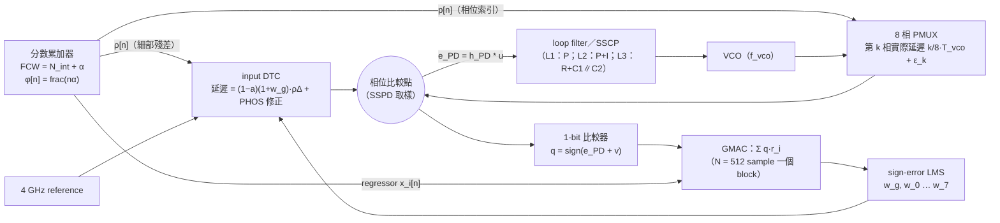

# DTC GOS 與 PMUX PHOS 的 LMS 為什麼會「反號」：從 $H_{PD}$ 看 Type-I SSPLL、Type-II SSPLL 與 CPPLL

> **使用者的問題（原文）**：「我想要知道 DTC 的 GOS error 跟 PHOS 的 error 到 PD 輸出的 transfer function 怎麼讓這些 LMS loop 改變符號，讓他不會收斂。你可以假設我是一個 subsampling PLL，假設我 closed-loop 3dB 頻寬 320M。」並要求把 Type-I SSPLL、Type-II SSPLL 與傳統 CPPLL 放在一起比較。
>
> **本文設定**：$f_{ref}=4\ \mathrm{GHz}$（$T_{ref}=250\ \mathrm{ps}$）；閉迴路 $T=L/(1+L)$ 的 $-3\ \mathrm{dB}$ 頻寬為 $320\ \mathrm{MHz}$；SSPD 取樣到 VCO 控制生效的延遲為 1 個 reference cycle；分數除頻由 feedback 端的 8 相 PMUX 加上 reference 端的 input DTC 實現。
>
> **數字來源**：本文每一個數字都來自 `analysis/sspll/golden/` 的程式（`python3 -m pytest -q` 為 64 個 `test_SSPLL_*` 測試；`tools/make_results.py` 產生 `results/doc_numbers.json`）。時域模擬的數字來自 `analysis/sspll/sim/results.json`，由 `tools/extract_sim_reference.py` 讀出，再與 golden 的理論逐點比對。網站資料在 `src/data/sspll/`。
>
> **結論標籤**：**【精確｜指定模型】** 表示在所述模型與假設下是數學上精確的結論；**【近似｜需驗證】** 表示來自線性化、數值掃描或模擬，在模型外需要驗證；**【研究假說】** 表示目前只有部分證據，還沒有證明。

---

## 0. 先講結論

### 0.1 一句話回答

PD（比較器）看到的不是誤差本身 $u$，而是被迴路「高通」過的殘差：

$$
e_{PD}=h_{PD}*u,\qquad H_{PD}=\frac{1}{1+L}.
$$

sign-error LMS 的平均梯度，等於「regressor 在每一條譜線上的功率」對 $\mathrm{Re}\,H_{PD}$ 做的加權平均。只要 regressor 的功率主要落在 $\mathrm{Re}\,H_{PD}<0$ 的頻帶，更新方向就會整個反過來，LMS 不但不收斂，反而會把權重推離正確值。

### 0.2 哪裡會反號

- **反號的頻率條件**：$\mathrm{Re}\,H_{PD}<0 \iff \mathrm{Re}\,L<-1 \iff \mathrm{Re}\,T>1$。這個帶子一定落在 $\lvert T\rvert>1$ 的 peaking 區裡。**【精確｜指定模型】**
- **Type-II 迴路**：只要迴路是 Type-II（兩個積分器），在 DC 附近一定有 $\mathrm{Re}\,H_{PD}\approx-\Omega^2/K_i<0$。白話說，PD 看到的是誤差的「二次微分」，而任何訊號與自己的二次微分的相關都是負的。所以從 DC 開始的反號帶**無法消除，只能變窄**。**【精確｜指定模型】**
- **Type-I 迴路（L1，標稱模型）**：沒有反號帶，$\mathrm{Re}\,H_{PD}\ge0$。但這不是 Type-I 天生免疫：只要延遲 $d$ 拍且 $K(d-\tfrac12)>1$，或有寄生極點且 $K(\tfrac12+\tfrac{p}{1-p})>1$，也會出現反號帶。**【精確｜指定模型】**

### 0.3 兩種 regressor 的結果

- **PHOS（8 相 PMUX 偏差）**：regressor 是 8 個 one-hot，矩陣是 circulant。mode-1 有 95%（$W_1=0.9496$）的權重落在 PMUX 的旋轉頻率 $\alpha f_{ref}$。
  - 當 $\alpha f_{ref}$ 落在反號帶內，PHOS LMS 就會反號（數字見下表）。
  - $\alpha\approx\tfrac14$、$\tfrac12$ 附近有 alias 造成的 dead zone。
  - $\alpha\to0$ 時也是 dead zone（$\lvert\kappa\rvert\lesssim5\times10^{-3}$）。
- **GOS（DTC 增益誤差）**：regressor 是鋸齒波 $\rho[n]$，功率分散到全頻帶的高次諧波。
  - 在相關器延遲 $D=0$ 時，三個迴路都**沒有**反號。
  - 11 個迴路、每個 152,096 個有理 $\beta$ 都沒找到反例，但目前沒有證明。**【研究假說】**
  - Type-II 在 near-grid（$\alpha\approx k/8$）時只會變成 dead zone，$12C\approx12\beta^2/K_i$。
  - 若 $D=+1$（相關器晚一拍），GOS 會反號。

### 0.4 結論總表

（$\alpha f_{ref}$ 一律折到 $[0,2000]\ \mathrm{MHz}$，也就是 $\min(\alpha,1-\alpha)f_{ref}$。）

| | L1 SSPLL Type-I | L2 SSPLL Type-II（PM 60°） | L3 CPPLL（3 階 Type-II，impulse-invariant） |
|---|---|---|---|
| 參數 | $K=0.388836$ | $K_p=0.287717$、$K_i=0.0382535$ | $b=13.928$、$\omega_cT_{ref}=0.303955$ |
| PM／$\lvert T\rvert$ peaking | 78.79°／0 dB | 60.00°／2.127 dB | 58.58°／1.736 dB |
| $\mathrm{Re}H_{PD}<0$ 的頻帶 | 無 | $0$–$134.820\ \mathrm{MHz}$，最低 $-0.2053$ @ 83.8 MHz | $0$–$117.278\ \mathrm{MHz}$，最低 $-0.1616$ @ 67.3 MHz |
| PHOS mode-1「一定反號」區（嚴格界限） | 無 | $32.68$–$125.33\ \mathrm{MHz}$ | $27.72$–$105.09\ \mathrm{MHz}$ |
| PHOS 反號（$\alpha=j/4096$ 精確 map，$\tau=10^{-2}$） | 無 | $29.3$–$124.0\ \mathrm{MHz}$，最差 $\kappa=-0.1397$ @ 83.0 MHz | $23.4$–$103.5\ \mathrm{MHz}$，最差 $-0.0957$ @ 67.4 MHz |
| PHOS alias dead zone（$\tau=10^{-3}$） | 無 | 980–987、1013–1020、1960–1975、1980–1987 MHz | 無 |
| GOS（$D=0$） | 不反號 | 不反號；near-grid 為 dead zone | 不反號；near-grid 為 dead zone |
| 大訊號（1-bit，$A\to\infty$）反向 α 數（fine grid 500 點） | 34（全部是 GOS，在 $k/8$ 正下方） | 83 | 75 |

### 0.5 對策（排序；理論、時域 replica、閉迴路 LMS 三方一致）

1. **一階差分 regressor $r[n]=x[n]-x[n-1]$**：任何 $\alpha$ 都可證明不反號，條件有 closed form（Type-II：$K_i\le2K_p$ 且 $K_p+K_i/2\le2$）。regressor 是 zero-mean，所以對比較器 offset 也免疫。硬性前提是 code→比較器的延遲對齊 $D=0$。**【精確｜指定模型】**
2. **filtered-x**：用 $\hat H_{PD}$ 先濾 regressor。BW 差 ±20% 也安全；但若用 Type-I 模型去配 Type-II 迴路，需要 $\hat K>0.1247$。代價是 9 條 IIR 必須以 4 GHz 全速運作。
3. **校準時 hold 住積分路徑（P-only）**，同時用 zero-mean regressor：迴路暫時變成 Type-I。代價是只能做 foreground 校準、BW 改變（218 / 268–298 MHz），而且需要 dual-path 或數位 loop filter 才做得到。
4. **PMUX 隨機旋轉／MASH**：目前只有 sim 證據。
5. **keep-out 頻道或 freeze**：keep-out 清單必須用大訊號 map 列，並留 PVT margin。

**不要做**：讓相關器延遲 $D\ne0$（$\min\mathrm{Re}\,\Gamma=-1.18$），或改用二階差分 regressor。

---

## 1. 本章符號

| 符號 | 意義 | 單位 | 首次出現 | 與全站約定的關係 |
|---|---|---|---|---|
| $f_{ref},\ T_{ref}$ | reference 頻率／週期 | Hz／s | §0 | $4\ \mathrm{GHz}$／$250\ \mathrm{ps}$ |
| $n$ | 比較器取樣索引（每個 $T_{ref}$ 一個） | sample | §2 | 同全站 $n$ |
| $k$ | GMAC block 索引（$N$ 個 sample 一個 block） | block | §4 | 同全站 $k$ |
| $f,\ \Omega$ | 正規化頻率 $f/f_{ref}$；$\Omega=2\pi f/f_{ref}$ | cycles/sample；rad/sample | §3 | |
| $z^{-1}$ | 延遲一拍；在單位圓上 $z^{-1}=e^{-j\Omega}$ | – | §3 | |
| $f_{vco},\ T_{vco},\ \Delta$ | VCO 頻率、週期、PMUX 相位間隔 $\Delta=T_{vco}/8$ | Hz、s、s | §2 | 插圖值 $f_{vco}=16$ GHz、$\Delta=7.8125$ ps |
| $\alpha$ | FCW 的分數部分，$\mathrm{FCW}=N_{int}+\alpha$ | – | §2 | |
| $\varphi[n]$ | 累積分數相位 $\mathrm{frac}(n\alpha)$ | VCO 週期 | §2 | |
| $p[n]$ | PMUX 相位索引 $\lfloor8\varphi[n]\rfloor\in\{0..7\}$ | – | §2 | |
| $\rho[n]$ | DTC 細部殘差 $8\varphi[n]-p[n]\in[0,1)$ | 以 $\Delta$ 為單位 | §2 | GOS 的 regressor |
| $\beta$ | $\mathrm{frac}(8\alpha)$，鋸齒 $\rho$ 的基頻 | cycles/sample | §7 | |
| $a,\ w_g$ | DTC 增益誤差（GOS）、其估計 | – | §2 | 理想模型 $e_{GOS}=(a-w_g)\rho\Delta$ |
| $\varepsilon_k,\ w_k$ | 第 $k$ 個 PMUX 相位的偏差、其估計 | s（fs） | §2 | |
| $\delta$ | 權重誤差：$\delta_g=a-w_g$，$\delta_k=\varepsilon_k-w_k$ | – | §4 | **本章採 $\delta=$ 真值 − 估計**（validation.md 的極性衝突以此為準） |
| $x_i[n]$ | regressor：$x_0=\rho$，$x_{1+k}=\mathbb 1\{p[n]=k\}$ | – | §2 | |
| $r_i[n]$ | GMAC 實際使用的 regressor $=g*x_i$ | – | §4 | raw 時 $r=x$ |
| $G(z)$ | regressor 前置濾波（raw：1；一階差分：$1-z^{-1}$；…） | – | §4 | |
| $u[n]$ | 注入在相位比較點的時間誤差 | s（fs） | §3 | |
| $e_{PD}[n]$ | PD／比較器輸入的殘差 $=h_{PD}*u$ | s（fs） | §3 | |
| $L(z)$ | 開迴路增益（含 1 拍延遲，嚴格 proper） | – | §3 | |
| $H_{PD},\ h_{PD}$ | $1/(1+L)$ 與其脈衝響應；$h_{PD}[0]=1$ | – | §3 | |
| $T$ | $L/(1+L)$，−3 dB = 320 MHz 的那一個 | – | §3 | |
| $K,\ K_p,\ K_i$ | Type-I 增益；Type-II 比例／積分增益（每 sample） | – | §5 | |
| $b,\ \omega_c,\ \omega_z,\ \omega_p$ | CPPLL 極零點比與頻率（以 $1/T_{ref}$ 為單位） | rad/sample | §6 | $b=1+C_1/C_2$ |
| $v[n],\ \sigma_v$ | 比較器輸入雜訊與其標準差 | fs | §4 | 插圖值 $\sigma_v=200$ fs |
| $q[n]$ | $\mathrm{sign}(e_{PD}+v)\in\{\pm1\}$ | – | §4 | 同全站 |
| $K_q$ | Bussgang 增益 $\sqrt{2/\pi}/\sigma_v$ | fs$^{-1}$ | §4 | 數值 $3.989\times10^{-3}\ \mathrm{fs}^{-1}$ |
| $\Gamma_{\rm eff}(f)$ | 有效 kernel $H_{PD}(f)\,\overline{G(f)}$ | – | §4 | |
| $C$ | 9×9 平均 GMAC 矩陣 $C_{ij}=\langle r_i\,(h_{PD}*x_j)\rangle$ | – | §4 | |
| $\lambda_m$ | PHOS 8×8 circulant 的 DFT 模態特徵值，$m=0..7$ | – | §8 | |
| $\kappa$ | 正規化斜率：$\kappa_m=8\lambda_m$、$\kappa_{PHOS}=8\min_m\mathrm{Re}\lambda_m$、$\kappa_{GOS}=C_{GOS}/\mathrm{var}(\rho)=12C_{GOS}$ | – | §4 | $H\equiv1$ 時 $\kappa=1$ |
| $\tau$ | 判定 dead zone 的門檻（$\kappa<-\tau$ 才算反號） | – | §8 | $10^{-3}$ 或 $10^{-2}$ |
| $N_\tau$ | 開迴路（$H\equiv1$）時 LMS 的時間常數 | block | §12 | sim 取 25 |
| $W_1$ | mode-1 基波權重 $64\sin^2(\pi/8)/\pi^2$ | – | §8 | $0.94964$ |
| $D$ | 相關器延遲：$r[n]=x[n-D]$ | sample | §7 | 正確值為 0 |
| $u_{os}$ | 比較器／PD 的 DC offset | fs | §13 | |
| $A$ | 大訊號分析的誤差振幅 | ps | §10 | |

---

## 2. 架構：誤差從哪裡進來



**兩個誤差的注入點**：

- **GOS**：DTC 在 reference 端。實際延遲是 $(1-a)(1+w_g)\rho\Delta$，理想值是 $\rho\Delta$。理想模型下，比較點多出 $e_{GOS}[n]=(a-w_g)\,\rho[n]\,\Delta$。
- **PHOS**：PMUX 在 feedback 端。選到第 $k$ 相時多出 $\varepsilon_k$；這個偏差經由 reference 端的 DTC 用 $w_k$ 補回來。所以 $e_{PHOS}[n]=\sum_k(\varepsilon_k-w_k)\,\mathbb 1\{p[n]=k\}$。

**極性約定**：reference 端與 feedback 端的誤差在比較點的符號相反。我們規定：在 $H_{PD}\equiv1$（沒有迴路）時，$w\leftarrow w+\mu\,q\,r$ 會往正確方向更新，並用這個規定吸收兩邊的符號。實作時，GOS 與 PHOS 的更新符號要**各自**依 $H\equiv1$ 推導，因為 PHOS 的修正是透過 reference 端的 DTC 加上去的，誤差卻來自 feedback 端。

注意：$C$ 只依賴 $\lvert c_\nu\rvert^2$ 與 $\Gamma$。所以 DTC code 用 $\rho$ 或 $1-\rho$、PMUX 索引用 $p$ 或 $p+1$、PMUX 旋轉方向（$\mathrm{Re}\lambda_m=\mathrm{Re}\lambda_{8-m}$）都**不會**改變反號結論。**【精確｜指定模型】**

**手算看 regressor 長什麼樣**（$\alpha=0.137$，由 `tools/worked_examples.py` 產生）：

| $n$ | 0 | 1 | 2 | 3 | 4 | 5 | 6 | 7 | 8 | 9 |
|---|---|---|---|---|---|---|---|---|---|---|
| $p[n]$ | 0 | 1 | 2 | 3 | 4 | 5 | 6 | 7 | 0 | 1 |
| $\rho[n]$ | 0.000 | 0.096 | 0.192 | 0.288 | 0.384 | 0.480 | 0.576 | 0.672 | 0.768 | 0.864 |

$8\alpha=1.096$：PMUX 每拍前進約 1 相，旋轉一圈約 8 拍，所以 mode-1 的頻率是 $\alpha f_{ref}=548$ MHz。$\rho$ 每拍增加 $\beta=0.096$，是一個頻率 $\beta f_{ref}=384$ MHz 的慢鋸齒。

---

## 3. 從比較點到 PD：$H_{PD}$ 的推導

<details><summary><b>先備知識：Z transform、離散頻率 Ω、頻率響應（點開）</b></summary>

- **離散時間訊號**：每個 $T_{ref}$ 取一個值，記為 $x[n]$。
- **延遲一拍**：記為 $z^{-1}$，意思是 $(z^{-1}x)[n]=x[n-1]$。把 $z^{-1}$ 當成一個代數符號，就可以把「差分方程」寫成「多項式的除法」，這就是 **Z transform**。例如 $y[n]=y[n-1]+x[n-1]$（累加器）寫成 $Y=z^{-1}Y+z^{-1}X$，解出 $Y/X=z^{-1}/(1-z^{-1})$。
- **離散頻率 $\Omega$**：輸入一個複弦波 $x[n]=e^{j\Omega n}$，延遲一拍等於乘上 $e^{-j\Omega}$。所以在單位圓上 $z^{-1}=e^{-j\Omega}$，$\Omega=2\pi f/f_{ref}\in[-\pi,\pi]$。
- **頻率響應**：線性非時變（LTI）系統對 $e^{j\Omega n}$ 的輸出是 $H(e^{j\Omega})e^{j\Omega n}$。複數 $H$ 的大小 $\lvert H\rvert$ 是增益，角度 $\angle H$ 是相位。
- **卷積**：$y=h*x$ 的意思是 $y[n]=\sum_m h[m]x[n-m]$；在頻域對應 $Y=HX$。
- **pole（極點）與穩定**：$H(z)$ 分母的根叫 pole。所有 pole 都在單位圓內（$\lvert z\rvert<1$）時，脈衝響應會衰減，系統穩定。
</details>

設比較點收到的「外加誤差」是 $u[n]$（DTC 加 PMUX 的誤差），迴路產生的修正是 $y[n]$。PD 看到的殘差為

$$
\begin{aligned}
e_{PD}[n] &= u[n]-y[n] && \text{(1)}\\
Y(z) &= L(z)\,E_{PD}(z) && \text{(2)}\\
E_{PD} &= U-L\,E_{PD} && \text{(3)}\\
(1+L)\,E_{PD} &= U && \text{(4)}\\
E_{PD} &= \frac{1}{1+L}\,U \;\equiv\; H_{PD}\,U && \text{(5)}
\end{aligned}
$$

1. 比較點做減法：外加誤差減去迴路修正。
2. 迴路把 PD 輸出經 loop filter、VCO（積分器）和 1 拍延遲送回來；這整條路徑記為 $L(z)$。
3. 把 (2) 代入 (1)。
4. 把含 $E_{PD}$ 的項移到左邊。
5. 兩邊除以 $(1+L)$。

這裡的 $H_{PD}$ 就是使用者問的「DTC GOS／PHOS 誤差到 PD 輸出的 transfer function」。因為 $L$ 嚴格 proper（至少 1 拍延遲），$L(\infty)=0$，所以 $h_{PD}[0]=1$：誤差注入的當拍，PD 會原封不動看到它。

三個迴路的脈衝響應前 6 個值（`tools/worked_examples.py`）：

| | $h[0]$ | $h[1]$ | $h[2]$ | $h[3]$ | $h[4]$ | $h[5]$ |
|---|---|---|---|---|---|---|
| L1 | 1 | −0.38884 | −0.23764 | −0.14524 | −0.08876 | −0.05425 |
| L2 | 1 | −0.32597 | −0.25797 | −0.19966 | −0.15049 | −0.10972 |
| L3 | 1 | −0.21615 | −0.25574 | −0.22636 | −0.17685 | −0.12777 |

直覺：誤差剛出現時 PD 全部看到，接著迴路把它「吃掉」，所以後面全是負值。Type-I 的負尾巴總和是 $-1$（$\sum h=H(1)=0$）。Type-II 的負尾巴更長，還會稍微 overshoot（多一個 DC 零點）。

---

## 4. LMS 的平均更新：為什麼是 $\mathrm{Re}\,H_{PD}$ 決定符號

### 4.1 一個問題，先算一次

**黑盒子例子**：你只能看到比較器輸出 $q=\mathrm{sign}(e)$，不知道真值 $a=1$。估計 $w$ 從 0 開始，取 $\mu=0.1$、$x=1$。

- 情況 A：沒有迴路，$e=(a-w)x$。
- 情況 B：PD 看到的是被迴路「反相縮小」的殘差 $e=-0.2\,(a-w)x$。這是一個單 tap 的玩具模型，代表 $\mathrm{Re}H<0$。

| 步 | A：$w$ | A：$q$ | B：$w$ | B：$q$ |
|---|---|---|---|---|
| 0 | 0.0 | +1 | 0.0 | −1 |
| 1 | 0.1 | +1 | −0.1 | −1 |
| 2 | 0.2 | +1 | −0.2 | −1 |
| 3 | 0.3 | +1 | −0.3 | −1 |
| 4 | 0.4 | | −0.4 | |

A 往 $a=1$ 前進；B 每一步都往反方向走，而且離真值越遠，$q$ 越肯定是 −1，所以會一直走下去。這就是「反號、不收斂」。剩下的問題是：真正的迴路什麼時候會變成情況 B？

### 4.2 一步一步推導平均梯度

<details><summary><b>先備知識：期望值、高斯分布、erf、相關（點開）</b></summary>

- **期望值** $E[X]$：隨機變數 $X$ 的長期平均。若 $X$ 有機率密度 $p(x)$，則 $E[X]=\int x\,p(x)\,dx$。
- **高斯分布** $v\sim\mathcal N(0,\sigma^2)$：$p(v)=\frac{1}{\sqrt{2\pi}\sigma}e^{-v^2/2\sigma^2}$。
- **erf**：$\mathrm{erf}(x)=\frac{2}{\sqrt\pi}\int_0^x e^{-t^2}dt$，奇函數，$\mathrm{erf}(x)\approx\frac{2}{\sqrt\pi}x$（$x$ 小時，泰勒一階）。
- **時間平均**：$\langle y\rangle=\lim_{M\to\infty}\frac1M\sum_{n=1}^{M}y[n]$。對週期或「幾乎週期」的訊號，它就是長期平均。
- **相關（correlation）**：$\langle r\,y\rangle$ 衡量兩個訊號「同向」的程度。同向時為正，反向時為負，無關時為 0。
</details>

$$
\begin{aligned}
E[q\mid e] &= P(e+v>0)-P(e+v<0) && \text{(1)}\\
&= \mathrm{erf}\!\left(\frac{e}{\sqrt2\,\sigma_v}\right) && \text{(2)}\\
&\approx \sqrt{\tfrac{2}{\pi}}\frac{e}{\sigma_v}\;=\;K_q\,e && \text{(3)}\\
E[G_i] &= E\Big[\tfrac1N\textstyle\sum_n q[n]\,r_i[n]\Big]\approx K_q\,\langle r_i\,e_{PD}\rangle && \text{(4)}\\
e_{PD} &= h_{PD}*\Big(\textstyle\sum_j \delta_j\,x_j\Big)=\textstyle\sum_j \delta_j\,(h_{PD}*x_j) && \text{(5)}\\
E[G_i] &\approx K_q\textstyle\sum_j \underbrace{\langle r_i\,(h_{PD}*x_j)\rangle}_{C_{ij}}\,\delta_j = K_q\,(C\delta)_i && \text{(6)}\\
\delta_{k+1} &= \delta_k-\mu K_q\,C\,\delta_k && \text{(7)}
\end{aligned}
$$

1. $q$ 是 ±1，期望值等於「為正的機率減去為負的機率」。
2. $v$ 是高斯，$P(v>-e)-P(v<-e)$ 正好寫成 erf。
3. Bussgang 線性化：$\lvert e\rvert\ll\sigma_v$ 時取 erf 的泰勒一階。例：$\sigma_v=200$ fs 時 $K_q=3.989\times10^{-3}\ \mathrm{fs}^{-1}$。
4. 一個 block 的 GMAC 輸出取期望，代入 (3)。block 夠長時，樣本平均可以換成時間平均。
5. 理想模型下的殘差：每個權重誤差 $\delta_j$ 乘上它的 regressor，再通過迴路。LTI 系統可以逐項通過。
6. 把 (5) 代入 (4)，定義 $C$。
7. 權重更新 $w\leftarrow w+\mu G$，而 $\delta=$ 真值 − $w$，所以 $\delta$ 減少 $\mu E[G]$。

**收斂條件**：(7) 是線性遞迴，它的 eigenvalue 是 $1-\mu K_q\lambda$。所以：

$$
\boxed{\ \text{小 }\mu\text{ 時，平均收斂}\iff \mathrm{Re}\,\mathrm{eig}(C)>0\ \text{（在可觀測子空間）}\ }
$$

**【精確｜指定模型】**（指 Bussgang 線性化與穩態平均下）。若某個 eigenvalue 的實部 $<0$，那個方向的誤差會指數成長，這就是反號。有限步長的條件更嚴，見 §12。

<details><summary><b>先備知識：矩陣、特徵值、可觀測子空間（點開）</b></summary>

- **特徵值（eigenvalue）**：$Cv=\lambda v$ 的 $\lambda$。對應的特徵向量 $v$ 是一個「方向」：沿這個方向的誤差，每一步只被乘上 $1-\mu K_q\lambda$，不會轉到別的方向。
- 實數矩陣的特徵值可能是複數。這時誤差會一邊旋轉一邊放大或縮小，決定放大或縮小的是 $\mathrm{Re}\,\lambda$。
- **可觀測子空間**：如果某個方向的 regressor 恆為 0（例如 $\alpha=k/8$ 時 $\rho\equiv0$），或者是 PHOS 的共模（8 個權重一起加同一個常數），PD 就看不到它，GMAC 也不會更新它。這些方向的特徵值是 0，與收斂無關，要先剔除。
</details>

### 4.3 頻域：$C$ 是「regressor 功率對 $\mathrm{Re}\,\Gamma$ 的加權平均」

<details><summary><b>先備知識：DFT／Fourier 級數、PSD（點開）</b></summary>

- 週期為 $Q$ 的序列可以寫成 $Q$ 個複弦波的和：$x[n]=\sum_{\ell=0}^{Q-1}c_\ell\,e^{j2\pi\ell n/Q}$，$c_\ell=\frac1Q\sum_n x[n]e^{-j2\pi\ell n/Q}$。這就是 **DFT**；每個 $c_\ell$ 稱為一條「譜線」，頻率 $f_\ell=\ell/Q$。
- **Parseval**：$\langle\lvert x\rvert^2\rangle=\sum_\ell\lvert c_\ell\rvert^2$。訊號的總功率等於各譜線功率的和。
- **PSD（功率頻譜密度）**：$\lvert c_\ell\rvert^2$ 隨頻率的分布。對週期訊號它由一根根譜線組成。
- 非週期但「幾乎週期」的序列（例如 $\alpha$ 為無理數時的 $\rho[n]$）也一樣，只是譜線有無限多根。
</details>

$$
\begin{aligned}
x_j[n] &= \textstyle\sum_\nu c^j_\nu\,e^{j2\pi f_\nu n} && \text{(1)}\\
(h_{PD}*x_j)[n] &= \textstyle\sum_\nu c^j_\nu\,H_{PD}(f_\nu)\,e^{j2\pi f_\nu n} && \text{(2)}\\
r_i[n] &= \textstyle\sum_\nu c^i_\nu\,G(f_\nu)\,e^{j2\pi f_\nu n} && \text{(3)}\\
C_{ij}=\langle r_i\,(h_{PD}*x_j)\rangle &= \textstyle\sum_\nu \overline{c^i_\nu\,G(f_\nu)}\;c^j_\nu\,H_{PD}(f_\nu) && \text{(4)}\\
&= \textstyle\sum_\nu \overline{c^i_\nu}\,c^j_\nu\;\Gamma_{\rm eff}(f_\nu),\qquad \Gamma_{\rm eff}\equiv H_{PD}\,\overline{G} && \text{(5)}\\
C_{ii} &= \textstyle\sum_\nu \lvert c^i_\nu\rvert^2\,\mathrm{Re}\,\Gamma_{\rm eff}(f_\nu) && \text{(6)}
\end{aligned}
$$

1. 把 regressor 展成譜線。
2. LTI 系統對每條譜線只乘上 $H_{PD}$。
3. GMAC 用的 regressor 是 $x$ 經過前置濾波 $G$（raw 時 $G=1$）。
4. Parseval（實數訊號 $r=\bar r$）：兩個訊號乘積的平均，等於譜線係數兩兩相乘再相加。
5. 把 $H_{PD}$ 與 $\overline G$ 合併成一個 kernel。
6. 對角項：實數訊號的譜線成對出現在 $\pm f$，而 $\Gamma(-f)=\overline{\Gamma(f)}$，虛部互相抵消，只剩實部。

**白話**：GOS 的「自我斜率」$C_{00}$，是 $\rho$ 的每條譜線功率乘上該頻率的 $\mathrm{Re}\,H_{PD}$ 再加總。若功率集中在 $\mathrm{Re}H_{PD}<0$ 的頻段，總和就是負的。PHOS 的情況相同，只是要對 8×8 矩陣取特徵值（§8）。**【精確｜指定模型】**

**DC 線不影響符號**：均值那一條線（$f=0$）乘上 $\Gamma(0)=H_{PD}(1)=0$。任何 Type ≥ I 的迴路都會把 DC 誤差完全吸收，所以 regressor 的平均值（$\rho$ 的 1/2、one-hot 的 1/8）在線性分析中不影響 $C$。但它在**比較器有 offset** 時會變成問題（§13），在大訊號時也會影響（§10）。

---

## 5. 為什麼 $\mathrm{Re}\,H_{PD}$ 會變負：恆等式與「微分」直覺

### 5.1 恆等式

$$
\begin{aligned}
H_{PD} &= \frac{1}{1+L}=\frac{\overline{1+L}}{\lvert1+L\rvert^2} && \text{(1)}\\
\mathrm{Re}\,H_{PD} &= \frac{1+\mathrm{Re}\,L}{\lvert1+L\rvert^2} && \text{(2)}\\
\mathrm{Re}\,T &= \mathrm{Re}\,(1-H_{PD}) = 1-\mathrm{Re}\,H_{PD} && \text{(3)}\\
\Rightarrow\quad \mathrm{Re}\,H_{PD}<0 &\iff \mathrm{Re}\,L<-1 \iff \mathrm{Re}\,T>1 \;\Rightarrow\; \lvert T\rvert>1 && \text{(4)}
\end{aligned}
$$

1. 分子分母同乘共軛。
2. 取實部；分母恆正，所以符號由分子決定。
3. $T=L/(1+L)=1-H_{PD}$。
4. 由 (2)、(3) 直接得到；最後一步因為 $\lvert T\rvert\ge\mathrm{Re}\,T$。

**【精確｜指定模型】**（對任何 $L$ 都成立。golden 在 40 萬點網格上檢查，0 個不一致；也沒有任何一點 $\mathrm{Re}H<0$ 而 $\lvert T\rvert\le1$）。所以**反號帶一定落在 closed-loop peaking 區裡**。320 MHz 的 Type-II 迴路有 1.7–2.1 dB 的 peaking，L1 則沒有 peaking。

### 5.2 低頻的「微分」直覺

**先算一次（20 MHz，$\Omega=2\pi\cdot20/4000=0.031416$）**：

- 對弦波 $x[n]=\cos\Omega n$：一次差分的相關 $\langle x[n](x[n]-x[n-1])\rangle=\tfrac{1-\cos\Omega}{2}=+2.467\times10^{-4}$；中心二次差分的相關 $\langle x[n](x[n+1]-2x[n]+x[n-1])\rangle=\cos\Omega-1=-4.934\times10^{-4}$。
- L2：$\mathrm{Re}H_{PD}(20\ \mathrm{MHz})=-0.02493$，而 $-\Omega^2/K_i=-0.02580$。
- L1：$\mathrm{Re}H_{PD}(20\ \mathrm{MHz})=+0.005237$，而 $(2-K)\Omega^2/(2K^2)=+0.005259$。

**Type-II（L2）的低頻推導**：

$$
\begin{aligned}
L &= \frac{K_p z^{-1}}{1-z^{-1}}+\frac{K_i z^{-1}}{(1-z^{-1})^2}\;\approx\;\frac{K_i z^{-1}}{(1-z^{-1})^2} && \text{(1)}\\
H_{PD} &= \frac{1}{1+L}\approx\frac1L=\frac{(1-z^{-1})^2}{K_i z^{-1}}=\frac{(z^{1/2}-z^{-1/2})^2}{K_i} && \text{(2)}\\
&= \frac{(2j\sin\frac\Omega2)^2}{K_i}=-\frac{4\sin^2(\Omega/2)}{K_i} && \text{(3)}\\
&\approx -\frac{\Omega^2}{K_i}\;<0 && \text{(4)}
\end{aligned}
$$

1. $\Omega\to0$ 時雙積分項 $\propto\Omega^{-2}$，比比例項 $\propto\Omega^{-1}$ 大。
2. $\lvert L\rvert\gg1$，所以 $1+L\approx L$；分子分母同乘 $z$。
3. 代入 $z=e^{j\Omega}$：$e^{j\Omega/2}-e^{-j\Omega/2}=2j\sin(\Omega/2)$。
4. $\sin x\approx x$。

所以低頻時 PD 看到的是誤差的**中心二次差分**除以 $K_i$，也就是連續時間的 $\frac{1}{K_i}\frac{d^2u}{dt^2}$。微積分告訴我們，對週期函數做分部積分：

$$
\int_0^P x\,x''\,dt=\big[x\,x'\big]_0^P-\int_0^P (x')^2dt=-\int_0^P(x')^2dt<0 .
$$

**任何訊號與自己的二次微分的相關都是負的**。所以只要 regressor 的功率落在 $\lvert L\rvert\gg1$ 的低頻，Type-II 迴路就一定會讓 LMS 反號。無論 PM、latency 是多少，這件事都避不掉。**【精確｜指定模型】**（golden：$\mathrm{Re}H(10^{-4}f_{ref})$ 與 $-\Omega^2/K_i$ 的比值為 0.99999；L3 為 $-\Omega^2/K_d$，$K_d=(\omega_cT)^2/\sqrt b=0.0247554$，比值 0.99996）

**Type-I（L1，延遲 $d$ 拍）的低頻推導**：

$$
\begin{aligned}
\frac1L &= \frac{(1-z^{-1})z^{d}}{K}=\frac{e^{j\Omega(d-1)}(e^{j\Omega}-1)}{K}\approx\frac{j\Omega-\Omega^2(d-\frac12)}{K} && \text{(1)}\\
H_{PD} &= \frac{1}{1+L}=\frac{1/L}{1+1/L}\approx\frac1L-\frac1{L^2} && \text{(2)}\\
\mathrm{Re}\,H_{PD} &\approx -\frac{\Omega^2(d-\frac12)}{K}+\frac{\Omega^2}{K^2}=\frac{\Omega^2}{K^2}\Big[1-K\big(d-\tfrac12\big)\Big] && \text{(3)}
\end{aligned}
$$

1. 泰勒展開到 $\Omega^2$：$e^{j\Omega(d-1)}(e^{j\Omega}-1)\approx(1+j\Omega(d-1))(j\Omega-\Omega^2/2)$。
2. $\lvert1/L\rvert\ll1$，用 $1/(1+x)\approx1-x$。
3. $1/L^2\approx(j\Omega)^2/K^2=-\Omega^2/K^2$；$1/L$ 的 $j\Omega/K$ 是純虛數，不貢獻實部。

所以 Type-I 的 PD 在低頻看到的主要是**一次微分**（純虛數，$\langle x\,x'\rangle=0$，不決定符號）。符號由兩個二階修正決定：迴路增益項 $+\Omega^2/K^2$ 對上延遲項 $-\Omega^2(d-\frac12)/K$。$d=1$、$K=0.389$ 時 $K(d-\tfrac12)=0.194<1$，所以 L1 在低頻是正的。**【精確｜指定模型】**

---

## 6. 三個迴路：設計與精確的反號帶

所有迴路都以「$\lvert T\rvert$ 的 −3 dB = 320.000000 MHz」為設計目標（golden 的 `nominal_loops()`；`test_SSPLL_loop_design_parameters`）。

### 6.1 L1：SSPLL Type-I

$$
L_1=\frac{Kz^{-1}}{1-z^{-1}},\qquad 1-K=c-\sqrt{c^2-1},\ c=2-\cos\Omega_3\ \Rightarrow\ K=0.388836 .
$$

$$
\begin{aligned}
H_{PD} &= \frac{1-z^{-1}}{1-(1-K)z^{-1}} && \text{(1)}\\
\mathrm{Re}\,H_{PD} &= \frac{\mathrm{Re}\{(1-e^{-j\Omega})(1-(1-K)e^{j\Omega})\}}{\lvert1-(1-K)e^{-j\Omega}\rvert^2} && \text{(2)}\\
&= \frac{(2-K)(1-\cos\Omega)}{\lvert1-(1-K)e^{-j\Omega}\rvert^2}\;\ge0\quad(0<K<2) && \text{(3)}
\end{aligned}
$$

1. $1/(1+L)$ 分子分母同乘 $(1-z^{-1})$。
2. 分子分母同乘分母的共軛。
3. 展開分子：$1-(1-K)e^{j\Omega}-e^{-j\Omega}+(1-K)$，取實部得到 $(2-K)(1-\cos\Omega)$。

L1 沒有反號帶（golden：closed form 誤差 0，$\min\mathrm{Re}H=2\times10^{-10}$，最小值出現在 DC 附近）。**【精確｜指定模型】**

**但 Type-I 不是天生免疫**（對抗審查的修正）：

| 變形（都重新調到 320 MHz） | $K$ | 判據 | PM | $\mathrm{Re}H<0$ 帶 |
|---|---|---|---|---|
| 延遲 $d=2$ | 0.2623 | $K(d-\tfrac12)=0.393$ | 67.4° | 無 |
| 延遲 $d=4$ | 0.2086 | 0.730 | 48.1° | 無 |
| 延遲 $d=5$ | 0.2447 | **1.101** | 26.8° | **0–107.08 MHz** |
| 寄生極點 500 MHz | 0.3407 | $K(\tfrac12+\tfrac{p}{1-p})=0.456$ | 66.7° | 無 |
| 寄生極點 250 MHz | 0.3848 | 0.993 | 51.5° | 無 |
| 寄生極點 200 MHz | 0.4278 | **1.373** | 45.1° | **0–122.85 MHz** |

判據的推導：

- 延遲：$\mathrm{Re}\{z^{-d}/(1-z^{-1})\}=-\sin((d-\frac12)\Omega)/(2\sin\frac\Omega2)\ge-(d-\frac12)$，因為 $\lvert\sin(n x)/\sin x\rvert\le n$。
- 極點：$\frac{(1-p)z^{-1}}{(1-z^{-1})(1-pz^{-1})}=\frac{z^{-1}}{1-z^{-1}}-\frac{pz^{-1}}{1-pz^{-1}}$。第一項實部恆為 $-\tfrac12$；第二項的實部在 $\Omega\to0$ 時最負，為 $-p/(1-p)$。

**【精確｜指定模型】**（`test_SSPLL_typeI_latency_criterion`、`test_SSPLL_typeI_pole_criterion`）。在 L1 加 200 MHz 寄生極點時反號帶很淺（min −0.02）。golden 在 $j/4096$ map 上算出 PHOS 最差 $\kappa$ 仍是 $+0.0013$（@ 1.0 MHz），因為帶太淺，PHOS 不會反號。

### 6.2 L2：SSPLL Type-II（P + I）

$$
L_2=\Big(K_p+\frac{K_i}{1-z^{-1}}\Big)\frac{z^{-1}}{1-z^{-1}},\qquad K_i=\omega_n^2,\ K_p=2\zeta\omega_n .
$$

$\zeta=0.7355$ 對應 sampled-data 的 PM 60.00°，$\omega_n$ 讓 BW 為 320 MHz：$K_p=0.287717$、$K_i=0.0382535$。

**$\mathrm{Re}\,L$ 的精確式**（每步一個理由）：

$$
\begin{aligned}
\frac{z^{-1}}{1-z^{-1}} &= \frac{1}{e^{j\Omega}-1}=\frac{e^{-j\Omega/2}}{2j\sin(\Omega/2)} && \text{(1)}\\
\mathrm{Re}\frac{z^{-1}}{1-z^{-1}} &= \mathrm{Re}\frac{\cos\frac\Omega2-j\sin\frac\Omega2}{2j\sin\frac\Omega2}=-\frac12 && \text{(2)}\\
\frac{z^{-1}}{(1-z^{-1})^2} &= \frac{1}{(e^{j\Omega/2}-e^{-j\Omega/2})^2}=-\frac{1}{4\sin^2(\Omega/2)} && \text{(3)}\\
\mathrm{Re}\,L_2 &= -\frac{K_p}{2}-\frac{K_i}{4\sin^2(\Omega/2)} && \text{(4)}\\
\mathrm{Re}\,L_2<-1 &\iff \sin^2\frac\Omega2<\frac{K_i}{2(2-K_p)} && \text{(5)}\\
f_{inv} &= \frac{f_{ref}}{\pi}\arcsin\sqrt{\frac{K_i}{2(2-K_p)}} && \text{(6)}
\end{aligned}
$$

1. 分子分母同乘 $z$，再把 $e^{j\Omega}-1$ 寫成 $e^{j\Omega/2}\cdot2j\sin(\Omega/2)$。
2. 除以純虛數 $2j\sin$：實部只來自 $-j\sin$ 那一項。
3. 同樣寫成 $(2j\sin)^2$，結果是**純實數**而且為負。
4. 兩項相加，乘上增益。
5. 代入恆等式 §5.1，移項（需要 $K_p<2$）。
6. 解出 $\Omega$，再換成頻率。

**數值手算**：$\frac{K_i}{2(2-K_p)}=0.0111703$ → 開根號得 $0.105690$ → $\arcsin$ 得 $0.105887$ → 乘上 $4000/\pi$ 得 $f_{inv}=134.820\ \mathrm{MHz}$。golden 數值掃描得到同樣的 134.820096 MHz。**【精確｜指定模型】**

**在 83.8 MHz 手算 $\mathrm{Re}H$**：

- $\Omega=0.131633$，$\sin^2(\Omega/2)=0.0043255$。
- $\mathrm{Re}L=-0.143858-2.210906=-2.354764$。
- $L=-2.35476-2.18260j$，$\lvert1+L\rvert^2=6.59912$。
- $\mathrm{Re}H=(1-2.35476)/6.59912=-0.20529$。

這正是 L2 反號帶的最低點。

### 6.3 L3：傳統 CPPLL（3 階 Type-II）

連續時間模型 $L(s)=K\frac{1+s/\omega_z}{s^2(1+s/\omega_p)}$，其中 $\omega_z=\omega_c/\sqrt b$、$\omega_p=\omega_c\sqrt b$、$K=\omega_c^2/\sqrt b$、$b=1+C_1/C_2=\big(\frac{1+\sin\mathrm{PM}}{\cos\mathrm{PM}}\big)^2$。取 CT PM = 60° 的放置法，得到 $b=13.928$；$\omega_cT_{ref}=0.303955$（CT 交越頻率 193.50 MHz），$f_z=51.85$ MHz、$f_p=722.17$ MHz。

**到 $f_{ref}$ 取樣域的映射**（CP 的電荷包在 $nT$ 注入，相位在 $(n+1)T$ 比較）：

$$
\begin{aligned}
L(s) &= \frac{K}{s^2}+\frac{B}{s}-\frac{B}{s+\omega_p},\qquad B=\frac{K(\omega_p/\omega_z-1)}{\omega_p}>0 && \text{(1)}\\
l(t) &= Kt+B\big(1-e^{-\omega_pt}\big) && \text{(2)}\\
L(z) &= \textstyle\sum_{n\ge1} l(n)\,z^{-n}=K\frac{z^{-1}}{(1-z^{-1})^2}+B\frac{z^{-1}}{1-z^{-1}}-B\frac{pz^{-1}}{1-pz^{-1}},\ \ p=e^{-\omega_p} && \text{(3)}\\
-\mathrm{Re}\,L &= \frac{K}{4\sin^2(\Omega/2)}+\frac{B(1-p^2)}{2\lvert1-pe^{-j\Omega}\rvert^2} && \text{(4)}
\end{aligned}
$$

1. 部分分式。
2. 逆 Laplace 得到「一個電荷包之後的相位」。
3. impulse-invariant：每一拍取樣一次（$l(0)=0$，所以嚴格 proper）。
4. 用 §6.2 的 (2)、(3)，加上 $\mathrm{Re}\{-pz^{-1}/(1-pz^{-1})\}=-p(\cos\Omega-p)/\lvert1-pe^{-j\Omega}\rvert^2$，合併得到。

數值：$B=0.28213$、$p=0.32162$；反號帶 $0$–$117.278\ \mathrm{MHz}$，最低 $-0.1616$ @ 67.3 MHz（closed form 相對誤差 $9\times10^{-10}$）。**【精確｜指定模型】**

**帶緣依賴取樣映射**（對抗審查的修正；每種都重新調到 320 MHz）：

| 映射 | 意義 | PM | 反號帶 | 最低 |
|---|---|---|---|---|
| impulse（本文 L3） | 窄電荷包，下一拍比較 | 58.58° | 0–117.278 MHz | −0.1616 |
| halfT | 電荷包中心延後 $T/2$（$e^{-sT/2}$ 型） | 52.56° | 0–115.636 MHz | −0.180 |
| zoh | PD 輸出保持一整拍 | 52.04° | 0–115.096 MHz | −0.180 |

另外，regressors 研究用的 CPPLL（$b=10.802$，DT PM 55.00°）是另一個設計。golden 重建後帶緣為 0–123.92 MHz（min −0.187），不能套到 L3。

### 6.4 一張表看 $H_{PD}$（「圖」的資料）

下表就是網站 `hpd_L*.json` 的取樣點（`tools/worked_examples.py`）。

| $f$ (MHz) | L1 $\mathrm{Re}H$ | L1 $\lvert T\rvert$ | L2 $\mathrm{Re}H$ | L2 $\lvert T\rvert$ | L3 $\mathrm{Re}H$ | L3 $\lvert T\rvert$ |
|---|---|---|---|---|---|---|
| 10 | +0.00131 | 0.9995 | −0.00640 | 1.0064 | −0.00972 | 1.0097 |
| 20 | +0.00524 | 0.9980 | −0.02493 | 1.0249 | −0.03615 | 1.0362 |
| 40 | +0.02070 | 0.9921 | −0.08922 | 1.0902 | −0.10918 | 1.1127 |
| 60 | +0.04565 | 0.9825 | −0.16265 | 1.1715 | −0.15753 | 1.1796 |
| 83.8 | +0.08616 | 0.9668 | **−0.20529** | 1.2498 | −0.14145 | 1.2183 |
| 100 | +0.11932 | 0.9537 | −0.18221 | 1.2750 | −0.08662 | 1.2197 |
| 120 | +0.16511 | 0.9353 | −0.09454 | 1.2695 | +0.01556 | 1.2001 |
| 134.82 | +0.20165 | 0.9203 | 0.0000 | 1.2433 | +0.10626 | 1.1746 |
| 200 | +0.37369 | 0.8465 | +0.44679 | 1.0327 | +0.52398 | 1.0108 |
| 320 | +0.65906 | 0.7071 | +0.87031 | 0.7071 | +1.00475 | 0.7071 |
| 1000 | +1.17302 | 0.3318 | +1.16044 | 0.2560 | +1.14029 | 0.1600 |
| 2000 | +1.24134 | 0.2413 | +1.18123 | 0.1812 | +1.08530 | 0.0853 |

圖形的樣子：L2、L3 的 $\mathrm{Re}H$ 從 DC 以 $-\Omega^2$ 往下，在 70–85 MHz 到谷底（−0.21／−0.16），在 117–135 MHz 回到 0，之後一路升到 1.1–1.24。L1 從 0 單調上升，沒有負值。

### 6.5 PVT 與設計參數會移動帶緣（keep-out 要留 margin）

| 變化（不重新設計） | L2 帶緣 | L2 最低 | L3 帶緣 | L3 最低 |
|---|---|---|---|---|
| loop gain ×0.6（BW 變 205／194 MHz） | 101.01 MHz | −0.288 | 84.86 MHz | −0.226 |
| ×0.8 | 118.56 | −0.238 | 101.29 | −0.187 |
| ×1（標稱） | 134.82 | −0.205 | 117.28 | −0.162 |
| ×1.25 | 154.09 | −0.177 | 137.36 | −0.140 |
| ×1.5（BW 變 499／488 MHz） | 172.73 | −0.156 | 158.16 | −0.125 |

| 設計變化（重新調到 320 MHz） | 反號帶 | 最低 |
|---|---|---|
| L2 PM 45° | 0–162.99 MHz | −0.385 |
| L2 PM 75° | 0–72.30 MHz | −0.053 |
| L2 延遲 2 拍（重新設計 PM 60°） | 0–76.52 MHz | −0.100 |
| L2 延遲 2 拍（$K_p,K_i$ 不變：BW 474 MHz、PM 41.1°） | 0–161.61 MHz | −0.292 |
| L3 CT PM 45°（DT PM 44.32°） | 0–144.18 MHz | −0.284 |
| L3 CT PM 55°（DT PM 53.91°） | 0–125.95 MHz | −0.195 |

**【精確｜指定模型】**（`test_SSPLL_pvt_loop_gain_moves_band_edge`、`test_SSPLL_type_II_band_always_starts_at_DC`）。PM 越大反號帶越窄越淺，但只要是 Type-II，帶子一定從 DC 開始。

> **試試看**：`make_L2(Kp=0.287717, Ki=0.0382535, gain_scale=1.5).inversion_bands()`，或打開網站資料 `hpd_L2.json` 的 `ReH` 欄，看谷底如何隨 gain 移動。

---

## 7. GOS：鋸齒 regressor

### 7.1 Fourier 級數（一步一步）

$$
\begin{aligned}
\rho[n] &= \mathrm{frac}(8\,\mathrm{frac}(n\alpha))=\mathrm{frac}(n\beta),\qquad \beta=\mathrm{frac}(8\alpha) && \text{(1)}\\
\mathrm{frac}(x) &= \tfrac12-\textstyle\sum_{m\ge1}\frac{\sin(2\pi m x)}{\pi m} && \text{(2)}\\
\sin\theta &= \tfrac{1}{2j}\big(e^{j\theta}-e^{-j\theta}\big)\ \Rightarrow\ \lvert c_{\pm m}\rvert^2=\frac{1}{4\pi^2m^2} && \text{(3)}\\
C_{GOS} &= \textstyle\sum_{m\ge1}\frac{\mathrm{Re}\,\Gamma_{\rm eff}(\mathrm{frac}(m\beta))}{2\pi^2m^2} && \text{(4)}\\
\textstyle\sum_{m\ge1}\frac{1}{2\pi^2m^2} &= \frac{1}{2\pi^2}\cdot\frac{\pi^2}{6}=\frac1{12}=\mathrm{var}(\rho) && \text{(5)}
\end{aligned}
$$

1. $8\,\mathrm{frac}(n\alpha)$ 與 $8n\alpha$ 只差 8 的整數倍，而 8 的整數倍不影響 frac。所以 **GOS 只依賴 $\beta$**。
2. 鋸齒波的 Fourier 級數（標準結果，可以對 $x$ 在 $(0,1)$ 上積分驗證）。
3. 每個正弦拆成 $\pm m\beta$ 兩條線，各自的功率是 $(1/2\pi m)^2$。
4. 代入 §4.3 的 (6)。DC 項 $1/2$ 乘上 $\Gamma(0)=0$。
5. $\sum 1/m^2=\pi^2/6$；權重加總恰好等於 $\rho$ 的變異數。

**【精確｜指定模型】**（$\alpha$ 為無理數時精確。有理數且 $8\mid Q$ 時，golden 的 exact periodic 與諧波和誤差 $\le8.3\times10^{-10}$）。正規化 $\kappa_{GOS}=12C_{GOS}$，$H\equiv1$ 時為 1。另外 $C(\beta)=C(1-\beta)$（譜線對稱），所以 $k/8$ 兩側的行為相同。

**先算一次（L2，$\alpha=0.137$，$\beta=0.096$）**：

| $m$ | 折到的頻率 | 權重 $\frac{1}{2\pi^2m^2}$ | $\mathrm{Re}H_{PD}$ | 貢獻 |
|---|---|---|---|---|
| 1 | 384 MHz | 0.050661 | 0.96735 | 0.049007 |
| 2 | 768 MHz | 0.012665 | 1.13740 | 0.014405 |
| 3 | 1152 MHz | 0.005629 | 1.16840 | 0.006577 |
| 4 | 1536 MHz | 0.003166 | 1.17820 | 0.003731 |
| 5 | 1920 MHz | 0.002026 | 1.18114 | 0.002393 |

前 5 項得到 $12C=0.9134$，全部加起來是 $12C=1.0259$，restoring。基波 384 MHz 已經在反號帶（0–134.8 MHz）之外，而高次諧波會折回全頻帶，那裡大部分 $\mathrm{Re}H\approx1.1$–1.2。

### 7.2 為什麼 GOS 在 $D=0$ 時不反號（以及什麼時候會）

**Near-grid**（$\alpha\approx k/8$，$\beta\to0$）：$\rho$ 變成一個很慢的斜坡，每 $1/\beta$ 拍跳回 0 一次。時域推導（$s=$ 步階響應 $h_{PD}$ 的累積和，$S_\infty=\sum_n s[n]$，$S_D=\sum_{n<D}s[n]$）：

$$
C_{GOS}\approx\frac{\beta}{2}\big(S_\infty-2S_D\big)-\beta^2\textstyle\sum_m m\,s[m] .
$$

- **Type-I**：$S_\infty=1/K$，所以 $C\approx\beta/(2K)>0$。
- **Type-II**：$H_{PD}$ 在 DC 有雙零點，所以 $S_\infty=0$。$D=0$ 時第一項消失，剩下 $C\approx\beta^2/K_i>0$，是一個 **dead zone**（很小但仍為正）。
- **Type-II 且 $D=1$**：$S_1=s[0]=1$，所以 $C\approx-\beta$，**反號**。

| 檢查（$\alpha=(1+\beta)/8$，$\beta=1/P$） | $P=64$ | $P=256$ | $P=1024$ |
|---|---|---|---|
| L2 $C$（exact, $D=0$） | 0.006380 | 3.989e-4 | 2.493e-5 |
| L2 $\beta^2/K_i$ | 0.006382 | 3.989e-4 | 2.493e-5 |
| L2 $C$（exact, $D=1$） | −0.009245 | −0.003507 | −9.516e-4 |
| L2 $-\beta$ 漸近 | −0.01563 | −0.003906 | −9.766e-4 |
| L1 $C$（exact）／$\beta/(2K)$ | 0.01879／0.02009 | 0.004942／0.005023 | 0.001251／0.001256 |

**【精確｜指定模型】**（漸近式。`test_SSPLL_gos_small_beta_asymptotes`：$\beta=1/1000$ 時 L2 的 $12C=3.137\times10^{-4}=12\beta^2/K_i$）

**全域不反號是猜想**。$\mathrm{Re}H$ 在一段頻帶內為負，所以 §9 的 PSD 定理不適用，只能靠數值。golden 的 `tools/gos_dense_scan.py` 對所有化簡後的 $\beta=a/b$（$b\le1000$）用精確公式 $C=\sum_{k=1}^{b-1}\frac{\mathrm{Re}H(k/b)}{4b^2\sin^2(\pi k/b)}$ 掃描：

| 迴路 | 反號帶 | β 個數 | 負值 | 最小 $12C$（都在 $\beta=1/1000$） |
|---|---|---|---|---|
| L1 | 無 | 152,096 | 0 | 1.537e-2 |
| L2 | 0–134.82 MHz | 152,096 | 0 | 3.137e-4 |
| L3 | 0–117.28 MHz | 152,096 | 0 | 4.847e-4 |
| L2 PM45 | 0–162.99 | 152,096 | 0 | 2.072e-4 |
| L2 PM75 | 0–72.30 | 152,096 | 0 | 1.138e-3 |
| L2 延遲 2 | 0–76.52 | 152,096 | 0 | 1.307e-3 |
| L3 PM45／PM55／halfT | 0–144.18／125.95／115.64 | 各 152,096 | 0 | 3.476e-4／4.347e-4／5.621e-4 |
| L1 延遲 5（有反號帶） | 0–107.08 | 152,096 | 0 | 2.454e-2 |
| L1 + 200 MHz 極點（有反號帶） | 0–122.85 | 152,096 | 0 | 1.405e-2 |

**【研究假說】**：在 $D=0$、raw regressor、線性化之下，GOS 對任何 $\alpha$ 都不反號。直覺是：鋸齒的功率按 $1/m^2$ 衰減，但諧波 $m\beta$ 折回後會均勻散布到全頻帶，而全頻帶上 $\mathrm{Re}H$ 的平均值很大（§6.4）；近 DC 的負區只能「咬掉」$\beta^2$ 階的量。這不是證明。換迴路（更低 PM、更長延遲、寄生極點）時，請用 `gos_harmonic` 重新檢查。

**注意（大訊號與 offset）**：near-grid 的 GOS 小訊號恢復力只剩 $12C\approx0.08$（L2，$\alpha=0.123$）。大訊號時它是**反向**的（$\kappa_\infty=-0.400$，§10），而比較器 offset 也很容易把它推進大訊號區（§13）。

---

## 8. PHOS：8 相 circulant 與 DFT 模態

### 8.1 一步一步推到特徵值

$$
\begin{aligned}
\mathbb 1\{p[n]=k\} &= \textstyle\sum_{\ell} a_\ell\,e^{-j2\pi\ell k/8}\,e^{j2\pi\ell\varphi[n]},\quad \lvert a_\ell\rvert=\Big\lvert\frac{\sin(\pi\ell/8)}{\pi\ell}\Big\rvert && \text{(1)}\\
C_{jk} &= \textstyle\sum_\ell \lvert a_\ell\rvert^2\,e^{j2\pi\ell(j-k)/8}\,\Gamma_{\rm eff}(\ell\alpha) && \text{(2)}\\
v_m[k] &= e^{j2\pi mk/8}\ \Rightarrow\ \frac{v_m^HCv_m}{8}=8\textstyle\sum_{\ell\equiv m\,(8)}\lvert a_\ell\rvert^2\,\Gamma_{\rm eff}(\ell\alpha)\equiv\lambda_m && \text{(3)}\\
\kappa_m=8\lambda_m &= \textstyle\sum_{\ell\equiv m}w_\ell\,\Gamma_{\rm eff}(\ell\alpha),\quad w_\ell=\frac{64\sin^2(\pi\ell/8)}{\pi^2\ell^2},\quad \textstyle\sum_{\ell\equiv m}w_\ell=1 && \text{(4)}\\
\lambda_0 &= \Gamma_{\rm eff}(0)\cdot(\cdots)=0 && \text{(5)}
\end{aligned}
$$

1. one-hot 是「相位 $\varphi$ 落在第 $k$ 個 1/8 區間」的指示函數。它在 $\varphi$ 上的 Fourier 係數是 sinc 形；平移 $k/8$ 只多一個相位因子。
2. 代入 §4.3 的 (5)：只依賴 $j-k$，所以 $C$ 是 **circulant**。
3. circulant 矩陣的特徵向量就是 DFT 向量。$\sum_j e^{j2\pi(\ell-m)j/8}$ 只在 $\ell\equiv m\ (\mathrm{mod}\ 8)$ 時非零，其值為 8。
4. 乘以 8 正規化；$\ell$ 要同時取正負整數（$\ell=m+8k$，$k\in\mathbb Z$）。權重和為 1，因為模態 $m$ 的 regressor $e^{-j2\pi m p[n]/8}$ 振幅恆為 1（Parseval），而且沒有 DC 線。
5. $m=0$ 是共模，只剩 DC 線，乘上 $\Gamma(0)=H(1)=0$。

**【精確｜指定模型】**（無理數 $\alpha$ 或 $8\mid Q$。golden：circulant 誤差 $\le1.1\times10^{-15}$；ergodic 與 periodic 的 $\lambda$ 差 $\le2.5\times10^{-8}$；$\lvert\lambda_0\rvert\le1.8\times10^{-16}$）

**共模是精確的 null**：對任何 $\alpha$（包括 $8\nmid Q$、occupancy 不均）都成立。因為 $H(1)=0$，全 1 向量同時是右 null（$C\mathbf1=\langle x\,(h*1)\rangle=0$）與左 null（$\mathbf 1^TC=0$）。物理上，共模就是一個靜態相位偏移，迴路會把它吃掉，所以它無害也不可觀測。**【精確｜指定模型】**

**權重集中在基波**：$w_1=W_1=64\sin^2(\pi/8)/\pi^2=0.94964$。所以

$$
\boxed{\ \kappa_1\approx0.9496\,\mathrm{Re}\,H_{PD}(\alpha f_{ref})+\text{（剩下 5\% 散在高頻）}\ }
$$

mode-1 的 regressor 就是「PMUX 以 $\alpha f_{ref}$ 旋轉」這件事本身。旋轉頻率落在反號帶，mode-1 就反號。

**先算一次（L2，$\alpha=0.021$，$\alpha f_{ref}=84$ MHz）**：

| 線 $\ell$ | 折到的頻率 | $w_\ell$ | $\mathrm{Re}H$ | 貢獻 |
|---|---|---|---|---|
| 1 | 84 MHz | 0.94964 | −0.20529 | −0.19495 |
| −7 | 588 MHz | 0.01938 | 1.09725 | +0.02127 |
| 9 | 756 MHz | 0.01172 | 1.13558 | +0.01331 |
| −15 | 1260 MHz | 0.00422 | 1.17226 | +0.00495 |
| 17 | 1428 MHz | 0.00329 | 1.17640 | +0.00387 |
| 其他 | | 0.01175 | | +0.0120 |
| **合計** $\kappa_1=8\mathrm{Re}\lambda_1$ | | 1 | | **−0.13953** |

這是三方調和後的最差點附近，$-0.1395$；L2 在 $j/4096$ 網格上的最差值是 $-0.1397$ @ 83.0 MHz。同一點其他模態為 $\kappa_{2..4}=0.401,\ 0.830,\ 0.944$，全部 restoring，所以只有 mode-1（以及 mode-7，它是 mode-1 的共軛）反號。

### 8.2 嚴格的 mode-1 界限：「一定反號」與「不可能反號」

由 (4)，$\sum w_\ell=1$，而且 $w_1=W_1$：

$$
\begin{aligned}
\kappa_1 &= W_1\,\mathrm{Re}\Gamma(\alpha)+\textstyle\sum_{\ell\ne1}w_\ell\,\mathrm{Re}\Gamma(\ell\alpha) && \text{(1)}\\
W_1\mathrm{Re}\Gamma(\alpha)+(1-W_1)\min_f\mathrm{Re}\Gamma\;\le\;&\kappa_1\;\le\;W_1\mathrm{Re}\Gamma(\alpha)+(1-W_1)\max_f\mathrm{Re}\Gamma && \text{(2)}\\
\text{一定反號} &\iff \mathrm{Re}\,H(\alpha f_{ref})<-\frac{(1-W_1)\max\mathrm{Re}H}{W_1} && \text{(3)}
\end{aligned}
$$

1. 把基波從和裡拿出來。
2. 其餘權重和為 $1-W_1$，每一項夾在 $\mathrm{Re}\Gamma$ 的全域最小與最大之間。
3. 上界 $<0$ 就保證反號。

| | $\max\mathrm{Re}H$ | 門檻 | **一定反號**（$\alpha f_{ref}$） | mode-1 **不可能反號** |
|---|---|---|---|---|
| L2 | 1.18123 | −0.06264 | **32.68–125.33 MHz** | $>136.38$ MHz |
| L3 | 1.19924 | −0.06359 | **27.72–105.09 MHz** | $>118.78$ MHz |

**【精確｜指定模型】**，但只對**無理數 $\alpha$ 與 $8\mid Q$**（這時 $8\mid Q$ 的離散權重 $w_1(Q)=\frac{64\sin^2(\pi/8)}{Q^2\sin^2(\pi/Q)}\ge W_1$，界限仍然成立）。

對 $8\nmid Q$，$C$ 不是 normal 矩陣。這時「某個方向的 Rayleigh quotient 為負」不能推出「有實部為負的特徵值」，所以帶內 $8\nmid Q$ 的反號只有數值證據。golden 檢查了 $Q\le120$ 落在帶內的所有有理數，全部反號；對抗審查報告 $Q\le1200$ 時 0 個例外，本文沒有重跑這部分。**【近似｜需驗證】**

### 8.3 精確 sign map（三方調和）

$\alpha=j/4096$（$j=1..2048$），exact periodic，floor 約定，理想注入模型；$\kappa_{PHOS}=8\min_m\mathrm{Re}\lambda_m$（`test_SSPLL_phos_sign_map_j4096`）：

| | $\tau=10^{-3}$ 的反號帶（MHz） | $\tau=10^{-2}$ | 最差 $\kappa_{PHOS}$ | GOS 負值 |
|---|---|---|---|---|
| L1 | 無 | 無 | +0.0015 @ 1.0 MHz | 0（最小 $\kappa_{GOS}=0.0299$） |
| L2 | 12.7–19.5（m3/m4）、**22.5–125.0**（m1）；alias：980.5–987.3、1012.7–1019.5、1960.0–1974.6、1980.5–1987.3 | **29.3–124.0** | **−0.1397 @ 83.0** | 0（最小 0.0012 @ 499 MHz） |
| L3 | **14.6–105.5** | **23.4–103.5** | **−0.0957 @ 67.4** | 0（最小 0.0018） |

網站資料 `signmap_L*.json` 用的是另一個網格：$\alpha=(2j-1)/8000$，也就是 $\alpha f_{ref}=0.5,1.5,\dots,1999.5$ MHz。這個網格上**每一點都有 $8\mid Q$**，所以 PHOS 精確是 circulant。在這個網格上：

- L2 的 $\tau=10^{-2}$ 帶是 29.5–123.5 MHz，最差 −0.13974 @ 83.5 MHz。
- L3 是 23.5–103.5 MHz，最差 −0.095683 @ 67.5 MHz。
- L2 的 $\tau=10^{-3}$ 分模態：m1 在 22.5–125.5 MHz；m2 在 25.5–39.5 與 1960.5–1974.5 MHz；m3 在 13.5–19.5 MHz；m4 在 13.5–19.5、980.5–986.5、1013.5–1019.5、1980.5–1986.5 MHz。

### 8.4 三種「特殊 α」

**(a) 近整數（$\alpha\to0$）：dead zone，不是穩健反號。** one-hot 變成每 $1/(8\alpha)$ 拍換一次相的階梯，$C\approx(\text{rate})\cdot S_\infty\cdot\sum\Delta^2/2$ 加上對 $1/(8\alpha)$ 指數小的尾項。Type-II 的 $S_\infty=0$，只剩符號不定的尾項。L2 在 15.6 MHz 時 $\kappa_{1..4}=+0.00043,\ +0.00001,\ -0.00253,\ -0.0042$：最負的是 m3、m4，不是 m1。這就是報告之間「反號帶下緣 3.9／16／22.5 MHz」說法不同的根因：門檻不同（$10^{-12}$ 或 $10^{-3}$），統計的模態也不同。**【近似｜需驗證】**（數值是精確的，但它的符號會隨 step response 的尾巴、$\sigma_v$、探測幅度而變，實務上一律當作「不收斂、會漂移」）

**(b) 有理數 α 的週期效應。**

- $8\mid Q$：occupancy 均勻，$C$ 是 circulant，與 ergodic 公式一致（golden 在 $Q=4096$、$8192$ 時差 $\le2.5\times10^{-8}$）。
- $8\nmid Q$：occupancy 不均勻，GOS–PHOS 有耦合（§9）。例：$\alpha=1/50$ 時 L2 的 $8\lambda_{min}=-0.1385$；若改用同一紀錄的開迴路參考正規化（sim 的做法，參考值是 0.12 而不是 1/8），得到 $-0.1443$。sim 報告的「−0.1447 @ α=0.020」與 regressors 報告的「−0.140 @ 84 MHz」之間的差異，**全部**來自這個正規化與 α 本身不同。**【精確｜指定模型】**
- **PE failure**：$\alpha=1/4$ 只走訪 4 個相、$\alpha=1/2$ 只走訪 2 個相；$\alpha=k/8$ 時 $\rho\equiv0$，GOS 不可觀測。

**(c) $\alpha\approx\tfrac14,\tfrac12$ 的 alias 區。** 設 $\alpha=\tfrac14+\delta$，每拍 $p$ 前進 $2+8\delta$：

- m4 的 regressor $(-1)^{p[n]}=e^{j\pi p[n]}$ 是頻率 $4\delta$ 的**方波**，基波權重是 $8/\pi^2=0.8106$。
- 在 $\alpha=\tfrac12+\delta$ 附近，m2 是頻率 $2\delta$ 的階梯相量（基波權重同樣 0.81），m4 是 $4\delta$。

因為 $0.81\min\mathrm{Re}H+0.19\max\mathrm{Re}H>0$（L2 與 L3 都成立），**alias 區的反號永遠不能保證**，只會是近乎抵消的 dead zone。在 $8\mid Q$ 的網格上 $\lvert\kappa\rvert\lesssim5\times10^{-3}$；$8\nmid Q$ 的有理數可以到 $-0.0085$（L2，$\alpha=15/59$），其次 $13/53$：$-0.0078$。L2 在 $Q\le400$、mode-1 帶緣以上有 480 個 PHOS 反號的有理數，**全部**位於 $\tfrac14$ 或 $\tfrac12$ 的 ±0.02 以內；L3 則一個都沒有。**【精確｜指定模型】**（界限部分）

---

## 9. GOS 與 PHOS 一起看：9×9 的耦合與 PSD 定理

**(a) 精確解耦**：$\rho$ 的譜線只在 $\ell\equiv0\ (\mathrm{mod}\ 8)$（頻率 $m\beta=8m\alpha$）。one-hot 在這些線上的權重除了 $\ell=0$ 以外都是 0，而 $\ell=0$ 乘上 $\Gamma(0)=0$。所以對無理數 $\alpha$ 與 $8\mid Q$，$C_{0k}=C_{k0}=0$，9×9 是 block-diagonal。只有 $8\nmid Q$ 會耦合（L2：$\alpha=1/50$ 時 $\max\lvert C_{0,1:}\rvert=7.8\times10^{-3}$；$12/383$ 時 $1.0\times10^{-3}$）。**【精確｜指定模型】**

**(b) 沒有「只在 joint 出現」的反號**：$Q\le200$ 的所有化簡有理數（每個迴路 6,116 個）中，joint 反號的有 L1 0 個、L2 588 個、L3 340 個；其中「GOS 與 PHOS 各自都不反號、只有 joint 反號」的是 **0 個**。所以分開檢查 GOS 與 PHOS 就夠了。**【近似｜需驗證】**（有限掃描）

**(c) PSD 定理（充分條件）**：

$$
\begin{aligned}
C &= \textstyle\sum_\nu \Gamma_\nu\,\overline{a_\nu}\,a_\nu^{T},\qquad a_\nu=(c^0_\nu,\dots,c^8_\nu) && \text{(1)}\\
Cv=\lambda v,\ \lVert v\rVert=1\ \Rightarrow\ \lambda=v^HCv &= \textstyle\sum_\nu \Gamma_\nu\,\lvert a_\nu^Tv\rvert^2 && \text{(2)}\\
\mathrm{Re}\,\lambda &= \textstyle\sum_\nu \mathrm{Re}\Gamma_\nu\,\lvert a_\nu^Tv\rvert^2 && \text{(3)}\\
\mathrm{Re}\,\Gamma_{\rm eff}(f)\ge0\ \ \forall f\ &\Rightarrow\ \mathrm{Re}\,\lambda\ge0\ \ \text{對任何 }\alpha\text{、任何 }Q && \text{(4)}
\end{aligned}
$$

1. §4.3 的 (5) 寫成矩陣形式。
2. 左乘 $v^H$；$v^H\overline{a}=\overline{a^Tv}$。
3. 取實部，$\lvert\cdot\rvert^2$ 是實數。
4. 所有權重非負、所有 $\mathrm{Re}\Gamma\ge0$。

**【精確｜指定模型】** 它只保證 $\ge0$（可能有中性、停滯的模態），不保證 $>0$。golden 用一個 $\mathrm{Re}\Gamma\ge0$ 的任意 kernel 抽 200 個隨機有理 α 驗證，最小 $\mathrm{Re\,eig}=+4.2\times10^{-4}$。這個定理是所有對策的理論基礎：**只要把 $\Gamma_{\rm eff}$ 的實部做成處處非負，就與 $\alpha$ 無關地安全。**

**(d) $f_{vco}$ 不影響符號**：理想模型裡所有誤差都對 $\Delta=T_{vco}/8$ 正規化，所以 $f_{vco}$ 不出現在線性分析中。sim 的物理模型有一個 $\varepsilon/\Delta$ 耦合項（GOS 欄）：

- $\alpha=21/1000$（$8\mid Q$）：矩陣是 block-triangular，joint 最小值在 12／16／24 GHz 都是 −0.0174408，**精確不變**。這也代表這個測試點本身是退化的，偵測不到 $f_{vco}$ 依賴。
- $8\nmid Q$ 的點：$12/383$ 為 −5.631e-4／−5.614e-4／−5.580e-4；$5/163$ 為 −2.3787e-3／−2.3825e-3／−2.3901e-3。差異約 1%，符號不變。

**【精確｜指定模型】**（理想模型）／**【近似｜需驗證】**（物理模型）。$f_{vco}$ 會影響的是大訊號與發散之後的行為：SSPD 單調範圍 $\pm T_{vco}/4$（12／16／24 GHz 分別為 20.8／15.6／10.4 ps）、DTC range、以及 mV 換算成 fs 的比較器 offset。

---

## 10. 模擬證據：預測與時域 sim 的比對

### 10.1 sim 的量測方式

`analysis/sspll/sim` 是獨立寫的時域模型：

- 每個 reference cycle 一步，32-bit 累加器，物理注入模型 $u=c\Delta+\varepsilon_p-(1-a)(1+w_g)(c\Delta+w_p)$，$a=0.03$，ε 取 seed 7、rms 0.25 ps，$f_{vco}=16$ GHz（插圖值）。
- 把 LMS 凍結在校準點，對每個權重做 ±30 fs 的擾動，記錄 $2^{16}$ 個 sample 的 GMAC 平均，得到斜率矩陣。
- 'erf' estimator 是對比較器雜訊的精確平均（$\sigma_v=200$ fs）。
- 正規化：除以同一段紀錄在 $H\equiv1$ 時的開迴路值。

golden 有兩種對照：

1. `simulator.replica_S`：照同樣流程重算一次（deterministic）。與 sim 存檔的 $\kappa$ 差：L1 $6.0\times10^{-6}$、L2 $6.8\times10^{-6}$、L3 $1.6\times10^{-6}$（存檔只有 6–7 位有效數字）。**【精確｜指定模型】**
2. `predictions.theory_point`：用同樣的物理模型與累加器那一側（left/right limit）計算 exact periodic steady state。

### 10.2 選定 α 的 $\kappa_{PHOS}$（sim／replica／exact periodic（sim 正規化）／$8\lambda$ 有理（理想）／ergodic／單線近似）

**L2（Type-II SSPLL）**

| $\alpha$（$\alpha f_{ref}$） | sim | replica | exact | $8\lambda$ 有理 | ergodic | mode-1 | 單線 $0.95\mathrm{Re}H$ | GOS sim | GOS $12C$ | 大訊號 $\kappa_\infty$ |
|---|---|---|---|---|---|---|---|---|---|---|
| 0.002（8） | −0.0001 | −0.0001 | −0.0000 | −0.0000 | −0.0000 | −0.0000 | −0.0039 | +0.0203 | +0.0803 | −0.079 |
| 0.004（16） | −0.0049 | −0.0049 | −0.0046 | −0.0045 | −0.0045 | +0.0005 | −0.0153 | +0.0828 | +0.3347 | −0.613 |
| 0.010（40） | −0.0387 | −0.0387 | −0.0386 | −0.0371 | −0.0373 | −0.0373 | −0.0847 | +0.2570 | +0.9650 | −0.385 |
| 0.016（64） | −0.1167 | −0.1167 | −0.1165 | −0.1118 | −0.1118 | −0.1118 | −0.1660 | +0.2749 | +1.0833 | −0.671 |
| 0.020（80，Q=50） | −0.1447 | −0.1447 | −0.1443 | −0.1385 | −0.1382 | −0.1382 | −0.1938 | +0.2956 | +1.1086 | −0.597 |
| 0.021（84） | −0.1399 | −0.1399 | −0.1395 | −0.1395 | −0.1395 | −0.1395 | −0.1950 | +0.2734 | +1.1050 | −0.566 |
| 0.031（124） | −0.0124 | −0.0124 | −0.0120 | −0.0120 | −0.0120 | −0.0120 | −0.0673 | +0.2701 | +1.0913 | −0.015 |
| 0.123（492） | +1.0538 | +1.0538 | +1.0534 | +1.0534 | +1.0534 | +1.0534 | +1.0025 | +0.0197 | +0.0803 | **−0.400** |
| 0.137（548） | +1.0652 | +1.0652 | +1.0647 | +1.0647 | +1.0647 | +1.0647 | +1.0280 | +0.2601 | +1.0259 | +0.725 |
| 0.247（988） | −0.0027 | −0.0027 | −0.0006 | −0.0006 | −0.0006 | +1.1584 | +1.1012 | +0.0449 | +0.1825 | −0.373 |
| 0.496（1984） | −0.0054 | −0.0054 | −0.0053 | −0.0051 | −0.0045 | +1.1803 | +1.1217 | +0.0845 | +0.3347 | −0.587 |

**L1 與 L3（節錄）**

| $\alpha$ | L1 sim | L1 exact | L1 GOS $12C$ | L1 $\kappa_\infty$ | L3 sim | L3 exact | L3 ergodic | L3 $\kappa_\infty$ |
|---|---|---|---|---|---|---|---|---|
| 0.010 | +0.0631 | +0.0630 | +0.8307 | +0.434 | −0.0542 | −0.0541 | −0.0521 | −0.328 |
| 0.016 | +0.1037 | +0.1035 | +1.0155 | +0.414 | **−0.0992** | −0.0990 | −0.0951 | −0.491 |
| 0.020 | +0.1342 | +0.1339 | +1.0757 | +0.414 | −0.0885 | −0.0882 | −0.0845 | −0.376 |
| 0.030 | +0.2226 | +0.2224 | +1.1310 | +0.434 | +0.0731 | +0.0734 | +0.0703 | +0.100 |
| 0.123 | +0.9176 | +0.9175 | +0.2305 | **−0.396** | +1.0851 | +1.0846 | +1.0846 | −0.462 |
| 0.247 | +0.1215 | +0.1234 | +0.3335 | −0.414 | +0.0023 | +0.0042 | +0.0042 | −0.744 |
| 0.496 | +0.0858 | +0.0858 | +0.4283 | −0.356 | +0.0002 | +0.0002 | +0.0002 | −0.683 |

怎麼讀這張表：

- **單線近似**（只看 $\alpha f_{ref}$ 那一點的 $\mathrm{Re}H$）在近整數時過度悲觀（L2 α=0.002：−0.0039 vs 精確 −0.0000），在 alias 區則完全看不到問題（α=0.247：+1.10 vs −0.0006）。所以**不能只用 $\mathrm{Re}H(\alpha f_{ref})$ 判斷**。
- **GOS 的「4 倍」**：sim 的 GOS 正規化參考保留了 regressor 的 DC（$(1-a)\langle c^2\rangle\approx0.97/3$），理論用 $\mathrm{var}(\rho)=1/12$。golden 算出 $12C/\kappa^{sim}_{GOS}$ 的中位數：L1 3.959、L2 3.982、L3 3.975（5–95% 為 3.76–4.24）。這只是約定不同，不是物理差異。

### 10.3 整個 fine grid（α = 0.001…0.500，500 點）的反號個數（$\kappa<-10^{-3}$）

| 迴路 | regressor | PHOS sim／理論 | GOS sim／理論 | 最小 $\kappa_{PHOS}$ sim／理論 |
|---|---|---|---|---|
| L1 | raw | 0／0 | 0／0 | +0.0061／+0.0060 |
| L1 | 1diff | 0／0 | 0／0 | +0.0047／+0.0047 |
| L1 | 2diff | 106／106 | 0／0 | −0.1595／−0.1602 |
| L1 | fx（exact、±20%） | 0／0 | 0／0 | +0.0072–0.0080 |
| L1 | D=1 | 459／460 | 387／390 | −1.5037／−1.5018 |
| L2 | raw | **44／38** | 0／0 | −0.1447／−0.1443 |
| L2 | 1diff | 0／0 | 0／0 | +0.0047／+0.0047 |
| L2 | 2diff | 145／145 | 0／0 | −0.2497／−0.2502 |
| L2 | fx（exact、±20%） | 0／0 | 0／0 | +0.0090–0.0104 |
| L2 | D=1 | 496／496 | 384／384 | −1.4286／−1.4269 |
| L3 | raw | **27／23** | 0／0 | −0.0992／−0.0990 |
| L3 | 1diff | 0／0 | 0／0 | +0.0047／+0.0047 |
| L3 | 2diff | 188／188 | 0／0 | −0.3838／−0.3842 |
| L3 | fx（exact、±20%） | 0／0 | 0／0 | +0.0102–0.0119 |
| L3 | D=1 | 482／482 | 336／336 | −1.2975／−1.2963 |

**raw 的 44／38、27／23 差在哪裡？** 用 sim 的 **linear** estimator 時，與理論在 $\tau=10^{-3}$ 的分類 **0 個不一致**。多出來的 6 個（L2）、4 個（L3）全部在 $\alpha\approx\tfrac14$ 附近（L2：0.247–0.253，sim 的 erf 為 −0.0027，理論為 −0.0006）。原因是 ±30 fs 探測擾動下，比較器的 erf 非線性把一個 dead-zone 點推過門檻。三個迴路的 $\lvert\kappa^{sim}_{erf}-\kappa^{th}\rvert\le3.2\times10^{-3}$；在 $\tau=10^{-2}$ 下 sim 與理論 **0 個分類不一致**；反號區間 L2 都是 [0.008, 0.031]、L3 都是 [0.006, 0.025]。**【精確｜指定模型】**（`test_SSPLL_theory_vs_sim_fine_grid`）

sim 與理論的差異來源：有限紀錄、累加器的 left/right limit、物理注入模型（$1-a$、$\varepsilon/\Delta$）、有理數週期性、正規化約定、比較器非線性。另外還有本文 §13 補上的**第七項：比較器／PD 的 DC 工作點（offset）**。它在硬體上是一階效應，比前六項都大。

### 10.4 大訊號：1-bit 比較器看的是「持續時間」而不是「面積」

當誤差振幅 $A\gg\sigma_v$ 時，Bussgang 線性化失效。沿方向 $v$ 的割線斜率：

$$
g_v(A)=\frac{\sigma_v\,\big\langle\mathrm{erf}\!\big(\tfrac{A\,y_v}{\sqrt2\sigma_v}\big)\,z_v\big\rangle}{A\sqrt{2/\pi}}\ \xrightarrow{A\to0}\ C_{vv},\qquad \xrightarrow{A\to\infty}\ \frac{\sigma_v}{A\sqrt{2/\pi}}\big\langle\mathrm{sgn}(h_{PD}*d_v)\,z_v\big\rangle .
$$

其中 $y_v=h_{PD}*d_v$ 是誤差方向 $v$ 在 PD 的響應，$z_v$ 是對應的 regressor。正規化後的判據是 $\kappa_\infty=\langle\mathrm{sgn}(y_v)z_v\rangle/\lvert\langle\mathrm{sgn}(d_v)x_v\rangle\rvert$。

**白話**：線性相關看的是 $y\cdot z$ 的「面積」；sign 相關看的是 $y$ 與 $z$ 同號的「時間比例」。Type-II 的 $h_{PD}$ 有一條很長的小負尾巴：它的面積很小，持續時間卻很長，所以小訊號是 dead zone 的地方，大訊號會穩健地反向。**【精確｜指定模型】**（極限推導）／**【近似｜需驗證】**（只沿 6 個方向：GOS、m1c、m1s、m2c、m3c、m4，不是完整的非線性穩定域）

| 迴路 | regressor | $A=1$ ps periodic／sim | $A=5$ ps periodic／sim | $A\to\infty$ |
|---|---|---|---|---|
| L1 | raw | 0／0 | 36／36 | 34（**全部是 GOS**，在 $k/8$ 正下方：α=0.117–0.124、0.240–0.249、0.367–0.374、0.491–0.499） |
| L1 | ac（GOS 去平均） | 0／0 | 0／0 | 0 |
| L2 | raw | 70／70 | 81／81 | 83（最差 −0.671） |
| L2 | ac | 68／68 | 79／79 | 77 |
| L3 | raw | 58／58 | 72／72 | 75（最差 −0.920） |
| L3 | ac | 56／56 | 66／66 | 69 |
| L1／L2／L3 | 1diff | 0／0 | 0／0 | 0 |
| L1／L2／L3 | fx exact | 0／0 | 0／0 | 0 |
| L2 P-only | raw／ac | – | – | 24／**0** |
| L3 P-only | raw／ac | – | – | 32／8 |

periodic 理論與 sim 的反號 α 個數**完全相同**（`test_SSPLL_large_signal_counts`）。

在網站的 2000 點 midpoint 網格上，$A\to\infty$、raw 時的反號區間：

- **L2**：0.5–124.5、466.5–508.5、958.5–1041.5（中間有 2 個小缺口）、1468.5–1499.5、1938.5–1999.5 MHz，共 344 點。
- **L3**：0.5–115.5、471.5–499.5、958.5–1041.5、1470.5–1499.5、1950.5–1999.5 MHz，共 309 點。
- **L1**：145 點（全在 $k/8$ 附近與 0.5–1.5 MHz）。改用 `ac` 後剩 5 點。

**大訊號的 keep-out 比小訊號寬得多**：它涵蓋近整數的 dead zone、alias 區，以及 near-grid（$k/8$）的 GOS。

### 10.5 閉迴路 sign-error LMS（真 1-bit 比較器）

設定：$\sigma_v=200$ fs、$N=512$、6000 blocks、2 條雜訊 lane、開迴路時間常數 $N_\tau=25$ blocks；PHOS 起始誤差 173 fs rms（§14 的 `run_sign_lms`）。

| 案例 | raw | 1diff | fx exact | P-only（raw） | P-only + ac |
|---|---|---|---|---|---|
| L2 α=0.02（80 MHz，帶內） | **28.4 ps** | 6.2 fs | 4.4 fs | 5.3 fs | 5.4 fs |
| L2 α=0.002（8 MHz，dead zone） | **5.9 ps** | 20.5 fs | 15.2 fs | 18.8 fs | – |
| L2 α=0.496（alias） | **57.5 ps** | 2.0 fs | 4.0 fs | 6.2 fs | – |
| L2 α=0.253（alias） | 88 fs（未收斂） | 3.4 fs | 3.7 fs | 4.9 fs | – |
| L3 α=0.016（64 MHz） | **21.2 ps** | 8.7 fs | – | 6.1 fs | – |
| L3 α=0.002 | **11.6 ps** | 22.2 fs | – | 19.3 fs | – |
| L1 α=0.02 | 7.9 fs | – | – | – | – |
| L1 α=0.122（GOS near-grid） | GOS 27.9 fs | – | – | – | `ac`：GOS 8.3 fs |
| L2 α=0.137（帶外） | 3.6 fs | 2diff：**799 fs** | D=1：**1.8 ps**（GOS 7.4 ps） | – | – |

**【近似｜需驗證】**（隨機模擬）。

注意：表中 ps 級的「發散值」是在**無界的線性 SSPD 與無限 DTC range** 下得到的，在硬體上不成立。以 16 GHz（插圖值）為例，SSPD 只在 $\pm T_{vco}/4=\pm15.6$ ps 內單調，DTC range 約 $T_{vco}/8=7.8$ ps。所以實際會看到的是**權重卡在 DTC 上限、SSPLL cycle slip、FLL dead zone 被觸發或失鎖**。應加上 weight clamp 與 lock detector。

收斂到 3–25 fs 的那些數字，則假設比較器沒有 offset（$E[q]=0$），見 §13。

---

## 11. 對策：每一種都有代價與自己的失效模式

### 11.1 一階差分 regressor：$r[n]=x[n]-x[n-1]$（推薦 ①）

$$
\begin{aligned}
\Gamma_{1d} &= H_{PD}\,\overline{(1-e^{-j\Omega})}=H_{PD}\,(1-e^{j\Omega}) && \text{(1)}\\
\mathrm{Re}\,\Gamma_{1d} &= \frac{\mathrm{Re}\{(1-e^{j\Omega})(1+\overline L)\}}{\lvert1+L\rvert^2}=\frac{1-\cos\Omega+\mathrm{Re}\{(1-e^{-j\Omega})L\}}{\lvert1+L\rvert^2} && \text{(2)}\\
(1-z^{-1})L_2 &= K_pz^{-1}+\frac{K_iz^{-1}}{1-z^{-1}}\ \Rightarrow\ \mathrm{Re}=K_p\cos\Omega-\frac{K_i}{2} && \text{(3)}\\
g(\Omega) &= 1-\frac{K_i}{2}-(1-K_p)\cos\Omega\ \ge\ 1-\frac{K_i}{2}-\lvert1-K_p\rvert && \text{(4)}\\
\text{安全} &\iff K_i\le2K_p\ \ \text{且}\ \ K_p+\frac{K_i}{2}\le2 && \text{(5)}
\end{aligned}
$$

1. $G=1-z^{-1}$，所以 $\overline G=1-e^{j\Omega}$。
2. 分子分母同乘 $\overline{1+L}$；分子實部 $=\mathrm{Re}(1-e^{j\Omega})+\mathrm{Re}\{\overline{(1-e^{-j\Omega})L}\}$。
3. 代入 L2；用 §6.2 的 $\mathrm{Re}\frac{z^{-1}}{1-z^{-1}}=-\frac12$。
4. 合併；$\cos\Omega$ 的係數取最壞情況。
5. 分 $K_p\le1$（最小值 $K_p-K_i/2\ge0$）與 $K_p>1$（最小值 $2-K_p-K_i/2\ge0$）兩種情況。

**數值**：

- margin $\min g$：L1 0.3888、L2 0.2686（$=K_p-K_i/2=0.26859$）、L3 0.2698。$\min\mathrm{Re}\Gamma_{1d}\ge0$。
- 由 §9 的定理，這對**任何 α、任何 Q 的 joint 9×9 都成立**。**【精確｜指定模型】**
- 證據：小訊號 fine 500 點 0 反號（sim 與理論）；網站 2000 點 map 上 PHOS 與 GOS 都是 0 反號；大訊號（fine 500 點）$A$ = 1 ps、5 ps、∞ 都是 0。
- 低 PM 也安全：L2 在 PM 40／35／30° 時 $K_i/K_p=0.317/0.388/0.480<2$，margin 為 0.170／0.144／0.119。

**更強的保證（有限步長）**：若 $\mathrm{Re}\Gamma\ge c\lvert\Gamma\rvert^2$ 對所有 $f$ 成立，由 Cauchy–Schwarz 可得 $\mathrm{Re}\lambda\ge c\lvert\lambda\rvert^2/(v^HRv)$（$R$ 為 regressor 相關矩陣）。所以只要 $\mu K_q\lambda_{max}(R)<2c$，block 更新就平均穩定，與 α 無關。一階差分的 disc constant 為 $c=$ 0.403（L1）、0.423（L2）、0.459（L3）。若 PHOS occupancy 均勻，並以 raw regressor 在 $H\equiv1$ 時的時間常數 $N_\tau$ 表示步長（$\mu K_q\lambda_{max}(R)=1/N_\tau$），條件就是 $N_\tau>1/(2c)\approx1.2$ blocks。**【精確｜指定模型】**

**直覺**：$x[n]-x[n-1]$ 只在 PMUX 換相、或鋸齒 wrap 的那一拍非零。$h_{PD}[0]=1$ 代表那一拍 PD 看到的就是誤差步階本身，與迴路後面的動態無關，所以符號一定對。

**代價與失效模式**：

| 項目 | 內容 |
|---|---|
| 硬體 | 每條 regressor 一個 register 與一個減法，約 9 個；幾乎免費 |
| **硬性前提** | code→比較器的延遲必須精確對齊（$D=0$）。錯一拍（`1diffD:±1`）就會失效。GOS（ref 端 DTC code）與 PHOS（fb 端 PMUX select）在硬體上可能屬於不同 clock domain，要**分別**對齊 |
| $h_{PD}[0]=1$ | **不是**必要條件（對抗審查的修正，本文重跑確認）。比較器前級有單極點時，0.5 GHz（$h_c[0]=0.544$）仍安全；只有 L3 在 0.25 GHz（$h_c[0]=0.325$）時失效（436–712 MHz 為負，min −0.0229 @ 560.7 MHz） |
| LPTV | 8 相 SSPD 振幅失配 10%（3 個 seed）加上 DTC 保持時間調變，1diff 的 min Re eig 全部 >0（physics 審查的 `s4_lptv.py`，本文在 scratch 重跑）。例：L2 125 MHz 的 raw 從 −0.00084 變成 −0.00273…−0.00111，1diff 為 +0.0246…+0.0250 |
| 慢 | 對 Type-II，$\mathrm{Re}\Gamma_{1d}\propto\Omega^4$（golden：低頻 log-log 斜率 4.000；raw 為 2）。所以 $\alpha\to0$ 時收斂很慢：L2 α=0.002 收斂到 20.5 fs（帶外 2–6 fs） |
| 額外好處 | **zero-mean**：完全不受比較器 offset 影響（§13） |

### 11.2 filtered-x：$r=\hat H_{PD}*x$（②）

$$
\Gamma_{fx}=H_{PD}\,\overline{\hat H_{PD}},\qquad \mathrm{Re}\,\Gamma_{fx}\ge0\iff\lvert\angle H_{PD}-\angle\hat H_{PD}\rvert\le90^\circ .
$$

模型精確時 $\Gamma_{fx}=\lvert H\rvert^2\ge0$。

| 模型 $\hat H$ | 對 L2 的 $\min\cos\Delta\phi$ | 對 L3 的 $\min\cos\Delta\phi$ |
|---|---|---|
| exact | 1.000 | 0.970（用 L3 自己的模型時 =1） |
| L2 PM45／PM75／延遲 2 | 0.906／0.707／0.769 | 0.795／0.833／0.891 |
| $K_i\times0.5$／$\times2$ | 0.899／0.844 | 0.978／0.740 |
| $K_p\times0.5$／$\times2$ | 0.921／0.905 | 0.845／0.867 |
| gain ×0.5／×2／×3 | 0.804／0.848／0.665 | 0.867／0.818／0.599 |

Type-II 形狀的模型都很 robust（$\ge0.599$）。BW ±20% 的模型在 fine 500 點上 sim 與理論都是 0 反號；exact 模型在網站的 2000 點 map 上也是 0 反號；大訊號（fine 500 點，exact 模型）同樣是 0。

**陷阱（對抗審查的修正）**：拿 **Type-I** 模型 $\hat K$ 去配 Type-II 迴路，在 DC 的相位裕度是 0。這時 $\angle H_{II}\to180^\circ$、$\angle\hat H_I\to90^\circ$，符號由 $\Omega^4[\tfrac12+K_p/K_i-1/\hat K]$ 決定，必須 $\hat K>1/(K_p/K_i+\tfrac12)=0.1247$。

| $\hat K$ | 0.389（=L1） | 0.2 | 0.13 | 0.12 | 0.10 | 0.05 |
|---|---|---|---|---|---|---|
| $\min\mathrm{Re}\{H\overline{\hat H}\}$ | ≥0 | ≥0 | ≥0 | −3.0e-5 | −4.0e-3 | −0.076 |
| 負值延伸到 | – | – | – | 27.0 MHz | 61.7 MHz | 105.8 MHz |

**【精確｜指定模型】**

**代價**：9 條 IIR 必須在 4 GHz（250 ps/cycle）全速更新 state。GMAC 的相關運算可以降頻或平行化，但 IIR state 不能降頻。若用 Type-I／Type-II 模型，$\hat H(1)=0$，濾波後的 regressor 沒有 DC，所以對 offset 也免疫。效果與 1diff 相當或略好（L2 α=0.002：15.2 fs 對 20.5 fs），但成本高很多。

### 11.3 校準時 hold 住積分路徑（P-only）＋ zero-mean regressor（③）

- **L2**：凍結積分器之後，$L=K_pz^{-1}/(1-z^{-1})$ 是 Type-I。判據 $K_p(d-\tfrac12)=0.144<1$，所以 $\mathrm{Re}H\ge0$。BW 從 320 MHz 變成 **218.09 MHz**（PM 81.7°）。
- **L3**：hold 住 $C_1$。這時安全的理由**不是**「變成 Type-I」（Type-I 加極點也可能反號，§6.1），而是 closed form $A(\tfrac12+\tfrac p{1-p})<1$：

| L3 hold 模型 | $A$ | $p$ | 判據 | $f_{3dB}$ | PM |
|---|---|---|---|---|---|
| $C_1\gg C_2$ 近似（$L=\frac{K/\omega_z}{s(1+s/\omega_p)}$） | 0.30395 | 0.3216 | 0.2961 | 267.84 MHz | 73.79° |
| 精確 $R\parallel C_2$（增益 ×$b/(b-1)$，極點 ×$(b-1)/b$；$C_1/C_2=12.9$） | 0.32747 | 0.3489 | 0.3392 | **297.95 MHz** | 71.72° |

**【精確｜指定模型】**

**大訊號仍需 zero-mean GOS**：$A\to\infty$ 時，P-only + raw 在 L2／L3 仍有 24／32 個 α 反向（幾乎全是 GOS near-grid）。改用 `ac` 後是 0／8（L3 剩下的在 $\alpha\to0$ 與 alias 點）。

**代價與限制**（對抗審查的物理面）：

1. 單一路徑的類比 R–$C_1\parallel C_2$（或單一 SSCP）**不能**只靠一個開關 hold 積分路徑，需要 dual-path loop filter、buffer 或數位 loop filter。
2. 只能做 **foreground** 校準：校準期間 BW 與 PM 不同，迴路是 Type-I，所以無法在背景追蹤 PVT。
3. Type-I 在頻率漂移下有 static phase error $e_{ss}=(\Delta f/f)T_{ref}/K_p$。它與 raw one-hot 的平均值 1/8 耦合，會讓 PHOS 共模一直漂移，所以 **PHOS 也要去平均**（`zm`）。
4. 放開積分路徑時會有 transient。

### 11.4 PMUX 隨機旋轉／MASH（④，只有 sim 證據）

sim 的 κ（以各自的開迴路參考正規化，`tools/extract_sim_dither.py`）：

| 方法 | DTC range | L2 α=0.01／0.03／0.253／0.496 | L3 α=0.01 |
|---|---|---|---|
| raw（一階累加器） | 1Δ | 反號（§10） | 反號 |
| dithered quantizer | 2Δ | +0.018／+0.012／+0.63／+0.29 | −0.000（dead） |
| MASH-1-1-1 | 4Δ $=T_{vco}/2$ | +0.25／+0.24／+0.98／+0.77 | +0.22 |
| PMUX 隨機旋轉 M=4 | 4Δ | +0.56／+0.56／+1.00／+1.01 | +0.55 |
| PMUX 隨機旋轉 M=8 | 8Δ $=T_{vco}$ | +1.00／+1.00／+1.00／+1.00 | +1.00 |

閉迴路 LMS：MASH 與 rot8 在 L2／L3 的 7 個 α 都收斂到 3.6–5.9 fs，**但 L2-PM45 搭配 MASH 在 α=0.03 發散到 10.7 ps**，目前理論無法解釋。**【研究假說】**

代價：DTC range 要 2–8 倍、會多出 quantization 雜訊。隨機序列的交叉譜理論本文沒有做。

### 11.5 keep-out／freeze（⑤）

在安全的 α 校準好之後凍結，切到帶內頻道時不再更新。sim 的 freeze 實驗（`tools/extract_sim_dither.py` 抽出）：先在 α=0.137 收斂到 PHOS 2.5 fs，再切到 α=0.01／0.03。

- LMS 繼續跑：L2 變成 11.7 ps／5.3 ps；L3 在 α=0.01 變成 23.7 ps（α=0.03 對 L3 在帶外，維持 5.5 fs）。
- 凍結：三個迴路都維持 2.5 fs。

GOS 與 PHOS 是硬體常數，與頻道無關，所以這在物理上可行；但無法背景追蹤溫度漂移。keep-out 清單請見 §15。

### 11.6 有害的「對策」

| 變形 | $\min\mathrm{Re}\Gamma$（L2／L3） | fine 500 點反號（L2） | 閉迴路 |
|---|---|---|---|
| 相關器延遲 $D=+1$ | $-H(\tfrac12)=-1/(1-\frac{K_p+K_i/2}{2})=$ **−1.1812**／−1.0853 | PHOS 496、GOS 384 | L2 α=0.137：PHOS 1.8 ps、GOS 7.4 ps |
| $D=-1$ | −1.1812／−1.0853 | 454（L3：455） | – |
| 二階差分 | −0.2776／−0.4143 | 145 | L2 α=0.137：799 fs |

**【精確｜指定模型】** 在 generic α，PMUX 指標每拍都在換，錯一拍等於把 regressor 換成另一相。二階差分在 $f_{ref}/4$ 以下、$H\approx1$ 的頻段相位接近 π，會把原本安全的 α 反向。

### 11.7 對策比較總表

| 對策 | 線性：任何 α 都安全？ | 大訊號 $A\to\infty$ | 對 offset | 硬體代價 | 主要失效模式 |
|---|---|---|---|---|---|
| raw | 否（Type-II 帶內） | L1 34、L2 83、L3 75 | 會偏（GOS）／共模漂移（PHOS） | – | – |
| **1diff** | **是**（closed form） | 0 | 免疫 | 極低 | $D$ 對齊（GOS、PHOS 分開）；比較器極點 ≤0.25 GHz（L3）；α→0 很慢 |
| **filtered-x** | 是（只要 $\lvert\Delta\phi\rvert\le90^\circ$） | 0 | 免疫（Type-I/II 模型） | 9 條 4 GHz IIR | Type-I 模型的 $\hat K<0.1247$ |
| **P-only + zm** | 是（判據 0.14／0.30） | L2 0、L3 8（以 `ac` 計算） | zm 才免疫 | hold 開關、dual-path LF | 只能 foreground；BW 改變；transient |
| 隨機旋轉／MASH | sim：大多安全 | sim：大多安全 | – | DTC range ×2–8 | L2-PM45 MASH α=0.03 發散（未解） |
| keep-out／freeze | 迴避 | 需大訊號清單 | – | 頻道規劃 | 無法追蹤 PVT；清單要涵蓋 PVT |
| D≠0、2diff | **有害** | – | – | – | 大面積反號 |

### 11.8 核心程式碼並排（golden 實際執行的程式）

regressor 前置濾波的**頻率響應**（`sspll_golden/regressors.py`，`# #region core:variant_G`）：

```python
def variant_G(variant: str, f, models: Optional[Dict] = None):
    """Frequency response G(e^{j2pi f}) of the regressor pre-filter r = g * x."""
    f = np.asarray(f, float)
    zi = np.exp(-2j * np.pi * f)                         # z^-1 on the unit circle
    if variant in ('raw', 'ac', 'zm'):
        return np.ones_like(zi)                          # G = 1 (the mean line l = 0 meets H(1) = 0 anyway)
    if variant.startswith('D:'):
        return zi ** int(variant[2:])                    # ← 差異：G = z^-D
    if variant == '1diff':
        return 1 - zi                                    # ← 差異：G = 1 - z^-1
    if variant == '2diff':
        return (1 - zi) ** 2                             # ← 差異：G = (1 - z^-1)^2
    if variant.startswith('1diffD:'):
        return (1 - zi) * zi ** int(variant[7:])
    if variant.startswith('fx:'):
        return models[variant[3:]].H(f)                 # ← 差異：G = H_hat_PD（模型）
    raise ValueError(variant)
```

同一組 regressor 的**時域**版本（`# #region core:gmac_variants`；閉迴路 LMS 與 sim replica 都用它）：

```python
def apply_variant(variant: str, Xfun: Callable[[np.ndarray], np.ndarray], n: np.ndarray,
                  models: Optional[Dict] = None, n_start: int = 0) -> np.ndarray:
    """Time-domain GMAC regressors for contiguous ascending sample indices n.
    Xfun(n) -> raw regressors (len(n), 9).  'fx:*' filters from n_start with zero state."""
    if variant == 'raw':
        return Xfun(n)                                   # r[n] = x[n]
    if variant == 'ac':
        Y = Xfun(n).copy()
        Y[..., 0] -= 0.5                                 # ← 差異：GOS 去掉標稱平均 1/2
        return Y
    if variant == 'zm':
        Y = Xfun(n).copy()
        Y[..., 0] -= 0.5                                 # ← 差異：GOS 去平均
        Y[..., 1:] -= 1.0 / NPH                          # ← 差異：PHOS 也去平均 1/8（zero-mean）
        return Y
    if variant.startswith('D:'):
        return Xfun(n - int(variant[2:]))                # ← 差異：r[n] = x[n-D]（相關器延遲）
    if variant == '1diff':
        return Xfun(n) - Xfun(n - 1)                     # ← 差異：r[n] = x[n] - x[n-1]
    if variant == '2diff':
        return Xfun(n) - 2 * Xfun(n - 1) + Xfun(n - 2)   # ← 差異：二階差分
    if variant.startswith('1diffD:'):
        k = int(variant[7:])
        return Xfun(n - k) - Xfun(n - k - 1)             # ← 差異：一階差分但錯位 k 拍
    if variant.startswith('fx:'):
        m = models[variant[3:]]
        nn = np.arange(n_start, n[-1] + 1)
        Y = m.filt(Xfun(nn), axis=0)                     # ← 差異：r = H_hat_PD * x（filtered-x）
        return Y[n - n_start]
    raise ValueError(variant)
```

有效 kernel 與精確週期穩態的 9×9 矩陣（`sspll_golden/predictions.py`，`core:gamma_eff`、`core:C_periodic`）。這兩段就是 §4.3 的 (5) 與 Parseval：

```python
def gamma_eff(loop: Optional[Loop], variant: str = 'raw', models: Optional[Dict] = None,
              open_loop: bool = False) -> Callable:
    """Gamma_eff(f) = H_PD(f) conj(G(f));  open_loop=True -> H_PD == 1."""
    def G(f):
        g = np.conj(variant_G(variant, f, models))
        return g if open_loop else loop.H(f) * g
    return G
```

```python
def C_periodic(P: int, Q: int, Geff: Callable, side: str = 'right', return_cov: bool = False):
    """EXACT long-run 9x9 C_ij for the Q-periodic regressors of alpha = P/Q (all lines,
    including l = 0 multiplied by Gamma_eff(0), which is 0 for any loop of type >= 1)."""
    X = X_rational(P, Q, np.arange(Q), side).T                    # (9, Q)
    F = np.fft.fft(X, axis=1) / Q
    G = Geff(np.arange(Q) / Q)
    C = np.real((np.conj(F) * G) @ F.T)
    if not return_cov:
        return C
    mu = X.mean(axis=1)
    cov = X @ X.T / Q - np.outer(mu, mu)
    return C, cov, mu
```

---

## 12. 有限步長：$\mathrm{Re}\,\kappa>0$ 還不夠

block 更新 $\theta_{k+1}=(I-\mu K_qC)\theta_k$。以 sim 的正規化（開迴路時間常數 $N_\tau$ blocks，$\kappa=8\lambda$）：

$$
\begin{aligned}
\theta_{k+1} &= \Big(1-\frac{\kappa}{N_\tau}\Big)\theta_k && \text{(1)}\\
\Big\lvert1-\frac{\kappa}{N_\tau}\Big\rvert^2 &= 1-\frac{2\,\mathrm{Re}\,\kappa}{N_\tau}+\frac{\lvert\kappa\rvert^2}{N_\tau^2}<1 && \text{(2)}\\
\iff \mathrm{Re}\,\kappa &> \frac{\lvert\kappa\rvert^2}{2N_\tau} && \text{(3)}
\end{aligned}
$$

1. 沿一個特徵方向。
2. 複數的模平方展開。
3. 移項，乘以 $N_\tau/2$。

在帶緣附近 $\mathrm{Re}\,\kappa\to0^+$，而 $\mathrm{Im}\,\kappa$ 約 0.57–0.67，所以有限步長會把有效的反號帶稍微加寬。golden 在 $j/4096$ 上統計「小 μ 判為穩定（$\mathrm{Re}\kappa>10^{-6}$）、但有限步長不穩定」的 α：

| | $N_\tau=25$ | $N_\tau=10$ | $N_\tau=5$ |
|---|---|---|---|
| L2 | 2（127.0 MHz：$\kappa=0.0059+0.6546j$；1959.0 MHz：$0.0004+0.1952j$） | 4 | 10（127.0–132.8 MHz 與 1957–1959 MHz） |
| L3 | 1（106.4 MHz：$0.0025+0.5673j$） | 4 | 8 |

**【精確｜指定模型】** 一階差分有 disc constant（§11.1），所以不會有這個問題。另外要記得兩個隱含前提：Bussgang 小訊號（$\lvert e\rvert\ll\sigma_v$），以及 LMS 適應與迴路暫態的時間尺度分離。

---

## 13. 比較器 DC offset：線性分析裡看不到的一階效應

所有特徵值分析都假設 $E[q]=0$。實際上比較器一定看到 DC，來源包括：比較器 offset、SSCP／gm offset、CPPLL 的 UP/DN mismatch 與 bleeder、Type-I 在殘餘頻差下的 static phase error。

$$
\begin{aligned}
E[q\mid e] &\approx \underbrace{\mathrm{erf}\!\Big(\frac{u_{os}}{\sqrt2\sigma_v}\Big)}_{E[q]}+K_q(u_{os})\,e,\qquad K_q(u)=\sqrt{\tfrac2\pi}\frac{e^{-u^2/2\sigma_v^2}}{\sigma_v} && \text{(1)}\\
E[G_i] &\approx E[q]\,\langle r_i\rangle+K_q(u_{os})\,(C\delta)_i && \text{(2)}\\
\delta_{GOS}^{\star} &= -\frac{E[q]\,\langle\rho\rangle}{K_q(u_{os})\,C_{GOS}}\quad(\text{raw}) && \text{(3)}\\
\textstyle\sum_k E[G_{1+k}] &= E[q]\cdot\textstyle\sum_k\langle\mathbb 1\{p=k\}\rangle=E[q] && \text{(4)}
\end{aligned}
$$

1. 在 $u_{os}$ 附近做泰勒展開，而不是在 0 附近。
2. 第一項是 **forcing 項**，與誤差無關，所以不會出現在 $\mathrm{eig}(C)$ 裡。
3. 令 (2) 為 0 解出穩態偏差。$\langle\rho\rangle\approx\tfrac12$ 不為 0，所以 raw GOS 一定偏。
4. PHOS 共模（全 1 方向）的更新只受 forcing 推動，而共模的恢復力 $\lambda_0=0$，所以**一直漂移**，直到 DTC range 溢位。

**數字**（$\sigma_v=200$ fs）：

- $u_{os}=25$ fs（約 1 mV @ A=0.4 V、16 GHz，插圖值）時 $E[q]=0.0995$。
- L2 α=0.137：raw 的 GOS 偏差 **−145.8 fs**，`ac` 剩 +1.18 fs。
- L2 α=0.123（near-grid，$12C=0.0803$）：raw **−1864 fs**，`ac` +15.0 fs。
- 全部 2047 個 $j/4096$ 頻道：raw 偏差中位數 135 fs（L2 135.4 fs），其中 4.3% 超過 1 ps；`ac` 中位數 0.52 fs。

| 閉迴路 LMS（L2，4000 blocks） | raw | zm | 1diff |
|---|---|---|---|
| α=0.137、$u_{os}=0$ | GOS 5.9 fs；PHOS 共模 21.5 fs | 3.1 fs；0 | 9.5 fs；0 |
| α=0.137、$u_{os}=25$ fs | GOS **133 fs**；共模 **3.9 ps** | 2.8 fs；0 | 7.4 fs；0 |
| α=0.137、$u_{os}=100$ fs | GOS **530 fs**；共模 **10.5 ps** | 4.3 fs；0 | 4.2 fs；0 |
| α=0.123（near-grid）、$u_{os}=25$ fs | GOS **74.8 ps**；共模 100 ps | 10.9 fs | 19.7 fs |

**near-grid 的細節**（本文新增的檢查）：α=0.123、$u_{os}=100$ fs 時，zero-mean regressor 是否夠用，取決於有理 α 的哪一側（殘差平均的符號）與雜訊 seed：

| 序列 | zm 的 GOS（3 個 seed） | 1diff 的 GOS（3 個 seed） |
|---|---|---|
| exact rational，right limit | **7.3 ps、8.3 ps**、95 fs | 6.3、16.1、1.1 fs |
| exact rational，left limit | 47、77、61 fs | 3.6、16.3、2.4 fs |
| sim 的 32-bit 累加器 | 27、59、39 fs | 3.6、16.3、2.4 fs |

**【近似｜需驗證】** 機制是：offset 把小剛性的 near-grid GOS 推到大振幅，進入大訊號反向區（$\kappa_\infty=-0.400$）。所以 **zero-mean 是必要條件但不保證**；Type-II near-grid 應優先用 1diff。

**量級（插圖值）**：

| 來源 | $u$ | $E[q]$ | $K_q/K_{q0}$ |
|---|---|---|---|
| 比較器 offset 1 mV（A=0.4 V、16 GHz） | 24.9 fs | 0.099 | 0.992 |
| 比較器 offset 5 mV | 124.3 fs | 0.466 | 0.824 |
| Type-I SSPLL，殘餘頻差 100 ppm | 64.3 fs | 0.252 | 0.95 |
| Type-I SSPLL，殘餘頻差 1000 ppm | 642.9 fs | 0.999 | 0.0057 |
| CPPLL：5% UP/DN mismatch × 50 ps reset | 2.5 ps | 1.000 | $1.2\times10^{-34}$ |

CPPLL 的 static offset 遠大於 $\sigma_v$，1-bit 比較器會完全飽和，LMS 等於失明。必須先把比較器門檻 trim 到 PD 的 static 工作點，或讓門檻追蹤 SSPD 的平均值。

**結論**：**所有對策都要搭配 zero-mean regressor**（1diff 天生滿足；`zm` 要減掉實際平均，PHOS 也要減 1/8），並對比較器做 offset trim。

---

## 14. 程式：閉迴路 sign-error LMS 的核心

`sspll_golden/simulator.py`，`# #region core:sign_lms_block`（節錄迴圈部分，未刪改）：

```python
    n0 = 0
    while n0 < N_settle:                                # settle the PLL with the LMS frozen
        X, _ = regs(n0, N_blk)
        _, zi = loop.filt(inj(X), axis=0, zi=zi)
        n0 += N_blk
    for b in range(n_blocks):
        X, R = regs(n0, N_blk)
        e, zi = loop.filt(inj(X), axis=0, zi=zi)        # e_PD = h_PD * u
        n0 += N_blk
        if b % rec_every == 0:
            record(b)
        q = np.sign(e + rng.normal(0, sig, e.shape) + u_os)   # 1-bit comparator
        G = q.T @ R / N_blk                             # GMAC: (lanes, 9)
        wg += mu_g * G[:, 0]                            # GOS update
        W += mu_p * G[:, 1:]                            # PHOS updates
```

在這段程式裡，不同對策**只差在 `R` 是怎麼來的**：`regs()` 呼叫的是上一節的 `apply_variant`。P-only 則是把 `loop` 換成 `make_P_only_L2(...)` 或 `make_P_only_L3(...)`。注入模型 `inj(X)` 是 $u=c\Delta+\varepsilon_p-(1-a)(1+w_g)(c\Delta+w_p)$，step size 以 $H\equiv1$ 時的時間常數 25 blocks 決定，並對 regressor 功率做 NLMS 式正規化。

---

## 15. 設計 checklist 與 α keep-out 配方

### 15.1 設計 checklist

1. **先算你的 $\mathrm{Re}H_{PD}(f)$**：用實際的 $L(z)$，含延遲、寄生極點、取樣映射；也要涵蓋 PVT 的 loop-gain 角落（例如 ×0.6–×1.5）。
2. **迴路型態**：Type-II（含 CPPLL）一定有從 DC 開始的反號帶。Type-I 要檢查 $K(d-\tfrac12)<1$ 與 $K(\tfrac12+\tfrac p{1-p})<1$。
3. **相關器延遲**：GOS 與 PHOS 的 code→比較器延遲要**各自**精確對齊，$D=0$。若 $D=\pm1$，min Re Γ ≈ −1.2，幾乎所有 α 都會反號。
4. **regressor**：首選 1diff。檢查 Type-II 的 $K_i\le2K_p$、$K_p+K_i/2\le2$，以及比較器前級頻寬 ≥0.5 GHz。
5. **zero-mean**：沒用 1diff 時，GOS 至少用 `ac`，PHOS 減 1/8。比較器要做 offset trim；CPPLL 尤其如此。
6. **step size**：若不是 1diff 或 fx，帶緣附近要滿足 $\mathrm{Re}\kappa>\lvert\kappa\rvert^2/(2N_\tau)$。1diff 有 disc constant，$N_\tau>1.2$ blocks 即可。
7. **大訊號**：raw／ac 的 keep-out 必須用 $A\to\infty$ 的 map 列；1diff 與 fx 在大訊號下也是 0 反號。
8. **飽和保護**：加 weight clamp（DTC range）與 lock detector，因為「發散」在硬體上是飽和或失鎖。
9. **極性**：在 $H\equiv1$（或 $\alpha f_{ref}$ 遠高於迴路頻寬、$\mathrm{Re}H\approx1$ 的頻道，例如 α=0.137 時 $\kappa=+1.06$）驗證更新方向正確。**不要**在帶內頻道用經驗翻正負號，否則帶外所有頻道都會變成錯號。

### 15.2 α keep-out 配方（給 raw 或 `ac` regressor 用）

**步驟 1：mode-1 主帶。** 計算 $h(f)=\mathrm{Re}H_{PD}(f)$ 與 $M=\max_f h$。

- 「一定反號」：$h(\alpha f_{ref})<-(1-W_1)M/W_1$。
- 「mode-1 可能反號」：$W_1h(\alpha f_{ref})+(1-W_1)\min h<0$。
- 本設計：L2 一定反號 32.68–125.33 MHz、可能反號到 136.38 MHz；L3 為 27.72–105.09 與 118.78 MHz。

**步驟 2：PVT margin。** 對每個 loop-gain 角落重做步驟 1 再取聯集。L2 在 ×0.6–×1.5 時，帶緣從 101.0 移到 172.7 MHz，所以 keep-out 上緣至少要到 **173 MHz**。L3 為 84.9–158.2 MHz。

**步驟 3：近整數 dead zone。** $\alpha f_{ref}\lesssim$ 帶的下緣（L2 約 30 MHz、L3 約 23 MHz）屬於 $\lvert\kappa\rvert\lesssim5\times10^{-3}$ 的 dead zone：小訊號會漂移，大訊號會反向。**全部列入**，也就是 keep-out 從 0 MHz 開始。

**步驟 4：alias 區。** 對每一條重要的線 $\ell$（權重 $w_\ell$）檢查 $\mathrm{frac}(\ell\alpha)f_{ref}$ 是否落在反號帶：

- $\alpha\approx\tfrac14$：m4 的頻率是 $4\lvert\alpha-\tfrac14\rvert f_{ref}$。
- $\alpha\approx\tfrac12$：m2 是 $2\lvert\alpha-\tfrac12\rvert f_{ref}$，m4 是 $4\lvert\alpha-\tfrac12\rvert f_{ref}$。

例：L2 的帶上緣 134.8 MHz 對應 $\lvert\alpha-\tfrac14\rvert f_{ref}<33.7$ MHz、$\lvert\alpha-\tfrac12\rvert f_{ref}<67.4$ MHz。實際的大訊號 map 是 958.5–1041.5 與 1938.5–1999.5 MHz。

**步驟 5：near-grid GOS（只在大訊號或有 offset 時）。** $\alpha\approx k/8$（$\beta=\mathrm{frac}(8\alpha)\to0$ 或 $\to1$）時，GOS 小訊號是 dead zone，大訊號會反向。L2 raw 的大訊號 map：466.5–508.5、1468.5–1499.5 MHz；`ac` 時為 490.5–513.5、1487.5–1512.5 MHz。L1 只有這一類（145 點；`ac` 剩 5 點）。

**步驟 6：查網站資料核對。** `signmap_L*.json` 的 `LSinf`、`LSinf_ac` 欄（$<-10^{-3}$ 即列入），以及 `summary.large_signal_inverted_MHz`。

本設計（raw，大訊號 $A\to\infty$，網站的 1 MHz midpoint 網格，未加 PVT margin）的 keep-out 總結：

| 迴路 | keep-out（$\min(\alpha,1-\alpha)f_{ref}$，MHz） |
|---|---|
| L1 | 0.5–1.5、465.5–500.5、953.5、965.5–1000.5、1465.5–1497.5、1502.5、1963.5–1999.5（GOS near-grid；改用 `ac` 後只剩 0.5–1.5、999.5–1000.5、1999.5） |
| L2 | 0.5–124.5、466.5–508.5、958.5–1041.5（1002.5、1009.5 兩點除外）、1468.5–1499.5、1938.5–1999.5（PVT 時主帶上緣到 173） |
| L3 | 0.5–115.5、471.5–499.5、958.5–1041.5、1470.5–1499.5、1950.5–1999.5（PVT 時主帶上緣到 159） |

改用 1diff 或 fx 時**不需要 keep-out**（線性與大訊號都是 0 反號），只需滿足 checklist 的第 3、4 項。

---

## 16. 思考題

**題 1（計算）**：把 L2 的 $K_i$ 加倍、$K_p$ 不變，反號帶上緣變成多少？
<details><summary>答案與解析</summary>

用 §6.2 的 (6)：$f_{inv}=\frac{4000}{\pi}\arcsin\sqrt{\frac{2K_i}{2(2-K_p)}}=\frac{4000}{\pi}\arcsin\sqrt{0.022341}=\frac{4000}{\pi}\arcsin(0.14947)=\frac{4000}{\pi}\cdot0.15003\approx191\ \mathrm{MHz}$。

積分增益越大，雙積分器主導的頻段越寬，反號帶就越寬。若是做一階差分，$K_i=0.0765\le2K_p=0.575$，仍然安全。
</details>

**題 2（選擇）**：某 Type-II SSPLL 在 $\alpha f_{ref}=300$ MHz（帶外）校準得很好。切到 $\alpha f_{ref}=60$ MHz 的頻道後 PHOS 開始漂移。以下哪個做法**錯誤**？(A) 改用一階差分 regressor；(B) 在 60 MHz 頻道把 PHOS 的更新符號反過來；(C) freeze；(D) filtered-x。
<details><summary>答案與解析</summary>

**(B)**。

- 反號只對 mode-1（以及 mode-7）成立，其他模態（$\kappa_{2..4}>0$）仍是正的。整個翻號會讓 m2–m4 發散。
- 換到別的頻道後，m1 也會跟著錯。
- (A)、(D) 由 PSD 定理保證；(C) 在物理上可行，但無法追蹤 PVT。
</details>

**題 3（概念）**：為什麼大訊號下 L1 的 34 個反向 α 全部是 GOS、全部在 $k/8$ 正下方，而改用 `ac` 後就消失了？
<details><summary>答案與解析</summary>

near-grid 時 $\rho$ 是慢斜坡，平均值約 1/2。Type-I 的 $h_{PD}$ 有長的負尾巴：

- 小訊號（面積）時 $C\approx\beta/(2K)>0$，仍然 restoring。
- 1-bit 相關看的是**同號的時間比例**。raw regressor 的大 DC 讓 $\langle\mathrm{sgn}(y)\,\rho\rangle$ 被那條長尾巴的「持續時間」主導，於是變號。
- 去掉 DC（`ac`）後，regressor 正負各半，持續時間效應抵消。

為什麼只在 $k/8$「正下方」？那裡 $\beta=\mathrm{frac}(8\alpha)\to1$，$\rho$ 是緩慢**下降**的斜坡，每 $1/(1-\beta)$ 拍向上跳回一次。Type-I 對斜率為 $s$ 的斜坡，穩態響應是 $s\cdot S_\infty=s/K$。下降斜坡的 $s=-(1-\beta)<0$，所以 $y$ 大部分時間是負的；而 raw 的 $\rho$ 恆為正，於是 $\langle\mathrm{sgn}(y)\rho\rangle<0$。在 $k/8$ 正上方，斜坡是上升的，$y$ 大部分時間為正，所以不反號。線性相關兩側對稱（$C(\beta)=C(1-\beta)>0$），只有 1-bit 相關才看得出方向。
</details>

---

## 17. 本課必記

$$
\boxed{H_{PD}=\frac{1}{1+L}}\qquad
\boxed{C_{ij}=\sum_\nu\overline{c^i_\nu}c^j_\nu\,\Gamma_{\rm eff}(f_\nu),\ \ \Gamma_{\rm eff}=H_{PD}\overline G}\qquad
\boxed{\mathrm{Re}H_{PD}<0\iff\mathrm{Re}L<-1\iff\mathrm{Re}T>1}
$$

$$
\boxed{\text{Type-II 低頻：}\ \mathrm{Re}H_{PD}\approx-\frac{\Omega^2}{K_i}}\qquad
\boxed{\kappa_1\approx0.9496\,\mathrm{Re}H_{PD}(\alpha f_{ref})}\qquad
\boxed{\text{1diff 安全}\iff1-\cos\Omega+\mathrm{Re}\{(1-e^{-j\Omega})L\}\ge0}
$$

**應該記住的 7 件事**：

1. LMS 的符號由「regressor 功率」對 $\mathrm{Re}\,H_{PD}$ 的加權平均決定，不是由 $\lvert H_{PD}\rvert$ 決定。
2. Type-II（含 CPPLL）的 PD 在低頻看到誤差的二次微分，而 $\langle x\,x''\rangle<0$，所以從 DC 開始的反號帶無法避免。L2 為 0–134.8 MHz、L3 為 0–117.3 MHz。
3. PHOS mode-1 的頻率就是 PMUX 旋轉頻率 $\alpha f_{ref}$。它落在帶內時就反號：L2 約 29–124 MHz、L3 約 23–104 MHz。$\alpha\to0$、$\tfrac14$、$\tfrac12$ 附近是 dead zone。
4. GOS 在 $D=0$ 時（數值上）不反號；相關器晚一拍就會反號。
5. 一階差分 regressor 把 $\Gamma_{\rm eff}$ 變成處處 $\mathrm{Re}\ge0$，對任何 α 都安全，又 zero-mean。硬性前提是延遲對齊。
6. 大訊號（1-bit）看持續時間而不是面積：raw 的 keep-out 必須用大訊號 map。
7. 比較器 offset 是 forcing 項，不在 $\mathrm{eig}(C)$ 裡：非 zero-mean 的 regressor 一定偏，PHOS 共模一定漂移。

---

## 18. 連結到 PLL 硬體

| 數學量 | 硬體 |
|---|---|
| $H_{PD}=1/(1+L)$ | SSPD 取樣值（或 CPPLL 的 PFD／CP 輸出）相對於注入誤差的閉迴路響應；比較器接在 SSPD 的 hold 節點 |
| $L$ 的 1 拍延遲 | SSPD 取樣 → SSCP／gm → VCO 控制電壓生效 |
| $K_p,\ K_i$ | SSCP 比例路徑的 gm·R 與積分電容（或數位 loop filter 的係數）乘上 $K_{vco}$ 與 SSPD 斜率 $A\omega_{vco}$；PVT 會移動它們 |
| $\rho[n]$／$p[n]$ | 分數累加器的低位（DTC code）／高 3 位（PMUX select） |
| $D$ | DTC code 與 PMUX select 到比較器的數位 pipeline 延遲（兩者可能在不同 clock domain） |
| $G=1-z^{-1}$ | 每條 regressor 一個暫存器與一個減法器（GMAC 前） |
| filtered-x | 9 條以 $f_{ref}$ 運作的數位 IIR，複製 $\hat H_{PD}$ |
| P-only | 校準時凍結積分路徑：需要 dual-path loop filter 或數位 LF |
| $u_{os}$ | 比較器 offset、SSPD／SSCP 的 DC、CP mismatch、Type-I 的 static phase error |
| $\Delta=T_{vco}/8$ | PMUX 相位間隔，也是 DTC 細部範圍 |

---

## 19. 仍未驗證的部分（誠實清單）

1. **GOS 在 $D=0$ 不反號**：11 個迴路、每個 152,096 個 β、0 個反例，但沒有一般證明。**【研究假說】**
2. **大訊號判據的範圍有限**：只沿 6 個方向算割線斜率與 $\kappa_\infty$，不是完整的非線性穩定域；吸引域邊界與模態耦合都沒有涵蓋。實際的反號幅度門檻約為 $\sigma_v$，而 200 fs 是插圖值。
3. **dead zone 的符號沒有意義**：近整數、$\tfrac14$、$\tfrac12$ 附近的 $\lvert\kappa\rvert\lesssim5\times10^{-3}$（$8\nmid Q$ 時可到 $8.5\times10^{-3}$），符號隨 step response 尾巴、$\sigma_v$、探測幅度而變。
4. **$8\nmid Q$ 的「一定反號」**只有數值證據（非 normal 矩陣）。
5. **1diff 的硬體前提**：GOS 與 PHOS 兩條路徑的延遲對齊尚未在電路上驗證。比較器前級極點 ≤0.25 GHz（L3）會失效；sampler 的 charge-sharing 記憶由 physics 審查檢查到 κ≤0.5 仍安全，本文只重跑了比較器極點與 LPTV 兩項。
6. **P-only**：$C_1\gg C_2$ 模型與精確 $R\parallel C_2$ 的 BW 不同（268 MHz 對 298 MHz）；放開積分路徑時的 transient 沒有模擬。
7. **MASH 與 PMUX 隨機旋轉**：只有 sim 證據；L2-PM45 搭配 MASH 在 α=0.03 的發散無法解釋；隨機序列的交叉譜理論沒有做。
8. **latency 的解讀**：本文假設「1 拍延遲」就是 $L$ 中的 $z^{-1}$（等效 CT 延遲 $T/2$），而且 $D=0$ 已對齊。若硬體在 SSPD 之後還有**額外**一整拍：重新設計時帶緣變 76.5 MHz；不重新設計時帶緣 161.6 MHz、PM 41°。定性結論不變（Type-II 低頻反號；1diff、P-only 安全）。分數拍延遲的帶緣依延遲模型而定，本文不引用。
9. **比較器 offset 的 near-grid 行為**：zm 在 $u_{os}=100$ fs 時是否失控，取決於有理 α 的側別與 seed（§13），屬於邊際行為。
10. **沒有建模的項目**：DTC INL、PMUX offset 的 PVT 時變、LMS 字長、SSPD 正弦增益以外的非線性、SSPD／DTC 範圍飽和的動態、FLL dead zone 與校準的交互、PMUX 切換 glitch、CPPLL 在 PMUX wrap 時的 cycle-swallow、比較器 hysteresis 或 metastability 造成的記憶。

---

## 20. 檔案與重現方式

| 檔案 | 內容 |
|---|---|
| `analysis/sspll/golden/sspll_golden/` | 模型（loops、regressors、predictions、simulator） |
| `analysis/sspll/golden/test_sspll_*.py` | 64 個 `test_SSPLL_*`（`python3 -m pytest -q`，約 30 秒） |
| `analysis/sspll/golden/results/doc_numbers.{json,log}` | 本文 §6–§13 的數字（`tools/make_results.py`） |
| `analysis/sspll/golden/results/worked_examples.json` | 手算例、$H_{PD}$ 表、低頻斜率 |
| `analysis/sspll/golden/results/gos_dense_scan.json` | GOS 猜想掃描 |
| `analysis/sspll/golden/results/sim_dither_extract.json` | sim 的 MASH／PMUX 隨機旋轉結果 |
| `analysis/sspll/golden/reference/sim_fine_reference.json` | sim fine grid 結果（比對用） |
| `src/data/sspll/params.json` | 參數、假設、約定、closed form、帶緣、對策 kernel |
| `src/data/sspll/hpd_L{1,2,3}.json` | $H_{PD}$ 網格（1500 點）與各對策的 $\mathrm{Re}\Gamma$ |
| `src/data/sspll/signmap_L{1,2,3}.json` | α sign map（2000 點）：GOS、PHOS 各模態、大訊號、各對策 |
| `src/data/sspll/pred_vs_sim.json` | 預測與模擬的對照、計數、LMS 軌跡 |

背景研究（輸入資料，本文已逐項重算或比對）：`analysis/sspll/{loops,regressors,sim,reconcile,challenge_math,challenge_physics}`。
